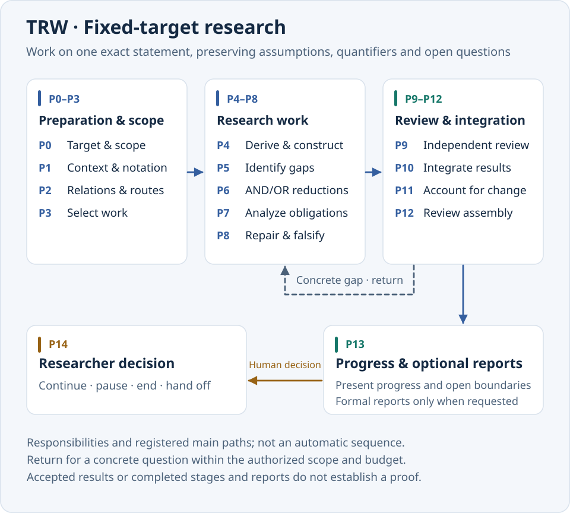
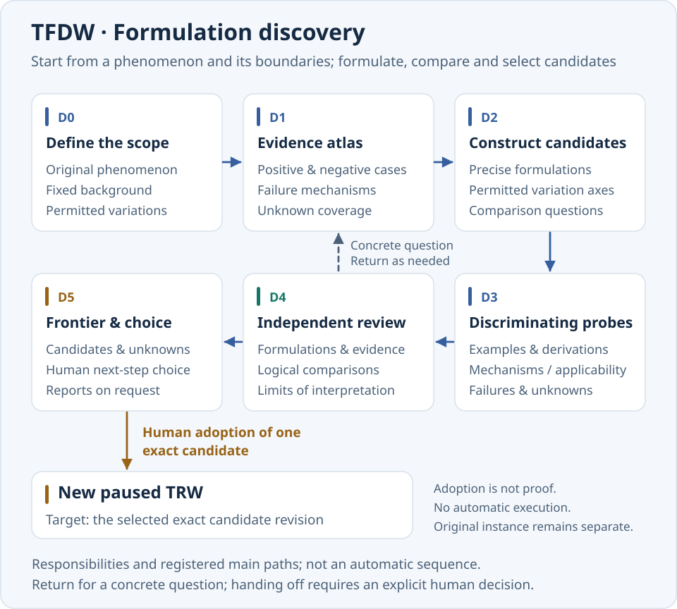
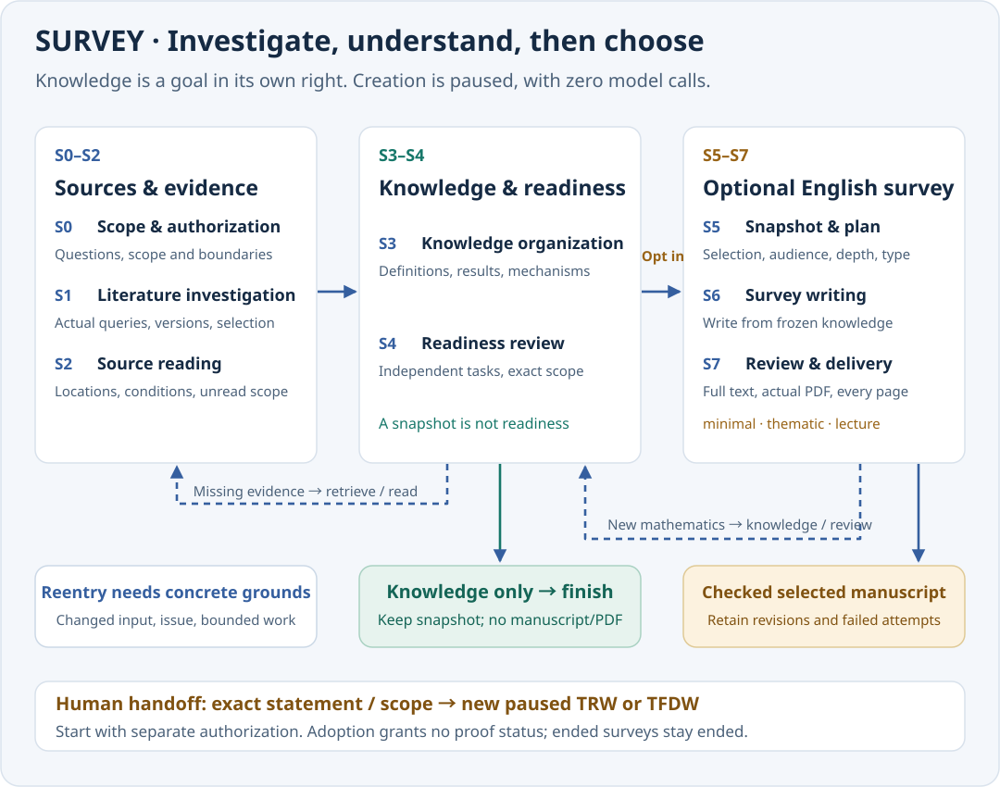

# Pure Math Research Studio 4.1.0

[简体中文](README.zh-CN.md) · [Download](https://github.com/ZhiyaoXiongMath/Pure-Math-Research-Studio/releases/tag/v4.1.0) · [Validation record](TEST-REPORT-4.1.0.md)

**Keep the mathematical question, the research process and the evidence for each check in one local workspace.** PMRS is for people who want to use models for mathematical research while retaining exact source material and traceable records. Work on a fixed statement through derivation, counterexample search and independent review, start from observations and compare formulations until you can select a statement worth proving, or investigate a literature topic and organize the evidence before optionally writing a survey.

Outputs include statements and arguments, examples and counterexamples, source references, review coverage, open questions and research reports. Tasks, call authorizations and original responses stay in the local project so you can pause, inspect and continue the work.

**Start here:** [choose a workflow](#choose-a-workflow) → [install and open](#install-and-open) → [run-a-round instructions](#run-a-round-of-research) → [three worked usage examples](#three-worked-usage-examples).

## Choose a workflow

| What do you have? | Choose | Main outputs | What do you decide next? |
| --- | --- | --- | --- |
| A statement with precise objects, assumptions, quantifiers and a conclusion | **TRW · Targeted Research Workflow** | Derivation or refutation, exact gaps, independent checks, progress and reports | Continue, pause, end, or explore alternative formulations |
| Observations, examples or a family of conjectures whose formulation needs work | **TFDW · Theorem Formulation Discovery Workflow** | Evidence, exact candidates, comparisons and unchecked scope | Keep exploring, retain candidates, or adopt one for a TRW |
| A topic, question or selected body of existing knowledge to investigate and explain | **SURVEY · Survey Workflow** | Versioned searches, source readings, organized knowledge, scoped readiness reviews and optional English manuscripts | Stop after knowledge work, request a selected manuscript type, update the topic, or hand off a statement |

A **project** holds shared knowledge and materials. A **workflow instance** binds a research target or discovery scope. A **research round** records the current intent, authorization and call limit. One project can contain several named instances that share materials and keep separate state. Adopting a candidate creates a new paused instance and preserves the original workflow.

### TRW: investigate an exact statement



The groups show how different kinds of work relate. **P0–P14 are available research activities, not a sequence that every round must execute.** Work is selected from concrete questions, dependencies and remaining authorization. In the current web UI, starting a TRW initially assigns derivation work at P4. Clicking a stage opens its details; it does not force that stage to execute.

| Stage | Work and results to inspect |
| --- | --- |
| P0 · Target and authorization | Fix the statement, existing knowledge entry points and bounded authorization. |
| P1 · Context and notation | Clarify objects, definitions, assumptions, quantifiers and notation. |
| P2 · Relations and routes | Distinguish necessary, sufficient and equivalent conditions and possible routes. |
| P3 · Work selection | Select concrete, justified work with a limited scope. |
| P4 · Derivation and construction | Attempt derivations, constructions, counterexamples and failed approaches; save what was actually obtained. |
| P5 · Target gap | Compare existing results with the original target and identify what is still missing. |
| P6 · Problem reduction | Organize AND/OR subproblems while retaining the work needed to lift local results to the original target. |
| P7 · Obligation analysis | Apply a source, derive directly, or compare both routes and then synthesize, as needed. |
| P8 · Repair and falsification | Repair a specific gap and search for targeted counterexamples. |
| P9 · Independent checks | Review proofs and counterexamples independently, recording checked and unchecked scope. |
| P10 · Integration | Combine local results under common context and same-witness requirements. |
| P11 · Change accounting | Compare with the starting point: additions, reuse, support changes and open work. |
| P12 · Assembled-argument review | Independently review the assembled argument; parts may remain open. |
| P13 · Progress and reports | Present current progress; prepare formal reports when explicitly requested. |
| P14 · Researcher decision | Record your choice to continue, pause, end or hand off. |

For example, P4 results may go directly to P9 for review; a gap found at P9 may return to P8 for repair; P12 may request integration again. P0–P12 also allow early delivery to P13, preserving unresolved questions. Reentry needs a concrete question, inputs and bounded retry authorization.

A candidate proof or refutation of the original fixed target requires the corresponding independent dual review. Local results are checked against an explicitly required scope; passing a local check does not establish the whole statement.

### TFDW: turn observations into a researchable statement



TFDW separates three inputs: **what you observed, what background must stay fixed, and what you permit the research to vary.** This preserves the question's boundaries when candidates are compared. Starting a TFDW in the current web UI initially assigns evidence-learning work at D1.

| Stage | Work and results to inspect |
| --- | --- |
| D0 · Phenomenon and scope | Fix the observations, immutable background and allowed exploration scope. |
| D1 · Evidence and failures | Organize positive and negative examples, failure mechanisms and unknown coverage. |
| D2 · Candidate formulations | Construct exact candidates along explicit axes of variation and identify comparisons to investigate. |
| D3 · Discriminating research | Use distinguishing examples, local derivations and mechanism analysis to evaluate candidates. |
| D4 · Independent review | Examine formulations, evidence selection, logical comparisons and interpretive limits. |
| D5 · Candidate selection | Present the candidate frontier, record your choice and prepare reports when requested. |

D4 can return to D2 for reformulation or to D3 for further investigation. D0–D4 may also present existing candidates and unknowns early at D5. There may be no candidate when evidence is insufficient, and a comparison may remain unknown.

In **Candidates & handoff**, read the complete candidate, click **Adopt as a new theorem research instance**, then confirm **Adopt and create paused TRW**. **Adoption means selecting an exact research target.** The new TRW needs a separate start and its own proof and review work. You can also create a paused TFDW from a TRW target while preserving the original statement.

### SURVEY: investigate a topic, then choose whether to write



Choose **Explore a new topic**, **Write from existing knowledge**, or **Update an existing survey**. Every entry creates a paused instance. **Knowledge only** stops after its knowledge objective is met; **Survey manuscript** additionally requests the selected `minimal`, `thematic` or `lecture` output. Creating the instance, browsing materials and freezing a snapshot make no model call. A new activity or report requires explicit authorization and a call limit.

| Stage | Work and results to inspect |
| --- | --- |
| S0 · Scope and authorization | Preserve the topic, questions, objects, assumptions, inclusion/exclusion boundaries, delivery goal and budget. |
| S1 · Literature investigation | Plan queries, retrieve actual candidate records through a controlled host provider, and retain selection, exclusion and stopping reasons. |
| S2 · Source reading | Read the acquired parts that support particular claims; record source versions, locations, conditions and unread scope. |
| S3 · Knowledge organization | Organize definitions, statements, proof mechanisms, examples, boundaries and dependencies in the shared native knowledge store. |
| S4 · Readiness review | Independently check the selected knowledge, evidence and coverage; identify exact blockers and unchecked scope. |
| S5 · Snapshot and writing plan | Freeze the selected knowledge and dependency closure; choose the audience, perspective, proof depth, omissions and output type. |
| S6 · Survey writing | Write the requested English manuscript from the frozen plan and sources. |
| S7 · Review and delivery | Review the complete manuscript, compile the actual PDF and inspect every generated page before formal delivery. |

These are activities with specific inputs and exits. S2 returns to S1 when sources are missing. S3/S4 return to the relevant retrieval, reading or organization work. Knowledge only can finish at S4 with a knowledge snapshot and no manuscript. Changed selection at S5 can require another readiness review. New mathematical claims found during S6/S7 return to knowledge work; prose defects return to writing, and layout fixes need fresh page checks. A snapshot by itself does not make its contents ready.

Sources distinguish metadata, abstracts, acquired full text and actual reading coverage. Original bytes, extracted text and mathematical knowledge have separate hashes. Retrieval limits and failures remain visible; coverage is only for the declared scope and queries. A citation or publication is not proof that PMRS independently checked a claim. Relevant changed or withdrawn support invalidates the affected readiness/output; unrelated knowledge or interface-language changes do not.

Survey can hand an exact statement or discovery scope to a new paused TRW/TFDW. Inspect its context and sources before adoption, then authorize the new research separately. Updating an ended survey creates a linked paused instance and preserves the old record.

### Read the application diagrams

- The default view emphasizes the selected instance's workflow and main path. Switch to another structure or open **All three workflows**.
- Select a node to inspect duties, model policies, tasks and outputs. Related branches, returns and early-delivery paths appear on demand; **Show all paths** retains every legal path.
- An iteration marker indicates authorized reentry. The activity area shows running or waiting P/D/S stages, including several active stages during parallel work. Stage numbers are not completion percentages.
- Without a loaded instance for that workflow, the graph is a structural preview with unknown state. It cannot tell you whether the stage has been visited.

## Install and open

The target is **Ubuntu 26.04**, with **Python 3.11+**.

1. Download `pmrs4-graphical-installer_4.1.0_all.deb` from the [v4.1.0 Release](https://github.com/ZhiyaoXiongMath/Pure-Math-Research-Studio/releases/tag/v4.1.0) and verify the accompanying `SHA256SUMS.txt`.
2. Open the `.deb` with Ubuntu's graphical package installer. After system authorization, launch “Install Pure Math Research Studio 4.1.0” from Applications and select a new personal installation location. The bundled wheel creates an isolated environment offline; missing Python venv and Zenity packages come from Ubuntu repositories.
3. Launch “Pure Math Research Studio 4.1.0”. In **Settings & sign-in**, select existing Codex CLI, Tectonic, offline-resource or public-CA paths, or explicitly install the listed official components. Authentication belongs to the official client.

If a `.desktop` file opens as text, use the `.deb` and application-menu route above. Existing installation directories and same-version menu entries are never overwritten. Without PDF components you can still read knowledge or perform work that does not need PDFs; report dependencies are checked separately before PDF generation. See [installation help](INSTALL-HELP.html).

Versioned installation directories and menu entries preserve the earlier application. The 4.x configuration and default-workspace locations retain their `4.0` directory names; 4.1 does not change the native storage contract or automatically start existing research. The default workspace is `$XDG_DATA_HOME/pure-math-research-studio/4.0/workspace`; settings use `$XDG_CONFIG_HOME/pure-math-research-studio/4.0`. Without XDG overrides, these use the user's `.local/share` and `.config`. Application files and research data are separate.

## Interface language

The default interface is **English**. Use **Language** at the top of the workbench to choose **English** or **简体中文**. The choice is saved by the host, survives reopening and port changes, and retains the selected project, instance, stage, tab, drafts, expanded bodies and scroll position. Switching language is a display operation: it does not submit research, consume calls or change frozen knowledge/report inputs.

**Research bodies and formal reports remain English in both interfaces.** Original user materials, including Chinese input, and external-client output retain their actual language. PMRS does not automatically translate research records. Native system buttons may follow the desktop's own language.

## Run a round of research

1. **Create a paused project.** In **New project**, select TRW and enter the full statement, or select TFDW and fill in its three discovery inputs. UTF-8 problem files and supplementary materials are supported. Creation makes no model call. An incomplete TFDW may explicitly be saved as a draft; complete it before starting.
2. **Set intent and budget.** In **Start research round**, enter a specific purpose, maximum call count and maximum concurrent tasks. The UI defaults are 12 calls and concurrency 2; adjust them as needed. Submitting authorizes and starts the necessary work. A call limit does not guarantee completion of the research and reports.
3. **Check model policies.** Policies distinguish stage, role and purpose. To override one, first click **Add or update this scope**, then submit. Future-policy edits affect new tasks only. Updating or resetting one scope preserves other overrides and existing frozen requests. Unsupported capabilities fail explicitly without fallback.
4. **Inspect progress and gaps.** Use **Current knowledge** for bodies and support scope, **Open questions** for missing work, and **Tasks & configuration** for actual execution state. New tasks and actions update automatically. Knowledge bodies retain the reading snapshot; refresh them when you choose after an update notice.
5. **Request TRW/TFDW reports or decide what follows.** Click **Make research report** to request formal reports. They have lecture and minimal versions, with separate semantic and actual-page checks. Reports are explicitly requested and share the round's call limit. Only selecting the report-first option makes report completion a prerequisite for continuing, ending or adopting a candidate.

Survey uses the same authorization, budget, frozen-task and recovery controls; select a concrete S-stage activity with its required source or knowledge references. Retrieval runs on the host with separate network accounting. Knowledge only never implicitly requests a report. A manuscript plan requests only its chosen type; it does not create the TRW/TFDW lecture/minimal pair.

To learn the interface without real model calls, open **Guide** and select **Run theorem example** or **Run candidate & handoff example**. These create independent deterministic simulations whose output carries test-isolation markers. Simulated output is not a real research result.

## Three worked usage examples

These are teaching inputs you can paste into the forms. The mathematical results below are references for inspection, not records of a real model run or guarantees of the exact output. Creating a project makes no model call; clicking **Start research round** starts work through the selected executor under your authorization.

### Example 1: use TRW to study the sum of the first n odd numbers

**Situation:** you already have a precise statement and want an inspectable proof with explicit review coverage.

Create a **TRW** project named `Odd-number sum`, name its first instance `Induction proof`, and paste this into the full-problem field:

```text
Prove that for every positive integer n,
1 + 3 + 5 + ... + (2n - 1) = n^2.
State the positive-integer domain and summation convention explicitly.
Give a complete proof; finitely many examples do not prove the general statement.
```

After creation, expect a paused TRW instance, the original problem retained and no model requests. Open the start-round form and enter this intent:

```text
Try mathematical induction first. Check the base case n = 1 and the step
from n to n + 1. Preserve the quantifiers and positive-integer domain.
Explain the proof's coverage and any remaining gaps.
```

Confirm the call limit and concurrency, then start. Inspect the result in this order:

| Where to look | What to check |
| --- | --- |
| Current knowledge | Does the argument include the base case and the step from adding $2n+1$ to $n^2$ to obtain $(n+1)^2$? |
| Tasks & configuration | Which derivation and independent-review tasks actually ran? What settings were frozen on their requests? |
| Open questions | Is any required review or scope still incomplete? Task completion is not a substitute for these checks. |
| Research reports | When you want a deliverable, request a report explicitly and inspect both versions and their review states. |

**Reference result:** the base case is $1=1^2$. If the first $n$ terms sum to $n^2$, adding the next term $2n+1$ gives $(n+1)^2$. The records should let you trace the argument and independent-review scope. If the budget runs out or a check is incomplete, retain that open status.

### Example 2: use TFDW to discover when a consecutive-integer sum is divisible by its length

**Situation:** you have observed a pattern and need to determine the right statement and its essential conditions.

Create a **TFDW** project named `Consecutive integers`, with instance name `Find divisibility conditions`. Fill the three inputs separately.

**Phenomenon:**

```text
1+2+3=6 is divisible by 3; 1+2+3+4=10 is not divisible by 4;
1+2+3+4+5=15 is divisible by 5.
If the starting integer and number of terms vary, when is the sum of
consecutive integers divisible by the number of terms?
```

**Immutable background and constraints:**

```text
The starting value a is any integer; the number of terms n is a positive integer.
Study S(a,n)=a+(a+1)+...+(a+n-1). Divisibility means integer divisibility.
```

**Allowed exploration directions and scope:**

```text
Vary a and n, and compare odd and even n.
Find a necessary and sufficient condition on n, and check whether it holds
for every integer a. Preserve consecutive integers and integer divisibility;
do not replace them with arbitrary real numbers or a different sum.
```

After creation, check that all three originals were retained and the instance is paused. For a research round, use an intent such as: “Construct positive and negative examples, compare odd and even lengths, propose exact candidates and record unchecked scope.”

Read **Candidates & handoff**: inspect the full quantifiers and assumptions, then the examples, counterevidence and unknown comparisons. A **reference candidate to check against** is: for every integer $a$ and positive integer $n$, $n$ divides $S(a,n)$ if and only if $n$ is odd. The calculation to inspect is

$$
S(a,n)=na+\frac{n(n-1)}{2},\qquad \frac{S(a,n)}n=a+\frac{n-1}{2}.
$$

Once a candidate is available, hand it off as follows:

1. Read and select that exact candidate. A few examples alone do not prove its general statement.
2. Click **Adopt as a new theorem research instance**, review the full statement, then confirm **Adopt and create paused TRW**.
3. Switch to the new TRW in the workflow selector. It shares project materials with the preserved TFDW. It starts paused, makes no automatic call and gains no proof qualification from adoption.
4. Set a separate purpose and budget for the new TRW and explicitly start the proof work. Use research history to trace candidate formation and adoption later.

### Example 3: use SURVEY to organize finite geometric sums, then request one minimal survey

**Situation:** first understand a small topic and its limits, then decide whether a short manuscript is useful. This example deliberately uses synthetic teaching material; it does not claim to have found or read a published paper.

In **New project**, choose **SURVEY**, **Explore a new topic**, and **Knowledge only**. Use project name `Finite geometric sums` and instance name `Knowledge foundation`. Fill the following Survey fields (list fields accept one item per line):

**Topic:**

```text
Finite geometric sums over the real numbers.
```

**Specific questions:**

```text
What is the exact formula for G_n(q)=sum_{k=0}^{n-1} q^k, including the q = 1 case?
```

**Objects / Conditions:** enter `A real number q and a positive integer n.` / `Only finite sums are considered.`

**Include:**

```text
Definition of the finite sum
The q != 1 formula and the separate q = 1 case
The multiply-and-subtract proof mechanism
```

**Exclude:**

```text
Infinite series and convergence
Matrices
Historical priority claims
```

After creation, check that the SURVEY instance is paused and **Tasks & configuration** contains zero model requests. In **Source materials**, upload the included [`finite-geometric-sums.teaching.md`](examples/readme/finite-geometric-sums.teaching.md), or save and upload this text:

```text
SYNTHETIC TEACHING MATERIAL — created for the PMRS usage example.
This is not a publication or a bibliographic claim.

Let n be a positive integer and q a real number.
Define G_n(q) = 1 + q + ... + q^(n-1).
If q != 1, (1-q)G_n(q) = 1-q^n, hence
G_n(q) = (1-q^n)/(1-q).
If q = 1, G_n(1) = n; division by 1-q is not allowed.
Proof mechanism: multiply G_n(q) by q, align the two finite sums,
and subtract. Check the n=1 boundary explicitly.
Scope: finite sums only; no statement about infinite-series convergence.
```

Use **Authorize survey activity** with a finite call limit. Select the uploaded teaching source for S2 and S3, and the organized knowledge for S4. Run **S2 · Source reading**, then **S3 · Knowledge organization**, then **S4 · Readiness review**, inspecting each actual result before continuing. A suitable activity intent is:

```text
Use only the explicitly labelled teaching source and the declared finite-sum scope.
Retain exact source locations. Organize the definition, q != 1 formula,
q = 1 boundary and multiply-and-subtract derivation. Identify unchecked scope.
Do not invent published references or infer that a saved item has been reviewed.
```

| Where to look | What to check |
| --- | --- |
| Source materials and reading records | Is the material labelled synthetic? Do the recorded read ranges refer to the actual uploaded version? |
| Current knowledge | Are the domain, positive-integer condition, formula and separate $q=1$ case preserved? Is the argument linked to its assumptions and source? |
| Survey readiness | Which exact revisions and dependency closure were checked? Do blockers, omissions and review task identities remain visible? |
| Tasks & configuration | Did only authorized activities run? Is independent review an actual separate task? |
| Knowledge snapshot and reports | After valid readiness, use **Freeze selected knowledge**, then end the knowledge instance. No manuscript or PDF should be generated. |

**Reference result to check:** $G_n(q)=(1-q^n)/(1-q)$ for $q\ne1$, while $G_n(1)=n$. At $n=1$ both branches give $1$. This is a teaching reference, not a record of a model execution or completed PMRS review. If readiness remains blocked, fix the specific source, reading or knowledge issue before requesting output.

To request a manuscript **later**, use **Write from existing knowledge** (or **Update an existing survey**) to create a linked paused Survey instance from the selected knowledge. Choose **Survey manuscript** and recheck the reused review's exact scope. Prepare a writing plan with **minimal**, language **English**, audience `A reader familiar with elementary algebra`, and perspective `The finite identity and the exceptional q = 1 case`. Use **Freeze selected knowledge**, then open **Prepare a selected survey edition**, choose that snapshot and add a **Proof commitment** for the derivation with **Complete proof**. Copy the exact step names recorded in the S4 review into **Required proof steps**; request further review if a promised step was not checked. Record the finite-sum scope under **Limitations**, and use **Omitted knowledge and reasons** when excluding a saved knowledge record.

Use **Save English output plan** for that selection. In **Authorize survey activity**, select **S5 · Authorize output budget** and authorize a finite report budget; this step makes no model call. Then use **Request selected English manuscript** for that saved plan. Inspect the one selected minimal manuscript under **Research reports**, together with its semantic review, compiled PDF and every-page review. `thematic` and `lecture` are alternatives selected separately; this operation should not generate either. A draft or a failed new revision cannot inherit the delivery status of a previous successful report. New mathematical claims found while writing must return to knowledge organization and readiness review.

A CLI alternative for the **zero-call creation and material upload** uses the supplied scope file. Run these commands from the source directory; read `instance_id` from the first result and use it in subsequent Survey commands:

```bash
python3 -m research_studio survey init --scope examples/readme/finite-geometric-sums.scope.json --out ../geometric-survey --title "Finite geometric sums"
python3 -m research_studio source ../geometric-survey --file examples/readme/finite-geometric-sums.teaching.md --media-type text/plain
python3 -m research_studio workflow list ../geometric-survey
```

Each returns stored native data without starting a model. `survey status PROJECT --instance INSTANCE_ID` is read-only. Later `survey activity` explicitly authorizes and starts S1–S4; S5 authorizes report budget only. `survey freeze`, `survey plan` and `report --prepare-only` do not run a model. A plain `report` command runs the selected report under its authorization. Use `--help` for the exact required fields and avoid using a real research workspace for this tutorial.

## Read, pause and save

| Need | Entry point and behavior |
| --- | --- |
| Inspect originals and evidence | Original Materials retains original files. Current Knowledge shows full text, formulas, versions and actual support scope. |
| See what changed | Round Changes distinguishes additions, reuse, support changes and withdrawals. Research History retains this project's immutable commits and events. |
| Pause or continue | Pause stops new dispatch and retains in-flight requests. Continue Existing Research uses existing authorization and balance. Ending the round makes the instance `ENDED`; further research requires explicitly creating a new instance. |
| Admit a captured result | Admit Captured Result reads the original response without resending. |
| Handle UNKNOWN | Resolve the original request rather than automatically resending. Abandoning the wait retains uncertainty and consumption. Confirming not-sent requires binding actual transport-evidence originals; a note alone is not evidence. |
| Recover a missing operation response | Query or recover the original operation. Workspace receipts survive service restart and port changes. Completed results are recovered directly; PENDING is not automatically resent. A deliberate new operation gets a new key. |
| Back up or restore | Export Backup writes a native archive. **Restore backup** opens the native-backup dialog, checks the archive and creates a new paused project without automatically resuming task execution. |

Closing the browser does not stop background research. Reopen the same workspace from Applications. To exit the service, pause research, wait for in-flight work to finish and use the exit button at the bottom of the page. Keep passwords and tokens out of project materials.

## Scope and validation

4.1.0 adds native SURVEY and English/Simplified Chinese display to the current TRW/TFDW product. It retains native storage and backup/restore and does not introduce older project migration, compatibility readers, real research samples or continuation packages. Unsupported inputs are rejected without silent conversion. Product, workflow and storage-format versions have separate responsibilities.

Original material, a successful save, task completion and report output do not establish mathematical proof. Support and qualification bind exact objects, revisions and checked scope. This release does not provide formal verification. Effective configuration, usage and actual costs absent from client responses remain unknown.

Task preparation has a declared 32 MiB budget for unique required input and metadata, with at most 8 MiB of metadata and 64 MiB per serialized packet. Model token capacity and output reserve are checked separately. Oversized complete scopes are blocked before sending; explicitly select a smaller scope or use a CoveragePlan instead of silently omitting evidence. At most two preparations share a project resource pool. Disposable checkpoints and settled task-input copies are bounded or reclaimed; originals, captured responses, receipts, report revisions and review evidence remain available. If resources are unavailable, preserve and recover the original operation; never resend UNKNOWN automatically. See the resource measurements and limits in the validation record.

The [4.1.0 validation record](TEST-REPORT-4.1.0.md) distinguishes executed tests, controlled simulation, actual rendering and remaining native desktop observations. No paid research is used for development acceptance; tutorial reference results are not acceptance evidence. Prior human observations are reused only for traceable, unaffected behavior. See the [acceptance scope](ACCEPTANCE-SCOPE-4.1.0.md) for the retained and new requirements.

## Advanced maintenance and development

Ordinary operation is available through the web UI. The advanced CLI shares its service layer. From the source directory:

```bash
python3 -m research_studio --help
python3 -m research_studio project init --problem examples/problem.zh-CN.md --out ../new-project
python3 -m research_studio status ../new-project
python3 -m research_studio audit ../new-project
python3 -m research_studio project restore BACKUP.zip --out ../restored-project
```

From a verified, extracted release ZIP, install offline into a new prefix with `python3 scripts/install-local.py --prefix NEW_PREFIX --bin-dir NEW_BIN --venv`. Add `--desktop-dir` for application-menu registration. Maintenance acceptance uses a separate private menu directory instead of overwriting existing entries. Keep test and build outputs outside the source tree:

```bash
python3 -B scripts/test-runner.py --out ../validation/suite.json
python3 -B scripts/validate-groups.py --out ../validation/required --browser-evidence ../validation/browser-evidence.json
SOURCE_DATE_EPOCH=315532800 python3 -B scripts/build-release.py --out ../artifacts
```

Builds produce a source ZIP, installable release ZIP, wheel, graphical `.deb`, artifact inventory and checksums. A successful build establishes packaging integrity only; acceptance requires actual execution records, not a previous version's PASS.

More: [architecture](ARCHITECTURE-4.1.0.md) · [changes](CHANGELOG-4.1.0.md) · [Ubuntu installation and acceptance](UBUNTU-E2E-GUIDE.md) · [license](LICENSE).
