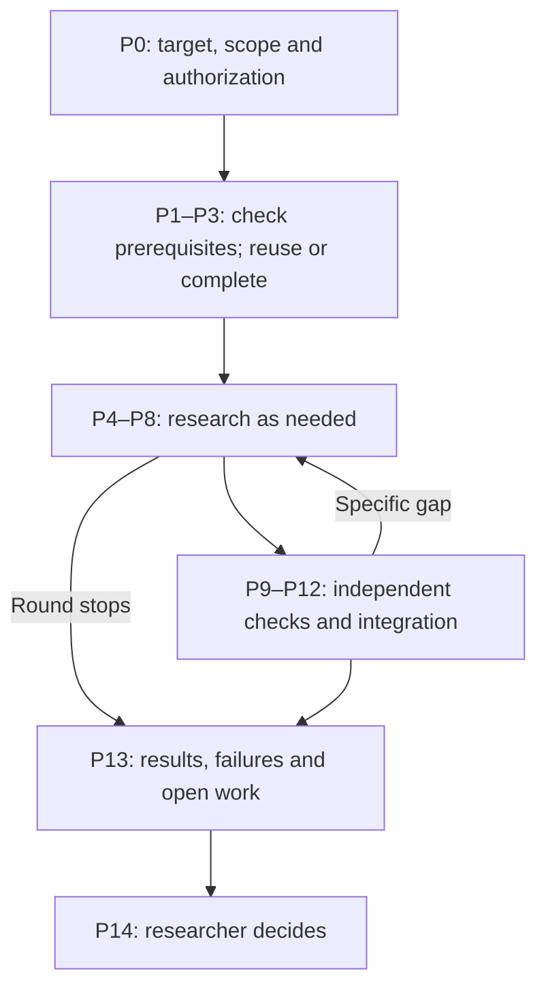
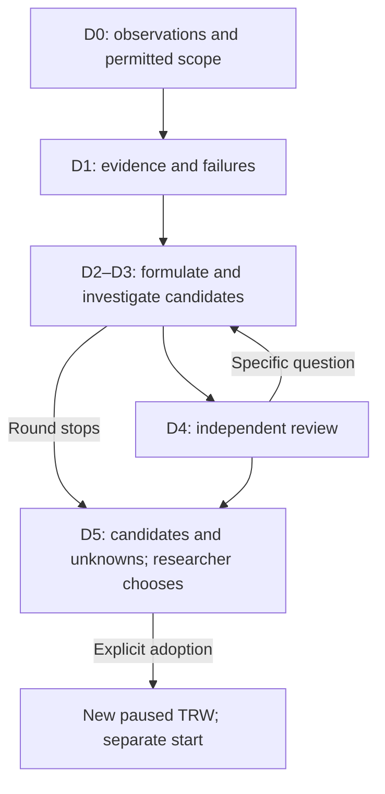
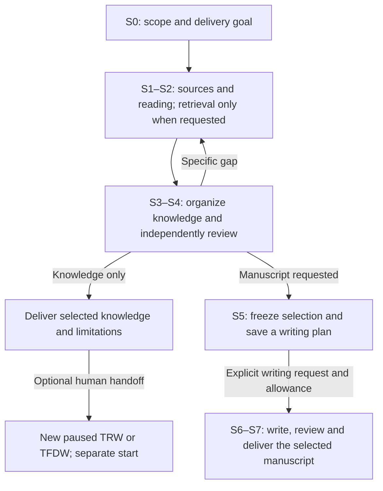

# Pure Math Research Studio (PMRS)

**PMRS is an AI-assisted research workspace for pure mathematics.**

Use it to investigate a precise mathematical statement, develop conjectures from observations and examples, or study the literature on a chosen topic.

After you define the goal, scope and call budget, PMRS arranges the necessary research and review work, reuses applicable results, and records arguments, sources, findings and unresolved questions. You can inspect the work, pause new tasks and request specific corrections, then decide what to pursue next. Formal research reports and survey manuscripts are available on request.

Projects and research records are stored locally. Model-assisted work uses the configured model service; explicitly requested literature retrieval accesses supported scholarly sources. A local workspace does not mean that model execution or literature retrieval is offline.

[简体中文](README.zh-CN.md) · [Version 4.2.0 release page](https://github.com/ZhiyaoXiongMath/Pure-Math-Research-Studio/releases/tag/v4.2.0) · [Implementation notes](IMPLEMENTATION-NOTES-4.2.0.md)

> **Version 4.2.0:** this version completes and repairs scientific responsibilities, bounded workflow continuation and resource execution, and adds Project assistant for evidence-based diagnosis and explicitly scoped report revision. Published v4.1.0 remains a historical baseline. See the [implementation notes](IMPLEMENTATION-NOTES-4.2.0.md) and [validation record](TEST-REPORT-4.2.0.md) for exact scope and evidence.

Start with [choosing a workflow](#choose-a-workflow), [installation](#install-and-open) and [your first round](#start-a-research-round). For a complete example, follow [TRW](#example-1-prove-an-odd-number-sum-with-trw), [TFDW](#example-2-find-the-right-divisibility-statement-with-tfdw) or [Survey](#example-3-understand-finite-geometric-sums-with-survey).

## Choose a workflow

| Your starting point | Workflow | What you receive | Your next decision |
| --- | --- | --- | --- |
| A precise statement with objects, assumptions, quantifiers and a conclusion | **TRW — Targeted Research Workflow** | Proof attempts, constructions or counterexamples; independent checks; remaining gaps | Continue the investigation, pause, end, or explore alternative formulations |
| Observations, examples or conjectures whose formulation needs work | **TFDW — Theorem Formulation Discovery Workflow** | Candidate statements, supporting and opposing evidence, comparisons and unresolved questions | Keep exploring, retain candidates, or select a statement for a new TRW |
| A topic or body of existing knowledge to understand and explain | **SURVEY — Survey Workflow** | Source readings, organized knowledge and coverage reviews; optionally an English manuscript | Finish with knowledge, request a manuscript, update the survey, or hand knowledge to TRW/TFDW |

A **project** contains shared materials and knowledge. Within it, each **workflow instance** is a named investigation with its own target or scope and state. A **research round** specifies what you want to accomplish now and how many calls you authorize. Several instances can share one project's materials without sharing the same research decision.

You do not need to understand every stage before starting. The [workflow reference](#workflow-reference) explains the diagrams and stage responsibilities when you need them. Its inline Mermaid diagrams need a compatible Markdown viewer; the adjacent stage tables remain readable as plain text.

## Install and open

The target desktop environment is **Ubuntu 26.04**, with **Python 3.11 or later**.

Use the matching 4.2.0 package and checksums below. Earlier release packages do not contain the complete 4.2.0 behavior described here.

1. Download `pmrs4-graphical-installer_4.2.0_all.deb` from [Version 4.2.0 release page](https://github.com/ZhiyaoXiongMath/Pure-Math-Research-Studio/releases/tag/v4.2.0). Check it against the accompanying `SHA256SUMS.txt`.
2. Open the `.deb` with Ubuntu's graphical package installer and complete the system authorization.
3. From Applications, open **Install Pure Math Research Studio 4.2.0**. Choose a new personal installation location. The bundled wheel installs into an isolated environment offline; missing Python venv and Zenity system packages are obtained from Ubuntu repositories.
4. Open **Pure Math Research Studio 4.2.0** from Applications.
5. In **Settings & sign-in**, select existing Codex CLI, Tectonic, offline-resource or public-CA paths as needed, or explicitly install the listed official components. Sign-in is handled by the official client. Check the displayed readiness before starting model work or requesting a PDF.

Existing installation directories and same-version application-menu entries are not overwritten. If a `.desktop` file opens as text, use the `.deb` and application-menu route above. Without PDF components, you can still read knowledge and use functions that do not require PDF generation. See [installation help](INSTALL-HELP.html) for details.

### Language and in-app help

Use **Language** at the top of the workbench to choose **English** or **简体中文**. English is the default. The choice persists across reopening and port changes; switching language preserves the current selection and form drafts.

The interface is bilingual. **Research bodies and formal reports are written in English** in either interface; uploaded originals retain their language. Switching the interface does not translate existing research or consume calls. Native file-dialog buttons may follow the desktop's language.

Open **Guide** for the in-app instructions. Its **Run theorem example** and **Run candidate & handoff example** buttons create isolated, deterministic demonstrations with no real model calls. These demonstrations show how the application works; their prepared responses are not research evidence.

## Start a research round

Normal use is through the web interface. You do not need terminal commands, handwritten JSON or a manually arranged sequence of stages.

1. **Create the project and its first instance.** For TRW or TFDW, open **New project** and choose **Theorem research: an exact statement** or **Formulation discovery: phenomena and boundaries** under **Workflow**. Enter the project and instance names; supply the full TRW statement or the separate TFDW phenomenon, fixed background and permitted exploration. For a new Survey project, select **Choose or create a project** in the project selector, then click **Explore a new topic** on the Survey card. Enter the topic, questions and inclusion/exclusion boundaries. To add an instance to a selected project, use **Add workflow**. An incomplete TFDW can be saved as a draft, but must be completed before research starts. Creation leaves the instance paused.
2. **Add relevant materials.** Use **Add materials** and inspect the saved files in **Source materials**. Include definitions, assumptions and the source passages needed for the proposed work. A saved document is available input; it is not automatically a read or checked result.
3. **Describe this round.** Open **Start research round** and fill **Round intent** with a concrete objective and boundaries. For example: “Try induction for the stated identity. Preserve the positive-integer domain, check the base case and inductive step, and identify any remaining review gaps.”
4. **Select inputs.** Use **Materials for this round (optional selection)** and **Existing knowledge for this round (optional selection)** to choose relevant sources and results. Tasks receive the necessary target, premises, selected materials and dependencies. Survey waits for missing material or knowledge; this start action does not silently search online.
5. **Set the allowance and concurrency.** **Maximum calls this round** defaults to **12** in the web form. **Maximum concurrent tasks** uses the saved project setting, initially **1**, and accepts **1–8**. These are different limits: one controls total calls, the other simultaneous work. See [budgets and concurrency](#budgets-and-concurrency).
6. **Check the model settings and start.** If you change a stage, role or purpose override, click **Add or update this scope** to include it before submitting. Click **Start research round** to authorize execution. Opening the form, reading help and inspecting a diagram do not start research.
7. **Read the results and make the next decision.** Follow **This round: progress and next decision**, inspect the actual content and wait reasons, then choose whether to continue, pause, end or hand off. A round can deliver useful progress while the mathematical question remains open.

### What PMRS does after you start

| Workflow | Work the system takes on | Where your decision is needed |
| --- | --- | --- |
| TRW | Checks whether background and notation, backward reasoning from the target, and route exploration already have valid support; reuses applicable results and arranges missing work. Then follows actual results, gaps and dependencies through the necessary research and independent checks. | At the round's stopping point, you decide what to pursue next. A new round or changed goal requires your authorization. |
| TFDW | Develops evidence, candidate formulations, discriminating investigations and independent reviews as needed within the declared scope. | You select from the candidate frontier, ask for more exploration or stop. PMRS does not adopt a candidate for you. |
| Survey | Reads selected sources, organizes knowledge and arranges the necessary readiness and coverage checks. | Missing sources or a required selection are shown explicitly. **Knowledge only** delivers knowledge; a manuscript needs a saved writing plan and explicit request. |

PMRS does not run every stage in every round or make a separate model call just to fill a stage. Related work can share a task when its results remain identifiable and independence is not required. Independent reviews remain separate. Scheduling and the round summary do not require a management-model call. Return work and additional branches use the same finite allowance and cumulative attempt limits.

**Plan research work** is an advanced option for deliberate branches, material choices and dependencies. Its separate run checkbox defaults off. It is useful for explicit intervention or a special division of work; it is not a prerequisite for normal startup.

## Follow progress and understand a stop

| Where to look | What it tells you |
| --- | --- |
| **This round: progress and next decision** | Actual results, failures, unfinished or unperformed work, open gaps and the next decision |
| **Current knowledge** | Statements, arguments and related records; open the full body to inspect the mathematics |
| **Open questions** | Missing premises, unresolved research questions, incomplete checks and other dependencies |
| **Tasks & configuration** | Tasks, requests, effective model settings, execution or wait states, and budget information |
| **Research history** and **Round changes** | How the work changed and which operations produced the current records |
| **Source materials** | Original files and the versions used by reading or research tasks |
| **Research reports** | Report editions and revisions, actual downloads, semantic checks and page-review status |

Progress refreshes automatically. When new body content becomes available, the content-update notice lets you refresh that list when ready without interrupting what you are reading.

**“No runnable task” does not mean “research completed.”** A required result may be missing, resources may be occupied, the allowance may be exhausted, a task may have failed, or the round may be ready for your decision. Read the stated reason and the unfinished-work list. At delivery, the summary preserves both progress and unresolved work; it does not mark an unperformed responsibility as passed.

Formal reports are requested separately. Unless you explicitly selected the advanced report-first condition for a decision, you can review progress and end an open round without first producing a PDF.

## Pause, correct and continue

**Pause** stops new task dispatch. It preserves requests already sent and responses already captured; it cannot undo an in-flight model call.

| Your intention | Use | What happens |
| --- | --- | --- |
| Resume the same authorized work | **Continue existing work** | Continues the same round with its remaining allowance; eligible saved responses are processed before further affected work |
| Correct a specific defect | **Request a correction** | Records the affected responsibility and a success criterion as actual work in the existing round |
| Give the same round more calls | **Authorize more calls in this round** | Adds a finite amount with a reason; saving the authorization alone does not start execution |
| Pursue a different purpose or next round | **Start research round**, on an eligible instance | Creates a new explicit authorization; it does not convert old unfinished requests into new work |
| End this investigation | **End round** | Records your decision and marks the instance `ENDED`; later research requires a new explicitly authorized instance |

### Enter a correction that changes the work

1. Click **Request a correction** and choose **Affected responsibility**. This can be an existing task or a responsibility not yet prepared for execution.
2. Fill **Specific issue and correction**, for example: “The argument divides by 1−q without treating q=1.”
3. Fill **Success criterion**, for example: “State q≠1 before division; prove G_n(1)=n separately; retain n≥1 and identify changed claims that require fresh review.”
4. Click **Save correction and pause**. The correction becomes executable work in the original round. Affected unsent tasks are held; already sent requests and saved responses keep their original identities.
5. Check the remaining allowance, then click **Continue existing work**. Inspect the resulting task, its complete response and any new checks to confirm that the correction was actually carried out.

A “continue” note alone does not revise the research plan. Likewise, saving a correction is not evidence that the defect has been fixed.

If calls are exhausted, enter **Additional calls** (1–1000) and a concrete **Reason for additional authorization**, then click **Save authorization without starting**. Resume separately with **Continue existing work**. This preserves the scope and cumulative attempt limits; more calls do not remove a missing dependency or reset a responsibility's attempt count.

For model-policy changes, **Configure future tasks in the existing round** applies to newly prepared tasks. It does not rewrite previously frozen requests. Unsupported model capabilities are reported explicitly; there is no silent fallback.

## Budgets and concurrency

### Three kinds of call allowance

| Allowance | Initial setting or form default | What it covers |
| --- | --- | --- |
| **Research round** | Web start form: **12** calls; CLI `start` requires an explicit call limit | Authorized research and checks, including explicitly requested report roles where that authorization applies |
| **Project assistant** | Starts at **0**; the authorization form suggests adding **3** | At most one assistant call for each sent turn; it does not pay for native report authors and reviewers |
| **Report work** | Uses an applicable existing allowance, or a separately entered finite report allowance | Authorship and required semantic and visual reviews for the requested report or revision |

A call limit is not a monetary quote or a guarantee that a round or report will finish. Actual usage and cost remain unknown when the executing client does not return them. Preparing a form, creating a project, viewing records, reading help and refreshing status do not consume model calls. Starting authorized research, sending an assistant message or requesting model-assisted report work can do so.

When an allowance runs out, PMRS retains the work already obtained and shows what remains incomplete. It does not automatically increase the budget. Assistant diagnosis or report revision can use their own applicable finite authorizations while research stays paused or has no remaining calls. A configured overall project call cap still applies.

### Simultaneous work and fair queuing

The saved project concurrency defaults to **1** and can be explicitly set up to **8**. Existing projects with a lower setting keep it. Participating PMRS projects share a **host pool of 10 simultaneous model calls**, including research, reports and the assistant across Web and CLI entry points.

Slots are shared according to ready demand and project limits. Two sufficiently busy projects can receive 5/5; demand of 2 and 8 can use 2/8. Unused shares can be used by other ready projects, remainders rotate, and queued tasks fill slots as they become available. A dependency, independent-review boundary or resource shortage can still prevent a task from running.

Increasing concurrency does not add calls or bypass review. Input preparation and PDF rendering also need memory and disk space; their resource waits can occur even when a model slot is free. See [troubleshooting](#when-work-waits-or-fails) and the [advanced limits](#advanced-input-and-storage-limits).

## Three worked examples

These examples provide inputs you can paste into the forms. Their mathematical results are **reference answers for inspection**, not records of a model run or promises of a particular output. Use a new example project. Creation is free of model calls; pressing **Start research round** runs real work through your configured executor.

### Example 1: prove an odd-number sum with TRW

**Goal:** investigate an exact identity and inspect the proof and its independent review.

1. In **New project**, set **Workflow** to **Theorem research: an exact statement** (TRW). Name the project `Odd-number sum` and its first instance `Induction proof`.
2. Enter the full problem:

```text
Prove that for every positive integer n,
1 + 3 + 5 + ... + (2n - 1) = n^2.
State the positive-integer domain and summation convention explicitly.
Give a complete proof; finitely many examples do not prove the general statement.
```

3. Create the project. The instance should be paused with the original problem retained.
4. Open **Start research round**. Enter this **Round intent**:

```text
Try mathematical induction first. Check the base case n = 1 and the step
from n to n + 1. Preserve the quantifiers and positive-integer domain.
Explain the proof's coverage and any remaining gaps.
```

5. For a bounded first attempt, keep **Maximum calls this round** at `12` and **Maximum concurrent tasks** at `1`. Check the model settings, then start. These values are an example allowance, not a completion guarantee.

PMRS checks for usable background, target analysis and route exploration, arranges missing prerequisites, and proceeds to the needed derivation and independent checks. You should not have to click each stage.

In **Current knowledge**, look for the base case $1=1^2$ and the induction step

$$
n^2+(2n+1)=(n+1)^2.
$$

In **Tasks & configuration**, inspect which derivation and independent-review tasks actually ran. In **Open questions**, check for missing scope or incomplete reviews. If the budget runs out first, the round should say so and preserve the partial work.

**Next:** pause or end after reading the result, authorize a concrete continuation, or click **Make research report** if you want the lecture and minimal reports. Reports are not generated merely because the round stops.

### Example 2: find the right divisibility statement with TFDW

**Goal:** turn examples into a precise candidate while preserving the intended domain.

1. In **New project**, set **Workflow** to **Formulation discovery: phenomena and boundaries** (TFDW). Name the project `Consecutive integers` and the instance `Find divisibility conditions`.
2. Fill the three discovery inputs separately.

**Phenomenon, examples or conjecture family (original text):**

```text
1+2+3=6 is divisible by 3; 1+2+3+4=10 is not divisible by 4;
1+2+3+4+5=15 is divisible by 5.
If the starting integer and number of terms vary, when is the sum of
consecutive integers divisible by the number of terms?
```

**Immutable background and constraints:**

```text
The starting value a is any integer; the number of terms n is a positive integer.
Study S(a,n)=a+(a+1)+...+(a+n-1). Divisibility means integer divisibility.
```

**Allowed exploration or changes:**

```text
Vary a and n, and compare odd and even n.
Find a necessary and sufficient condition on n, and check whether it holds
for every integer a. Preserve consecutive integers and integer divisibility;
do not replace them with arbitrary real numbers or a different sum.
```

3. Create the paused instance and verify that all three inputs were saved. In **Start research round**, set **Round intent** to: “Construct positive and negative examples, compare odd and even lengths, propose exact candidates and record unchecked scope.” For this example, use a finite allowance of `12` and concurrency `1`, then start.
4. PMRS arranges the necessary evidence, formulation, comparison and review work. Open **Candidates & handoff** to inspect the resulting candidates, full assumptions, evidence and unknown comparisons.

A reference candidate is: for every integer $a$ and positive integer $n$, $n$ divides $S(a,n)$ if and only if $n$ is odd. The relevant calculation is

$$
S(a,n)=na+\frac{n(n-1)}2,
\qquad
\frac{S(a,n)}n=a+\frac{n-1}2.
$$

Finite examples alone do not establish this claim. An incomplete comparison should remain unknown; insufficient evidence can also leave no candidate ready to select.

**Next:** keep exploring, pause, or adopt an exact candidate. To adopt, click **Adopt as a new theorem research instance**, review the statement, then **Adopt and create paused TRW**. Switch to the new instance, inspect its inherited materials and authorize a separate round for proof work. The TFDW remains available; adoption itself neither starts calls nor establishes a proof.

### Example 3: understand finite geometric sums with Survey

**Goal:** build a small, well-scoped body of knowledge, then decide whether to write or start further research.

#### A. Deliver knowledge without a manuscript

1. Select **Choose or create a project** in the project selector, then click **Explore a new topic** on the Survey card. Select **Knowledge only**. Name the project `Finite geometric sums` and the instance `Knowledge foundation`.
2. Fill these fields; list fields accept one item per line.

| Field | Example input |
| --- | --- |
| **Topic** | Finite geometric sums over the real numbers. |
| **Specific questions (one per line)** | What is the exact formula for G_n(q)=sum from k=0 to n−1 of q^k, including q=1? |
| **Mathematical objects and background** | A real number q and a positive integer n. |
| **Conditions** | Only finite sums are considered. |
| **Include (one item per line)** | Definition of the finite sum; the q≠1 formula and separate q=1 case; the multiply-and-subtract proof mechanism. Enter these as separate lines. |
| **Exclude (one item per line)** | Infinite series and convergence; matrices; historical priority claims. Enter these as separate lines. |

3. Click **Create paused Survey**. Use **Add materials** to upload [`finite-geometric-sums.teaching.md`](examples/readme/finite-geometric-sums.teaching.md), then inspect it in **Source materials**. Alternatively, save and upload this text:

```text
SYNTHETIC TEACHING MATERIAL — created for the PMRS usage example.
This is not a publication or a bibliographic claim.

Let n be a positive integer and q a real number.
Define G_n(q) = 1 + q + ... + q^(n-1).
If q != 1, (1-q)G_n(q) = 1-q^n, hence
G_n(q) = (1-q^n)/(1-q).
If q = 1, G_n(1) = n; division by 1-q is not allowed.
Proof mechanism: multiply G_n(q) by q, align the two finite sums,
and subtract. Check the n=1 boundary explicitly.
Scope: finite sums only; no statement about infinite-series convergence.
```

4. Open **Start research round**, select this source under **Materials for this round (optional selection)**, and use `12` calls and concurrency `1` for a bounded first attempt. Enter:

```text
Use only the explicitly labelled teaching source and the declared finite-sum scope.
Retain exact source locations. Organize the definition, q != 1 formula,
q = 1 boundary and multiply-and-subtract derivation. Identify unchecked scope.
Do not invent published references or infer that a saved item has been reviewed.
```

5. Start. PMRS arranges the necessary source reading, knowledge organization and independent readiness review from actual dependencies.

Inspect the source version and read ranges, the full knowledge records and **Selected scope readiness**. The reference identity is

$$
G_n(q)=
\begin{cases}
\dfrac{1-q^n}{1-q}, & q\ne1,\\
n, & q=1.
\end{cases}
$$

Both cases give $1$ at $n=1$. Check that the real-number domain, positive-integer condition, exceptional case and proof mechanism remain explicit. Read the readiness blockers and checked scope, not just the saved formula. Successful knowledge delivery contains the selected knowledge and remaining limitations, with **no automatically generated manuscript or PDF**.

This example uses an uploaded teaching source. It does not demonstrate an actual literature search or a published paper's reading.

#### B. Request a manuscript when you want one

1. Use **Write from existing knowledge** or **Update an existing survey** to create a linked paused Survey instance. Choose **Survey manuscript** and inspect the reused knowledge and exact review scope. If more reading or checking is required, authorize that work with **Start research round** first.
2. Use **Freeze selected knowledge**, then **Prepare a selected survey edition**. Select the saved snapshot and choose **Minimal** under **Generate only this edition**. The manuscript is in English. Set **Intended audience** to `A reader familiar with elementary algebra` and **Selection perspective** to `The finite identity and the exceptional q = 1 case`.
3. Click **Add a proof commitment**, choose the derivation's **Knowledge record**, and set **Proof treatment** to **Complete proof**. In **Required proof steps (one per line)**, use the exact steps recorded in the readiness review. If a promised step was not checked, obtain that review first. Record the finite-sum boundary under **Limitations** and explain excluded saved knowledge in **Omitted knowledge and reasons**.
4. Click **Save English output plan**, then close its confirmation dialog. In **Survey knowledge & outputs**, open **Authorize survey activity**, select **S5 · Authorize output budget**, and provide a finite report allowance and intent. Saving this allowance makes no model call.
5. Reopen **Prepare a selected survey edition**, choose the plan under **Saved output plan**, and click **Request selected English manuscript**. Inspect the selected minimal manuscript, semantic review, actual PDF and reviews of every generated page in **Research reports**.

This request produces only the selected edition. **Thematic** and **Lecture** are separate choices. A missing check or failed revision remains visible; it does not inherit an earlier report's completed status.

#### C. Hand the knowledge to a research workflow

Use **Hand off current workflow** after inspecting the knowledge. For a TRW, select the exact statement with real $q$, positive integer $n$, and both formula cases. For a TFDW, use the apparent singularity of the quotient at $q=1$ as the phenomenon; keep finite sums, real $q$ and positive integer $n$ fixed, and allow comparison of algebraic formulations and their conditions.

Confirm the handoff, select the **new paused** TRW or TFDW, inspect the inherited target, scope and sources, then explicitly **Start research round** with a new purpose and finite allowance. Handoff preserves the Survey and does not itself authorize further calls.

### When a Survey needs online literature

Ordinary startup works with selected material; it does not silently retrieve papers. For an explicit search, use **Authorize survey activity**, select **S1 · Literature discovery**, describe the bounded question and authorize a finite search-planning allowance. Once a search plan is accepted, inspect **Search plans**, then open **Run a saved search plan**, select its **Search plan record reference** and click **Retrieve literature and save results**.

The host executes the saved search with count, timeout and download limits. Inspect **Search & acquisition** for actual queries, returned records, selection reasons, failures and full-text availability. Search planning uses model calls; executing an accepted retrieval plan is a separate host operation. Metadata and abstracts do not establish that a full text was acquired or read. Select acquired sources for the subsequent authorized reading work. The supported providers and limits are described under [current limitations](#current-limitations-and-validation).

## Project assistant

The assistant helps you understand a project's state and request revisions to existing reports. It does not run arbitrary terminal commands, repair application source, choose the next research question or resume research merely because you asked a question.

### Open the right conversation

Use **Project assistant** from the project toolbar, **Ask about this issue** on a task or error, or **Discuss or revise this report** on a report. These open the same persistent panel with the relevant context.

Check **Conversation context** before sending: the project, instance, task or report edition and revision should match your question. Changing the main workbench selection does not move an open conversation to another project. **Conversation history** restores earlier messages; **New conversation in this project** starts a separate conversation.

The assistant uses **gpt-6-astra / xhigh — Extra high**. Its allowance starts at zero. Enter **Additional assistant calls** and click **Authorize assistant calls without sending**; the form suggests `3`. Each sent turn permits one assistant call. An unavailable model or reasoning level is reported explicitly rather than replaced silently.

### Ask for a diagnosis

Open a waiting task, choose **Ask about this issue**, and send:

> Why is this task waiting? Explain the confirmed facts, what remains uncertain and what I should do next. Do not change a report or resume research.

The reply distinguishes facts, inferences, unknowns and suggested actions. Follow its evidence references and collection time. A stored status alone cannot establish that a process is still running now. A question, or an instruction not to modify, does not authorize a report revision or research-plan change.

**View evidence summary** reads the local diagnostic summary. **Download diagnostic summary** saves it for your review; it does not upload it or automatically export the entire source library, manuscripts or credentials. History, status refreshes and evidence viewing consume no model calls. **Settings & sign-in** and **Assistant usage guide** remain available if the assistant cannot answer.

### Revise an exact report across several turns

On the report you intend to change, click **Discuss or revise this report** and check its edition, revision and section titles. For example:

1. “Explain what is unclear in Section 3; do not modify the report yet.”
2. “Revise only Section 3 of this selected report. Define each symbol before use, preserve the domain and assumptions, and leave all other sections unchanged.”
3. “Revise only Section 3 again, keeping those requirements. Also treat q=1 before division by 1−q. Do not introduce new mathematical claims.”

Use a section that actually exists in the selected manuscript. **Effective revision requirements** retains applicable requirements from earlier turns. The revision reads the exact old manuscript and preserves content outside the selected section range. An explicit whole-manuscript request is required for a full rewrite. If the target or allowed scope is ambiguous, supply that missing information; if the bound version has changed, inspect the current version before issuing a new request.

With a clear target, scope and applicable report allowance, an explicit revision request enters native report processing without a second confirmation of the same instruction. **Authorize report calls for this request (optional)** provides a separate finite allowance for authors and reviewers. Leave it blank only when an applicable existing allowance is available. If the original turn is waiting for report calls, fill the allowance and use **Continue the original request** on that turn; this does not require another assistant inference.

Inspect **Native report processing**, the actual new revision, modification summary and checks. “Queued” or “Revision recorded” is not completed delivery. Old versions remain available, and links identify the actual revision whose file exists. Research stays paused during an independently authorized report revision. A new proof or expanded research scope must return to the appropriate workflow authorization.

Local edits currently select **existing top-level numbered sections**, not arbitrary sentence ranges. The assistant's reply is neither a mathematical proof nor a substitute for independent review.

### Recover the same assistant request

For a resource wait, lost reply or already captured response, reopen the same conversation and inspect the recorded turn. Use its original continuation or operation-recovery control. Do not send a replacement message merely because the result has not appeared. An `UNKNOWN` request needs evidence-based resolution, as described in the [recovery table](#when-work-waits-or-fails).

Closing the assistant panel or browser does not cancel a sent assistant or report job.

## Reports: editions, revisions and checks

**Make research report** requests the TRW/TFDW lecture and minimal editions. Survey instead uses **Request selected English manuscript** for one saved output plan. Reports are formal deliverables requested in addition to the round's ordinary progress summary.

| Edition | Intended use |
| --- | --- |
| **Lecture** (`lecture`) | A fuller exposition with definitions, explanations, derivations and examples appropriate to the declared audience |
| **Minimal** (`minimal`) | A concise account retaining the essential statements, assumptions, supporting arguments and limitations |
| **Thematic** (`thematic`, Survey only) | An account organized by themes and proof mechanisms, comparing sources, conditions and unresolved relations |

An **edition** describes the kind of document. A **revision** identifies a successive version of that edition. For example, “Minimal, revision 2” is a revised minimal manuscript, not a second report type.

For TRW/TFDW, the minimal edition derives from the accepted lecture edition; revising the lecture also requires regenerating the corresponding minimal edition. A minimal-only revision leaves the lecture unchanged. Survey produces only the explicitly selected edition.

Authorship, semantic review and visual review use authorized model calls. PDF compilation alone is not completed delivery: inspect the report's classification, missing-check list, semantic review and review of every actual rendered page. Proof sketches, omissions and unresolved mathematics must remain explicit.

A temporary rendering failure can resume from the same accepted body without another author call. If relevant research changed after the snapshot was frozen, `STALE_CANDIDATE` preserves the old report and requires an explicit new request; the snapshot is not silently replaced. New mathematical defects return to research, while prose and layout repairs receive their appropriate new checks.

## When work waits or fails

| What you see | Likely cause | What to do | Expected result |
| --- | --- | --- | --- |
| Waiting for a dependency or your choice | An upstream result, review, source or human selection is missing | Inspect **Open questions** and the pending task; supply the named input or make the requested choice | Only work whose real prerequisites are satisfied proceeds |
| `RESOURCE_WAIT` or `RESOURCE_DISK_LOW` | Model slots, memory, preparation capacity or disk space are unavailable | Read the specific reason; let occupied slots finish or resolve the stated shortage, then continue/recover the original operation if required | Queued work proceeds when admitted; existing requests and results are preserved |
| Budget exhausted | Used calls and reservations reach the authorized limit | Read partial results; pause/end, or explicitly add a finite allowance and then continue | Existing progress remains available; no automatic expansion of the allowance |
| Missing material or `CONTEXT_LIMIT` | Necessary sources are absent, or complete inputs exceed supported capacity | Supply the missing material, select a smaller complete scope, or use an explicit coverage plan; check model capabilities | A supported request can be prepared without silently dropping necessary assumptions or evidence |
| `CAPTURED`, awaiting admission | The response was saved but has not been processed into project results | Resolve the stated resource issue and use **Admit captured result**, or the original continuation path while paused | The original response is processed without another model call; invalid content may still need a separately authorized repair |
| `UNKNOWN` | It is uncertain whether the original request was sent or completed | Use **Resolve unknown request** and actual external evidence. Do not resend. “Confirm not sent” requires evidence; abandoning the wait retains UNKNOWN and consumption | Uncertainty remains explicit until resolved; refreshes or explanatory notes do not count as send evidence |
| A submitted button produced no visible reply | The operation may have completed while its response was lost | Use **Query original operation** or the operation-recovery notice to retrieve the original receipt | A completed result is restored; a pending operation is not automatically submitted again |
| Report generation failed, is incomplete or is stale | Rendering failed, a required check is missing, or relevant research changed | Open the exact report and its failure details; resume rendering on the same body where possible. Request a new snapshot only for an explicitly new report | Old versions remain; the new revision receives its own checks and cannot inherit completion |
| Login or the specified model is unavailable | Authentication or required model/reasoning capability is missing | Inspect **Settings & sign-in** and the precise error. Resolve any uncertain original request before another send | Work remains blocked visibly; PMRS does not silently choose another model |

Reading a receipt, recovering an already captured response and rendering an accepted body do not need a new author or assistant inference. New research, content repair, report authorship and additional review may require remaining or newly authorized calls. Check which operation is being resumed before granting more.

## Save, back up and exit

Changes are stored as operations complete. **Export backup** creates a portable native archive. **Restore backup** checks the archive and creates a **new paused project**; it does not restart old processes. Inspect the restored copy before authorizing any work there.

Application files and research data are separate. The 4.x product retains these `4.0` directory names:

| Data | Location |
| --- | --- |
| Default workspace | `$XDG_DATA_HOME/pure-math-research-studio/4.0/workspace` |
| Settings | `$XDG_CONFIG_HOME/pure-math-research-studio/4.0` |

Without XDG overrides, these are under `~/.local/share` and `~/.config`. Installing the application does not automatically start existing projects. Retain original sources, saved responses, operation receipts and report history with the project. Rebuildable temporary input copies can be reclaimed without removing those records. Keep space available in both the workspace and the PDF temporary directory.

**Closing the browser does not pause research.** The service may continue in the background. Reopen PMRS from Applications and select the same workspace to inspect it. To exit safely, click **Pause**, let in-flight tasks finish, then use **Quit background service**. Reopening or refreshing does not authorize duplicate calls.

## Workflow reference

These diagrams show available responsibilities and paths, not a checklist every round must complete. Select a node in the application to inspect its duties, model policies, tasks and results. **All three workflows** compares structures; **Show all paths** reveals branches and returns. Stage numbers are not completion percentages. Without a selected instance, a graph is a structural preview, not a record of executed work.

### TRW: investigate and check a fixed target



<details>
<summary>TRW responsibilities: P0–P14</summary>

| Stage | Responsibility and result |
| --- | --- |
| P0 · Target and authorization | Fix the exact statement, existing knowledge and finite authorization. |
| P1 · Context and notation | Establish objects, definitions, assumptions, quantifiers and notation. |
| P2 · Relations and routes | Reason backward from the target: identify necessary, sufficient and equivalent conditions and what would establish the conclusion. |
| P3 · Route exploration | Explore substantive approaches; compare their mechanisms and obstacles and identify the next useful research. |
| P4 · Derivation and construction | Attempt derivations, constructions and counterexamples; retain failed approaches and actual results. |
| P5 · Target gap | Identify what remains between the current results and the original target. |
| P6 · Problem reduction | Organize subproblems whose results are jointly required or offer alternative routes, preserving how they would establish the original target. |
| P7 · Method transfer and direct analysis | Transfer mature frameworks from multiple similar domains and pursue multiple justified independent direct-analysis branches. Synthesis accounts for every selected branch, including failures or explicitly deferred work. |
| P8 · Targeted research | Do the mathematics required by a specific need: a first attempt, proof, repair or counterexample. |
| P9 · Independent checks | Independently review proofs and counterexamples; record both checked and unchecked scope. |
| P10 · Integration | Assemble local results under compatible assumptions and any requirement that they use the same object or witness. |
| P11 · Global gap assessment | Compare the assembled result with the full target, including quantifiers, common witnesses, dependencies and remaining global gaps. |
| P12 · Assembled-argument review | Independently review the complete assembled argument while preserving unresolved parts. |
| P13 · Progress and reports | Deliver actual progress, failures, unfinished work and open questions; make formal reports when explicitly requested. |
| P14 · Researcher decision | Record your choice to continue, pause, end or hand off. |

P2 clarifies what would be enough to reach the goal; P3 investigates which approaches could deliver it. P7's `LEARN` and `DIRECT` labels identify role categories, not a limit of one task each. Its selected branches retain their identities, dependencies, independence requirements and shared allowance.

A P4 result may go directly to P9; a P9 defect may return to P8; P12 may require further integration. Early delivery preserves unfinished work. Return work needs a concrete question and remains within the authorized allowance and attempt limits. Candidate proofs or refutations of the original target require the corresponding independent dual review. Passing a local check does not establish the entire statement.

</details>

### TFDW: develop and compare formulations



<details>
<summary>TFDW responsibilities: D0–D5</summary>

| Stage | Responsibility and result |
| --- | --- |
| D0 · Phenomenon and scope | Preserve observations, fixed background and permitted exploration. |
| D1 · Evidence and failures | Collect positive and negative examples, failure mechanisms and unknown coverage. |
| D2 · Candidate formulations | Form exact candidates along permitted variations and identify useful comparisons. |
| D3 · Discriminating research | Investigate distinguishing examples, local derivations and mechanisms. |
| D4 · Independent review | Review formulations, evidence selection, logical comparisons and interpretive limits. |
| D5 · Candidate selection | Present the candidate frontier and unknowns for your decision; prepare reports when requested. |

Review can return work for reformulation or further investigation. A round can deliver incomplete comparisons or no candidate. Adoption creates a new paused TRW; it does not prove or automatically pursue the selected statement. A TRW can also hand off to a paused TFDW while preserving the original target.

</details>

### Survey: build knowledge, then write if requested



<details>
<summary>Survey responsibilities: S0–S7</summary>

| Stage | Responsibility and result |
| --- | --- |
| S0 · Scope and authorization | Set the topic, questions, objects, conditions, inclusion/exclusion boundaries, delivery goal and allowance. |
| S1 · Literature investigation | Plan and explicitly execute bounded searches; record selection, exclusion, acquisition and stopping reasons. |
| S2 · Source reading | Read acquired passages supporting particular claims; retain source versions, locations, conditions and unread scope. |
| S3 · Knowledge organization | Organize definitions, statements, proof mechanisms, examples, boundaries and dependencies. |
| S4 · Readiness review | Independently check selected knowledge, source support and coverage; identify blockers and unchecked scope. |
| S5 · Snapshot and writing plan | Freeze the selected knowledge and necessary dependencies; specify audience, perspective, proof depth, omissions and edition. |
| S6 · Survey writing | Write the selected English manuscript from the frozen plan and sources. |
| S7 · Review and delivery | Review its content, compile the actual PDF and inspect every generated page. |

**Explore a new topic**, **Write from existing knowledge** and **Update an existing survey** create paused instances. Knowledge-only work can finish after S4. Selecting a manuscript goal does not itself submit a writing request.

Missing sources return work toward S1; reading or organization problems return to the relevant activity. Changed writing selections can require fresh readiness review. New mathematical claims discovered during writing return to knowledge work; prose defects return to writing, and layout changes need fresh page checks. Freezing a snapshot alone does not establish readiness.

Sources distinguish metadata, abstracts, acquired full text and actual reading coverage. Relevant changed or withdrawn support invalidates affected readiness or output; unrelated knowledge and interface-language changes do not. Updating an ended Survey creates a linked paused instance and preserves the earlier record.

</details>

## Current limitations and validation

- **Human mathematical judgment remains necessary.** A saved statement, completed task, citation or generated report is not a proof certificate. Independent checks cover their recorded scope; PMRS does not provide formal verification.
- **Automatic progression is bounded.** It can reuse applicable results and arrange necessary work, but cannot guarantee a solution or full review within a chosen allowance. Missing inputs, required choices, faults and exhausted budgets remain explicit.
- **Literature retrieval is limited.** The current implementation uses controlled arXiv and Crossref providers with bounded queries and downloads. It is not a general browser or an exhaustive literature search; metadata-only results, inaccessible full text and retrieval failures remain visible.
- **Report output is English.** The interface is bilingual; existing research is not automatically translated. Assistant local revisions currently support top-level numbered sections, not arbitrary sentence selections.
- **Compatibility is limited to supported native data.** This product does not add older-project migration or compatibility readers. Unsupported inputs are rejected rather than silently converted. It does not ship real research projects or continuation packages.
- **Validation has a defined scope.** [Implementation notes](IMPLEMENTATION-NOTES-4.2.0.md) describe the repaired responsibilities, new assistant, controlled-response tests and measured resource cases. These tests do not establish live model availability or mathematical correctness. The [4.2.0 validation record](TEST-REPORT-4.2.0.md) distinguishes reused development evidence, checks performed for this release, and the historical v4.1.0 baseline. Earlier test counts and browser observations are not presented as a newly executed full suite or a complete all-path gate. See the [acceptance scope](ACCEPTANCE-SCOPE-4.2.0.md).

### Advanced input and storage limits

<details>
<summary>For large inputs and technical diagnosis</summary>

Task preparation supports **32 MiB of unique required material plus metadata**, with at most **8 MiB of metadata** and **64 MiB per serialized packet**. Model capacity is checked separately, including instructions, selected text, an image estimate and the existing **128000-token output reserve**. These file-size limits do not promise that a model can accept every input that fits them. Text capacity uses the declared conservative UTF-8 byte bound.

Choose a smaller complete scope or an explicit coverage plan when necessary. Required assumptions, source support and independent-review inputs must not be silently removed to fit a request.

New tasks reference immutable source content and prepare only the selected material and its dependencies, avoiding repeated full-body or base64 copies in task packets. Existing frozen tasks retain their identities and bytes. The host allows at most two simultaneous short preparations, subject to a lower project limit, and checks physical memory and temporary disk requirements across projects. These application-level checks do not impose new operating-system memory or swap limits.

The supported native checkpoint state serialization is **48 MiB**. A commit producing a checkpoint beyond this boundary cannot advance the current state; an existing capture remains available for recovery after the blockage is resolved. This is not a source-library size limit or a guarantee of unlimited history. See [measured implementation boundaries](IMPLEMENTATION-NOTES-4.2.0.md) and [architecture](ARCHITECTURE-4.2.0.md).

</details>

## Advanced CLI and development

The web interface is the normal user route. The CLI shares its service layer and is available for advanced use. Run examples from the source directory and use a new example project:

CLI `start` requires an explicit `--max-calls` value; only the advanced `plan-work` command defaults to **8** calls. Neither command increases an existing authorization implicitly.

```bash
python3 -m research_studio --help
python3 -m research_studio project init --problem examples/problem.zh-CN.md --out ../new-project
python3 -m research_studio status ../new-project
python3 -m research_studio audit ../new-project
python3 -m research_studio project restore BACKUP.zip --out ../restored-project
```

For zero-call creation and upload of the Survey teaching example:

```bash
python3 -m research_studio survey init --scope examples/readme/finite-geometric-sums.scope.json --out ../geometric-survey --title "Finite geometric sums"
python3 -m research_studio source ../geometric-survey --file examples/readme/finite-geometric-sums.teaching.md --media-type text/plain
python3 -m research_studio workflow list ../geometric-survey
```

Use the returned instance ID for later Survey commands. `survey status` is read-only; `survey activity` provides explicit bounded S1–S4 work, while S5 only authorizes report calls. `survey freeze`, `survey plan` and `report --prepare-only` do not run a model. A plain `report` command executes the authorized report work. Consult each command's `--help` for required fields.

From a verified release ZIP, offline installation into new locations is available with `python3 scripts/install-local.py --prefix NEW_PREFIX --bin-dir NEW_BIN --venv`; add `--desktop-dir` for application-menu registration.

Tests and build scripts are supplied in the matching **source ZIP**, not the installation ZIP. User-document links in both packages refer to files they actually contain. For maintainers working from the source ZIP, keep outputs outside the source tree:

```bash
python3 -B scripts/test-runner.py --out ../validation/suite.json
python3 -B scripts/validate-groups.py --out ../validation/required --browser-evidence ../validation/browser-evidence.json
SOURCE_DATE_EPOCH=315532800 python3 -B scripts/build-release.py --out ../artifacts
```

Builds produce source and installable ZIPs, a wheel, graphical `.deb`, inventory and checksums. Packaging success does not by itself establish functional or release acceptance.

Further reading: [architecture](ARCHITECTURE-4.2.0.md) · [4.2.0 changes](CHANGELOG-4.2.0.md) · [Ubuntu installation and acceptance](UBUNTU-E2E-GUIDE.md) · [license](LICENSE).
