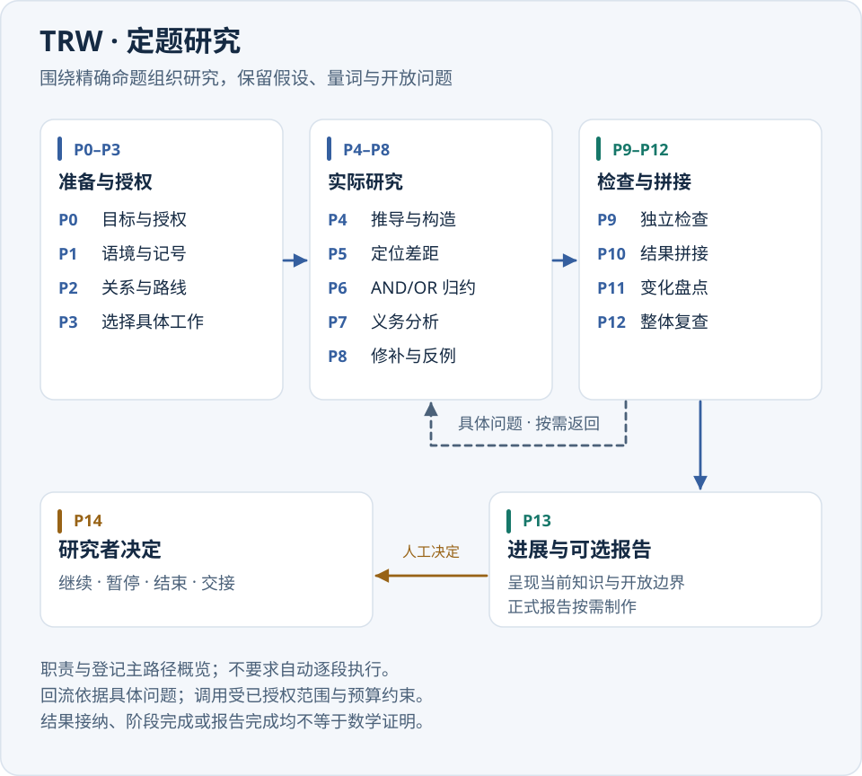
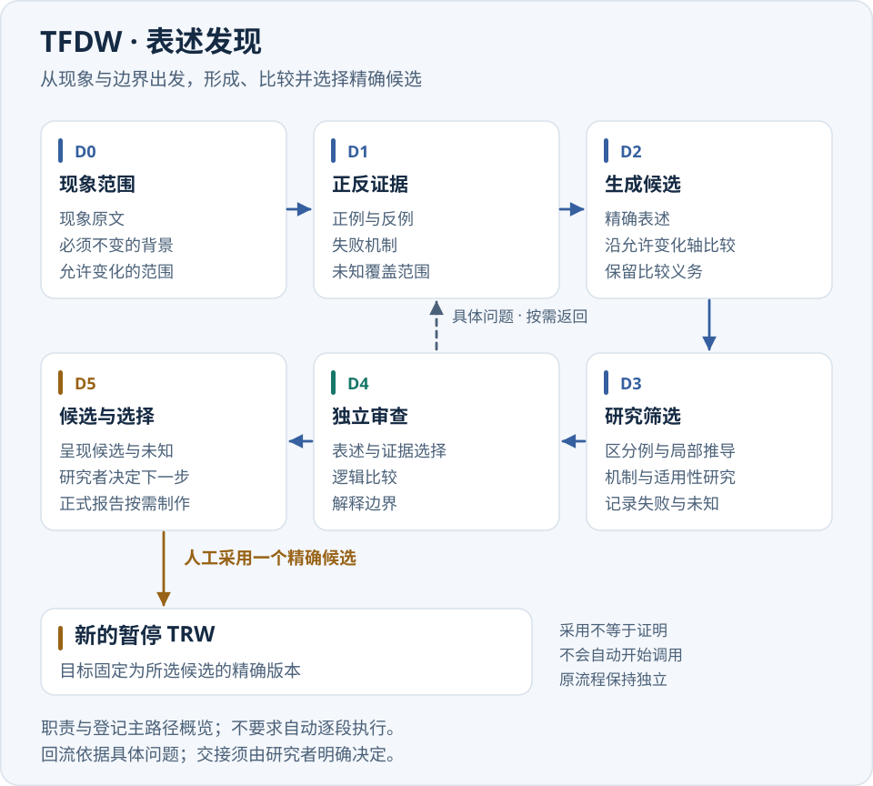
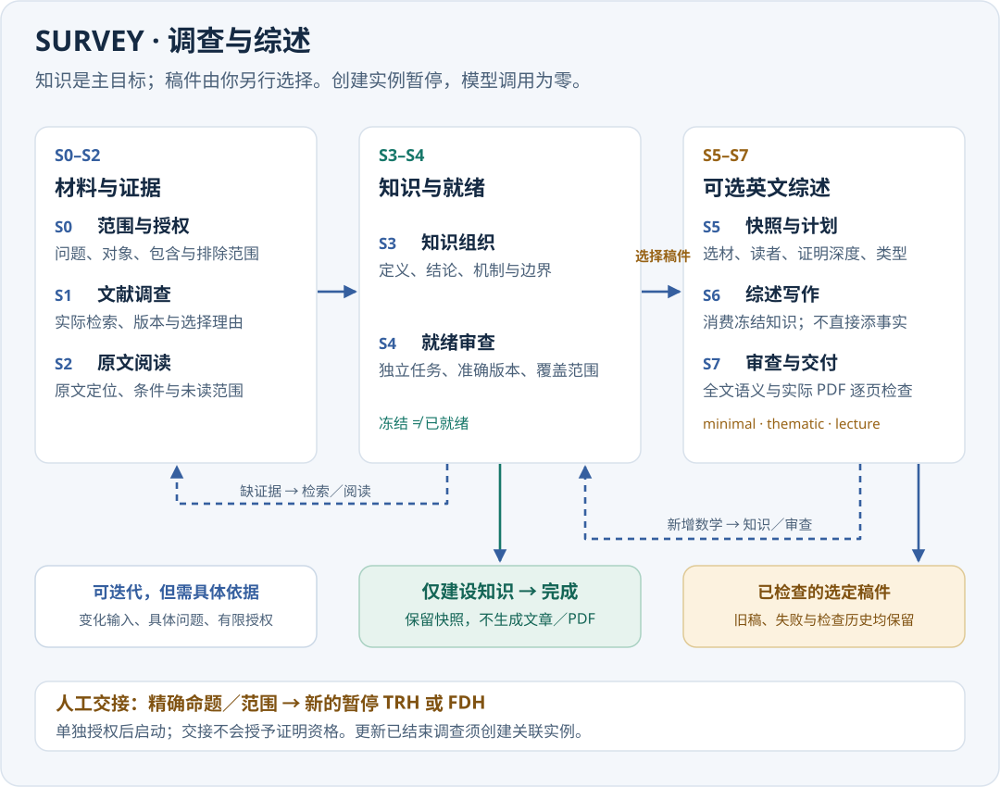

# Pure Math Research Studio 4.1.0

[English](README.md) · [下载安装包](https://github.com/ZhiyaoXiongMath/Pure-Math-Research-Studio/releases/tag/v4.1.0) · [验收记录](TEST-REPORT-4.1.0.md)

**把数学问题、研究过程和检查依据放在同一个本地工作台中。** PMRS 面向希望借助模型开展数学研究、同时保留精确材料和可追溯研究记录的使用者。你可以围绕一个确定命题推导、寻找反例、独立检查，也可以从现象出发，比较不同表述，逐步选出值得证明的命题；也可以调查文献主题，整理证据，再按需写综述。

工作成果包括命题与论证正文、正反例、材料引用、检查范围、未解决问题和研究报告。任务、调用授权及原始响应都保存在本机项目中，便于暂停、回看和继续。

**阅读顺序：**[选择工作流](#选择工作流) → [安装与打开](#安装与打开) → [运行一轮研究](#运行一轮研究) → [三个使用实例](#三个使用实例)。

## 选择工作流

| 你现在有什么？ | 选择 | 主要产物 | 你接下来决定什么？ |
| --- | --- | --- | --- |
| 一个有明确对象、假设、量词和结论的命题 | **TRW · 定题研究**（Targeted Research Workflow） | 推导或反驳、精确缺口、独立检查、进展与报告 | 继续、暂停、结束，或转向表述发现 |
| 一些现象、样例或猜想族，还需要确定怎样表述问题 | **TFDW · 表述发现**（Theorem Formulation Discovery Workflow） | 正反证据、精确候选、候选之间的比较及未查范围 | 继续探索、保留候选，或采用一个候选开展 TRW |

| 一个待调查的主题、问题或已选知识范围 | **SURVEY · 调查与综述**（Survey Workflow） | 版本化检索、原文阅读、知识整理、范围明确的就绪审查及可选英文稿件 | 完成知识后停止、选择一种稿件、更新调查或交接命题 |

一个**项目**保存共同材料与知识；一个**流程实例**绑定一个研究目标或发现范围；一**轮研究**记录这次的目的、授权和调用上限。同一项目可有多个具名流程实例，共用材料并分别记录状态。采用候选会创建新的暂停实例，原流程仍保留。

### TRW：围绕精确命题开展研究



图中分组帮助你理解各类工作之间的关系。**P0–P14 是可用的研究活动，不是每轮必须依次经过的步骤。** 系统根据具体问题、依赖和剩余授权安排工作；当前网页启动 TRW 时，首项研究是 P4 的推导构造。点击图上节点用于阅读详情，不会强制启动该阶段。

| 阶段 | 主要工作与可查看的结果 |
| --- | --- |
| P0 · 目标授权 | 固定要研究的命题、已有知识入口和有限授权。 |
| P1 · 语境记号 | 明确对象、定义、假设、量词与记号。 |
| P2 · 关系路线 | 分辨必要、充分、等价关系及可能的研究路线。 |
| P3 · 工作选择 | 选择有依据、范围有限的具体研究工作。 |
| P4 · 推导构造 | 开展推导、构造、反例和失败探索，保存实际得到的内容。 |
| P5 · 目标差距 | 比较已有结果与原目标，指出仍差哪一步。 |
| P6 · 问题归约 | 将问题组织为 AND/OR 子问题，保留把局部成果提升回原目标的责任。 |
| P7 · 义务分析 | 按需要应用来源、直接分析，或比较两条路线后综合。 |
| P8 · 修补反例 | 针对具体缺口修补论证，开展定向反例探索。 |
| P9 · 独立检查 | 独立审查证明与反例，记录实际检查和未检查的范围。 |
| P10 · 结果拼接 | 在共同语境及同一见证要求下整合局部成果。 |
| P11 · 变化盘点 | 对照起点查看新增、复用、支持变化和剩余问题。 |
| P12 · 整体复查 | 独立复查拼接后的论证；开放部分仍可保留。 |
| P13 · 进展报告 | 呈现当前进展；明确请求后制作正式研究报告。 |
| P14 · 研究决定 | 记录你的继续、暂停、结束或交接选择。 |

例如，P4 的成果可直接进入 P9 检查；P9 发现缺口后可回到 P8 修补；P12 也可要求重新拼接。P0–P12 均可提前进入 P13 呈现已有进展，未解决的问题不会因此消失。重新进入阶段需要具体问题、输入及有限重试授权。

原固定目标的候选证明或反驳需要相应的独立双向审查。局部成果按明确需要的范围检查，不能把一项局部检查通过理解为整个命题已证明。

### TFDW：从现象形成值得研究的命题



TFDW 的输入分为三部分：**观察到什么、哪些背景必须保持不变、允许沿哪些方向探索。** 这让模型比较候选时保留原问题的边界。当前网页启动 TFDW 时，首项工作是 D1 的证据学习。

| 阶段 | 主要工作与可查看的结果 |
| --- | --- |
| D0 · 现象范围 | 固定现象、不变背景与允许探索范围。 |
| D1 · 正反证据 | 整理正例、反例、失败机制以及尚不清楚的范围。 |
| D2 · 生成候选 | 沿明确变化轴提出精确候选，列出需要比较的问题。 |
| D3 · 研究筛选 | 用区分例、局部推导和机制分析筛选候选。 |
| D4 · 独立审查 | 审查表述、证据选择、逻辑比较及解释边界。 |
| D5 · 候选选择 | 呈现候选前沿，记录你的选择，按需制作报告。 |

D4 可以把问题送回 D2 修改表述，或回 D3 补充研究；D0–D4 也可以提前在 D5 呈现已有候选和未知部分。没有足够证据时可以没有候选，比较结论也可以保持未知。

在“候选比较与交接”中阅读完整候选，点击“采用为新的定题研究”，再确认“采用并创建暂停的 TRW”。**采用只表示你选择了一个精确研究目标。** 新 TRW 需要另行启动，其证明与检查仍需开展。反过来，也可从 TRW 的原目标创建暂停的 TFDW，原命题保持不变。

### SURVEY：调查主题，再决定是否写作



选择**调查新主题**、**根据已有知识生成综述**或**更新已有 Survey**，都会创建暂停实例。**仅建设知识**在完成本次知识目标后结束；**生成综述稿件**额外请求所选的 `minimal`、`thematic` 或 `lecture` 类型。创建实例、查看材料和冻结快照均不调用模型；新活动和报告工作需要明确授权与调用上限。

| 阶段 | 主要工作与可查看的结果 |
| --- | --- |
| S0 · 范围授权 | 保存主题、问题、对象、条件、包含与排除范围、交付目标和预算。 |
| S1 · 文献调查 | 规划查询，由宿主受控提供方实际检索候选，记录选择、排除和停止理由。 |
| S2 · 原文阅读 | 阅读支持具体结论的已获取部分，记录来源版本、定位、适用条件和未读范围。 |
| S3 · 知识组织 | 在共享原生知识库中整理定义、命题、证明机制、例子、边界和依赖。 |
| S4 · 就绪审查 | 独立检查选定知识、证据和覆盖，指出具体阻断问题及未查范围。 |
| S5 · 快照计划 | 冻结所选知识及依赖闭包，确定读者、视角、证明深度、遗漏和输出类型。 |
| S6 · 综述写作 | 根据冻结计划和来源撰写指定英文稿件。 |
| S7 · 审查交付 | 检查全文语义、编译实际 PDF，并检查每张实际页面后正式交付。 |

这些活动各有输入与退出条件。S2 材料不足可返回 S1；S3/S4 按具体问题返回调查、阅读或整理。仅建设知识可以在 S4 完成后保留知识快照，不生成稿件；S5 选材变化可能需要重新审查。S6/S7 发现新增数学主张要返回知识流程；文字缺陷回写作，排版修复需重新检查页面。冻结快照本身不代表内容已就绪。

来源状态分别记录元数据、摘要、已获取全文和实际阅读范围；原始文件、抽取文本与数学知识的哈希相互独立。获取失败和限制保留可见，覆盖只针对已声明范围和查询。文献发表或被引用不等于 PMRS 独立检查通过。相关支持改变或撤回会使受影响的审查／输出失效；无关知识或界面语言变化不会。

Survey 可以把精确命题或发现范围交给新的暂停 TRW／TFDW。采用前查看上下文与来源，再单独授权后续研究；更新已结束 Survey 时新建关联暂停实例，保留旧记录。

### 怎样读应用里的流程图

- 默认突出选中实例所属的 workflow 和主路径；可切换另一种结构，或打开“三流程总览”。
- 点击节点查看职责、模型策略、任务和产物；相关分支、回流和提前交付路径按需显示。“显示全部路径”保留完整合法路径。
- “可迭代”标记表示可按授权重入。上方活动区显示正在执行或等待的 P/D/S 阶段；并行时可能有多个活跃阶段，阶段编号不表示完成百分比。
- 没有加载对应实例时显示“流程结构预览／未选择实例”，不能据此判断某阶段是否已访问。

## 安装与打开

目标环境为 **Ubuntu 26.04**，运行时需要 **Python 3.11+**。

1. 从 [v4.1.0 Release](https://github.com/ZhiyaoXiongMath/Pure-Math-Research-Studio/releases/tag/v4.1.0) 下载 `pmrs4-graphical-installer_4.1.0_all.deb`，核对同页的 `SHA256SUMS.txt`。
2. 用 Ubuntu 图形软件包安装器打开 `.deb`。完成系统授权后，从应用菜单打开“安装纯数学研究工作室 4.1.0”，选择新的个人安装位置。包内 wheel 离线创建独立环境；缺少的 Python venv、Zenity 系统组件由 Ubuntu 软件源提供。
3. 从应用菜单打开“纯数学研究工作室 4.1.0”。在“设置与登录”中选择已有 Codex CLI、Tectonic、离线资源或公共 CA 文件，也可明确安装界面列出的官方组件。登录由官方客户端处理。

如果 `.desktop` 文件打开成文本，请使用上述 `.deb` 和应用菜单入口。已有安装目录和同版本菜单入口不会被覆盖。缺少 PDF 组件仍可阅读知识或开展不需要 PDF 的工作；生成 PDF 前另行检查报告依赖。更详细的操作见[安装帮助](INSTALL-HELP.html)。

版本化安装目录和菜单保留早期应用。4.x 配置与默认工作区继续使用名为 `4.0` 的目录；4.1 不改变原生存储合同，也不会自动启动已有研究。默认工作区为 `$XDG_DATA_HOME/pure-math-research-studio/4.0/workspace`，配置位于 `$XDG_CONFIG_HOME/pure-math-research-studio/4.0`；未设置 XDG 时分别使用用户的 `.local/share` 和 `.config`。安装目录与研究数据分开。

## 界面语言

新安装默认使用 **English**。在工作台上方的 **Language／界面语言** 中选择 **English** 或 **简体中文**。选择由宿主保存，重新打开或换端口后仍有效；切换时保留项目、流程、阶段、页签、输入草稿、展开正文及滚动位置。切换仅影响显示，不提交研究、不消耗调用，也不改变知识或报告的冻结输入。

**两种界面下的研究正文和正式报告都保持英文。** 中文用户输入等原始材料和外部客户端输出保留原文；PMRS 不自动翻译研究记录。操作系统原生按钮可以遵循桌面系统语言。

## 运行一轮研究

1. **创建暂停项目。** “新建项目”选择 TRW 并输入完整题目，或选择 TFDW 分别填写三项发现输入。可以上传 UTF-8 题目或补充材料。创建项目本身不调用模型；未完成的 TFDW 可明确保存为草稿，补齐后再启动。
2. **设置目的与预算。** “开始本轮研究”中填写具体目的、最多调用次数和最多同时处理的任务。界面默认值为 12 次、并发 2；可自行调整。点击提交即授权并启动本轮必要工作，调用上限不保证本轮能完成全部研究及报告。
3. **核对模型策略。** 配置按“阶段／角色／用途”区分。需要覆盖时先点“加入或更新此作用域”，再提交。未来配置修改只影响新任务，单项修改或恢复默认不清空其他覆盖，也不改变已冻结请求。能力不支持时明确拒绝，不静默降级。
4. **阅读进展并处理缺口。** 在“当前知识”看正文与支持范围，在“开放问题”看尚缺什么，在“任务与配置”看真实状态。新任务和操作会自动刷新；知识正文保留阅读快照，出现更新提示后可自行刷新正文。
5. **按需请求 TRW／TFDW 报告或作出决定。** 点击“制作研究报告”请求正式报告，包含讲义版和精简版，并分别记录语义检查和实际页面检查。报告需要明确请求，与研究共享本轮调用上限；只有勾选“报告优先”时，报告完成才成为继续、结束或采用候选的前提。

Survey 共用上述授权、预算、冻结任务与恢复控制；启动时选择具体 S 阶段活动及其所需的来源或知识引用。获取由宿主执行，网络次数单独记录。仅建设知识不隐含请求报告；综述计划只生成所选类型，不自动套用 TRW／TFDW 的讲义／精简配对。

要先熟悉界面而不调用真实模型，可在“使用指引”中选择“运行命题示例”或“运行候选与交接示例”。它们创建独立的确定性模拟项目，输出带有测试隔离标记；模拟结果不能当成真实研究结论。

## 三个使用实例

下面是可直接填写到表单的教学输入。给出的数学结论是供你核对的参考，不是一次真实模型运行的记录，也不保证实际任务一定生成相同内容。仅创建项目不会调用模型；点击“开始本轮研究”后才会按所选执行器和授权运行。

### 实例一：用 TRW 研究前 n 个奇数的和

**场景：**你已经有一个精确命题，希望得到可检查的证明，并看清检查覆盖了哪些部分。

在“新建项目”中选择 **TRW**，项目名称填 `Odd-number sum`，首个流程名称填 `Induction proof`，完整题目粘贴：

```text
证明：对每个正整数 n，1 + 3 + 5 + ... + (2n - 1) = n^2。
明确正整数域和求和约定；给出完整证明，不以有限样例代替一般证明。
```

创建后，应看到一个暂停的 TRW 实例，原题保留，尚无模型请求。接着打开“开始本轮研究”，本轮目的可填：

```text
优先尝试数学归纳法，检查 n = 1 的基例及从 n 到 n + 1 的归纳步骤。
保持原命题的量词和正整数域，说明证明覆盖范围以及仍未解决的缺口。
```

确认调用上限与并发数后启动。阅读时按以下顺序查看：

| 去哪里看 | 要核对什么 |
| --- | --- |
| 当前知识 | 论证是否包含基例，以及从 $n^2$ 加上 $2n+1$ 得到 $(n+1)^2$ 的步骤？ |
| 任务与配置 | 实际执行了哪些推导和独立检查？请求使用了什么冻结配置？ |
| 开放问题 | 是否还有未完成的检查或未覆盖范围？任务结束不能代替这些检查。 |
| 研究报告 | 需要交付时明确请求报告，查看讲义版、精简版及各自检查状态。 |

**参考结果：**基例 $1=1^2$；若前 $n$ 项之和为 $n^2$，则再加下一项 $2n+1$ 得到 $(n+1)^2$。你应能从系统记录中追溯论证及独立检查的范围；若预算耗尽或检查未完成，仍按实际状态保留开放问题。

### 实例二：用 TFDW 发现连续整数之和的整除条件

**场景：**你观察到一个规律，但需要确定命题怎样表述、哪些条件必不可少。

新建 **TFDW** 项目，项目名称填 `Consecutive integers`，流程名称填 `Find divisibility conditions`。三项输入分别填写：

**现象：**

```text
1+2+3=6，可被 3 整除；1+2+3+4=10，不能被 4 整除；
1+2+3+4+5=15，可被 5 整除。
改变起始整数和项数后，连续整数之和何时能被项数整除？
```

**必须保持不变的背景与约束：**

```text
起始数 a 为任意整数，项数 n 为正整数。
研究 S(a,n)=a+(a+1)+...+(a+n-1)，整除均指整数整除。
```

**允许探索的方向与范围：**

```text
允许改变 a 和 n，比较 n 为奇数、偶数时的情形。
寻找关于 n 的必要且充分条件，并检查该条件是否对所有整数 a 成立。
保持连续整数及整数整除的含义，不改成任意实数或其他求和对象。
```

创建后检查三项原文均已保存，流程处于暂停状态。开始一轮研究时，目的可填“构造正反例，比较项数的奇偶性，提出精确候选并记录尚未检查的范围”。

阅读“候选比较与交接”：先看完整量词和假设，再看例子、反面证据及比较的未知部分。**供核对的候选**是：对于任意整数 $a$ 和正整数 $n$，$n$ 整除 $S(a,n)$ 当且仅当 $n$ 为奇数。其核对线索为

$$
S(a,n)=na+\frac{n(n-1)}{2},\qquad \frac{S(a,n)}n=a+\frac{n-1}{2}.
$$

候选出现后，可按以下步骤交接：

1. 阅读并选定那一个精确候选；只有少数样例并不足以证明一般结论。
2. 点击“采用为新的定题研究”，确认完整命题，再点“采用并创建暂停的 TRW”。
3. 在流程选择器切换到新 TRW。它与原 TFDW 共用材料，原 TFDW 仍保留；新流程不会自动开始调用，也不会因采用而获得证明资格。
4. 为新 TRW 单独设置研究目的和预算，再明确启动证明工作。以后可通过“研究历史”追溯候选的形成与采用过程。

### 实例三：用 SURVEY 整理有限等比求和，再选择一份 minimal 综述

**场景：**先弄清一个小主题的知识和边界，再决定是否需要短稿。此例明确使用合成教学材料，不声称已经检索或阅读过真实论文。

在“新建项目”选择 **SURVEY**、**调查新主题**和**仅建设知识**。项目名称填 `Finite geometric sums`，流程名称填 `Knowledge foundation`，分别填写调查表单（列表字段每行一项）：

**主题：**

```text
实数上的有限等比求和。
```

**具体问题：**

```text
G_n(q)=sum_{k=0}^{n-1} q^k 的精确公式是什么？请包含 q = 1 的边界情形。
```

**对象／条件：**分别填 `q 为实数，n 为正整数。`／`只讨论有限和。`

**纳入范围：**

```text
有限和的定义
q != 1 的公式及单独的 q = 1 情形
乘以 q 后相减的证明机制
```

**排除范围：**

```text
无穷级数与收敛性
矩阵
历史优先权判断
```

创建后核对实例暂停，“任务与配置”中模型请求为零。在“原始材料”上传随文的 [`finite-geometric-sums.teaching.md`](examples/readme/finite-geometric-sums.teaching.md)，或者把以下内容保存为文件上传：

```text
合成教学材料——为 PMRS 使用实例编写，不是出版物或书目声明。
令 n 为正整数、q 为实数。定义 G_n(q)=1+q+...+q^(n-1)。
若 q != 1，则 (1-q)G_n(q)=1-q^n，因此 G_n(q)=(1-q^n)/(1-q)。
若 q = 1，则 G_n(1)=n，此时不能除以 1-q。
证明机制：把 G_n(q) 乘以 q，对齐两个有限和并相减；显式检查 n=1 的边界。
范围：仅讨论有限和；不对无穷级数收敛性作出任何主张。
```

点击“授权调查活动”并设置有限调用上限；S2 和 S3 选择已上传的教学来源，S4 选择已整理知识，依次开展 **S2 原文阅读**、**S3 知识组织**、**S4 就绪审查**；每次先检查实际结果，再决定下一步。活动目的可以填写：

```text
仅使用明确标识的教学材料和已声明的有限求和范围，保留准确原文定位。
整理定义、q != 1 公式、q = 1 边界和乘法相减推导，指出未检查范围。
不要编造发表文献，也不要把保存成功当作独立审查通过。
研究正文继续使用英文。
```

| 去哪里看 | 要核对什么 |
| --- | --- |
| 原始材料与阅读记录 | 是否标为合成材料？实际阅读范围是否绑定上传的准确版本？ |
| 当前知识 | 是否保留实数域、正整数条件、公式和单独的 $q=1$ 情形？论证是否关联其条件与来源？ |
| Survey 就绪状态 | 检查了哪些准确版本和依赖闭包？是否保留阻断、遗漏和独立任务身份？ |
| 任务与配置 | 是否只运行已授权活动？独立审查是否来自实际独立任务？ |
| 知识快照与研究报告 | 就绪审查有效后点击“冻结选定知识”，再结束知识实例；不应自动产生稿件或 PDF。 |

**参考结果：**$q\ne1$ 时 $G_n(q)=(1-q^n)/(1-q)$，$q=1$ 时 $G_n(1)=n$；$n=1$ 时两种情形都得到 $1$。这是教学核对线索，不代表模型已经执行或 PMRS 审查已经完成。若就绪状态阻断，应先补齐具体的来源、阅读或知识问题。

**稍后另行请求稿件：**通过“根据已有知识生成综述”（或“更新已有 Survey”）从已选知识创建关联暂停实例。选择“生成综述稿件”，重新核对复用审查的精确范围。写作计划选择 **minimal**，语言 **English**，读者填 `A reader familiar with elementary algebra`，视角填 `The finite identity and the exceptional q = 1 case`。点击“冻结选定知识”，再打开“准备选定类型的综述”，选择该快照，为该推导新增“证明承诺”并选“完整证明”。在“必要证明步骤”中填写 S4 审查实际记录的步骤名；若某承诺步骤尚未检查，先补做审查。在“限制”说明有限和范围；排除已保存知识记录时，用“遗漏知识与理由”逐项解释。

通过“保存英文输出计划”保存本次选材。在“授权调查活动”选择“S5 · 授权输出预算”，给出有限报告预算；这一步不调用模型。随后对该已保存计划点击“请求选定的英文稿件”，在“研究报告”查看所选的一份 minimal 英文稿、语义审查、实际编译 PDF 和逐页检查。`thematic` 与 `lecture` 是另行选择的类型，本次不应生成。草稿或失败的新稿不能继承旧稿成功交付状态；写作中出现新增数学主张，应返回知识组织与就绪审查。

高级 CLI 可用随文范围文件完成**零调用创建与材料上传**。从源码目录运行以下命令；首项结果中的 `instance_id` 用于后续 Survey 命令：

```bash
python3 -m research_studio survey init --scope examples/readme/finite-geometric-sums.scope.json --out ../geometric-survey --title "Finite geometric sums"
python3 -m research_studio source ../geometric-survey --file examples/readme/finite-geometric-sums.teaching.md --media-type text/plain
python3 -m research_studio workflow list ../geometric-survey
```

上述命令返回已保存的原生数据，不启动模型；`survey status PROJECT --instance INSTANCE_ID` 只读。后续 `survey activity` 会明确授权并启动 S1–S4，S5 只授权报告预算；`survey freeze`、`survey plan` 和 `report --prepare-only` 不调用模型。不加上述只准备参数的 `report` 会按授权运行选定报告。具体必填项见 `--help`；教程应使用独立工作区。

## 阅读、暂停与保存

| 需求 | 入口与行为 |
| --- | --- |
| 查原文与材料依据 | “原始材料”保留原件；“当前知识”展示全文、公式、版本和实际支持范围。 |
| 看这一轮改变了什么 | “本轮变化”比较新增、复用、支持变化和撤回；“研究历史”保留本项目不可变提交与事件。 |
| 暂停或继续 | 暂停停止新派发并保留在途请求；“继续已有研究”沿用已有授权与余额。结束本轮后实例成为 `ENDED`，再次开展研究需明确创建新实例。 |
| 已捕获结果尚未接纳 | “接纳已捕获结果”读取原响应，不重新发送请求。 |
| 请求为 UNKNOWN | 先处置原请求，不自动重发。放弃等待仍保留不确定状态和消耗；确认未发送需要绑定实际传输证据原件，说明文字本身不是证据。 |
| 提交后没收到响应 | 查询或恢复原操作。回执保存在工作区，服务重启或换端口后仍可找回；完成结果直接恢复，PENDING 不自动重发。明确的新操作使用新编号。 |
| 保存或恢复项目 | “导出备份”保存原生归档；“恢复备份”打开原生备份窗口，先检查，再恢复到新的暂停项目，不自动恢复任务执行。 |

关闭浏览器不终止后台研究，从应用菜单可重开同一工作区。需要退出后台时先暂停研究，等待在途任务结束，再使用页面底部的退出按钮。不要把密码或令牌写进项目材料。

## 范围与验收

4.1.0 在原有 TRW／TFDW 产品上增加原生 SURVEY 和英／简中界面。它保留原生存储与备份恢复，不增加旧项目迁移、兼容读取器、真实研究样本或续接包；不支持的输入明确拒绝，不静默转换。产品、工作流和存储格式版本分别管理。

原始材料、保存成功、任务完成和报告输出都不等于数学证明。支持与资格按精确对象、版本和检查范围记录；本版不提供形式化验证。客户端未返回的有效配置、用量和实际费用保持未知。

任务准备为必需输入的唯一内容及元数据设定 32 MiB 预算，其中元数据最多 8 MiB，单份序列化任务包最多 64 MiB；模型 token 容量与输出储备另行检查。完整范围超限时在发送前阻断，应明确缩小选材或使用 CoveragePlan，不静默省略证据。同一项目最多两个准备任务共享资源预留。可重建检查点和已结算的任务输入副本有界保留或回收；原件、已捕获响应、回执、报告版本和审查依据仍保留。资源不足时按原操作恢复，不自动重发 UNKNOWN。资源实测和适用边界见验收记录。

[4.1.0 验收记录](TEST-REPORT-4.1.0.md)区分实际测试、受控模拟、实际渲染和未完成的原生桌面观察。开发验收不调用付费研究，也不把教程参考结论计作验收通过；旧人工记录仅在行为未受影响且可追溯时沿用。新增及保留要求见[验收范围](ACCEPTANCE-SCOPE-4.1.0.md)。

## 高级维护与开发

普通操作可在网页完成。高级 CLI 与网页共享服务层，在源码目录中可运行：

```bash
python3 -m research_studio --help
python3 -m research_studio project init --problem examples/problem.zh-CN.md --out ../new-project
python3 -m research_studio status ../new-project
python3 -m research_studio audit ../new-project
python3 -m research_studio project restore BACKUP.zip --out ../restored-project
```

在已验证解包的 release ZIP 目录中，可离线安装到新前缀：`python3 scripts/install-local.py --prefix NEW_PREFIX --bin-dir NEW_BIN --venv`。需要应用菜单时传入 `--desktop-dir`；维护验收使用独立私有菜单目录，不覆盖已有入口。测试和构建输出放到源码树外：

```bash
python3 -B scripts/test-runner.py --out ../validation/suite.json
python3 -B scripts/validate-groups.py --out ../validation/required --browser-evidence ../validation/browser-evidence.json
SOURCE_DATE_EPOCH=315532800 python3 -B scripts/build-release.py --out ../artifacts
```

构建输出源码 ZIP、安装用 release ZIP、wheel、图形安装器 `.deb`、制品清单与哈希。构建成功只确认打包完整性；验收必须使用实际执行记录，不能复用旧版本 PASS。

更多：[架构](ARCHITECTURE-4.1.0.md) · [更新说明](CHANGELOG-4.1.0.md) · [Ubuntu 安装与验收](UBUNTU-E2E-GUIDE.md) · [许可证](LICENSE)。
