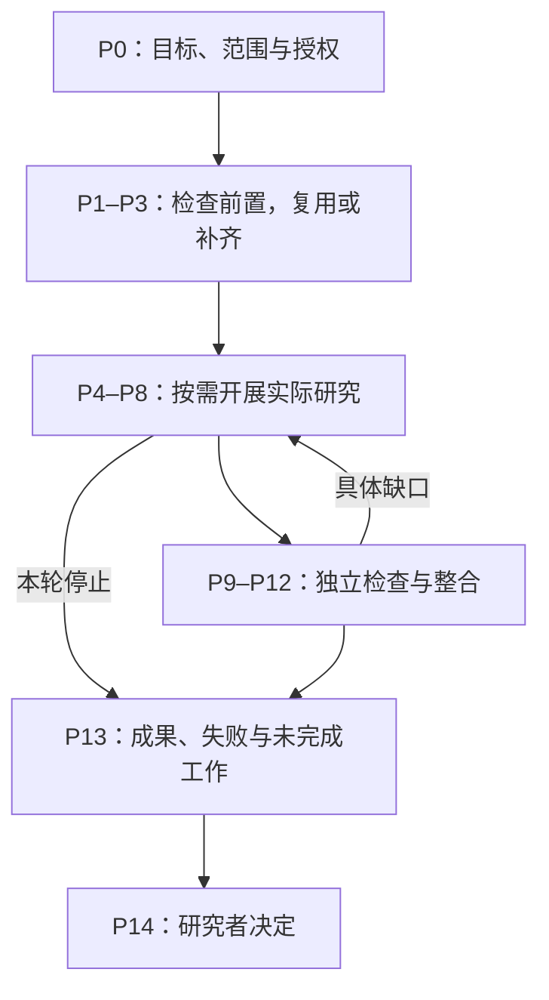
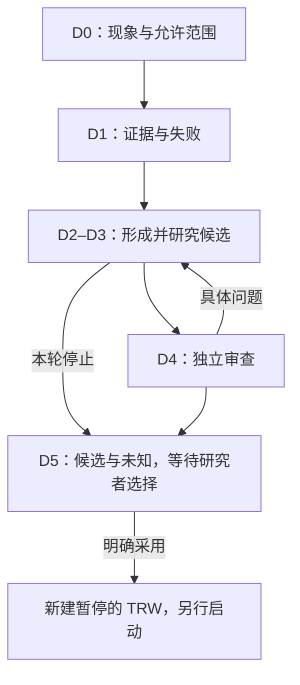
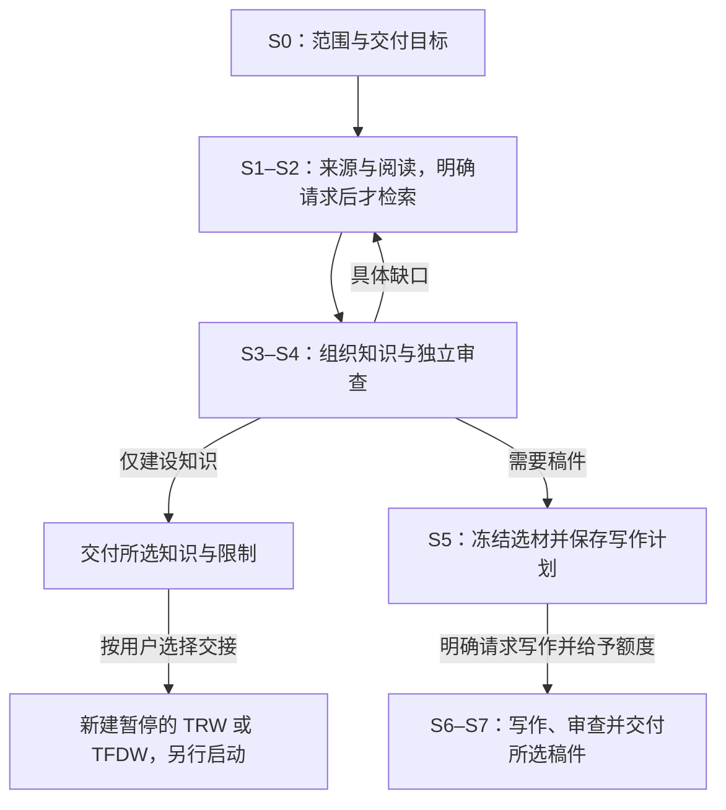

# Pure Math Research Studio (PMRS)

**PMRS 是一个 AI 辅助的纯数学研究工作台。**

你可以用它研究明确的数学命题，从现象和例子中探索猜想，或调查文献、整理某一主题的已有知识。

设定目标、范围和调用预算后，PMRS 会安排必要的研究与检查，复用适用的已有成果，保存论证、来源、研究结果和未解决问题。你可以查看具体内容、暂停新任务、提出明确的纠正要求，再决定下一步研究方向。需要正式研究报告或综述稿件时，可以另行请求。

项目和研究记录保存在本地。模型工作使用已配置的模型服务；明确请求文献检索时，程序会访问支持的学术来源。本地保存并不表示模型执行和文献检索都在离线环境中完成。

[English](README.md) · [4.2.0 对应发布页](https://github.com/ZhiyaoXiongMath/Pure-Math-Research-Studio/releases/tag/v4.2.0) · [实现说明](IMPLEMENTATION-NOTES-4.2.0.md)

> **版本 4.2.0：**本版补齐并修复科学职责、有限自动承接和资源执行，新增项目助手，用于基于证据的诊断与明确范围的报告修订。已发布 v4.1.0 保留为历史基线。具体实现及证据范围见[实现说明](IMPLEMENTATION-NOTES-4.2.0.md)和[验收记录](TEST-REPORT-4.2.0.md)。

首次使用可依次阅读[选择工作流程](#选择工作流程)、[安装与打开](#安装与打开)和[开始一轮研究](#开始一轮研究)。想直接跟着操作，可查看三个完整示例：[TRW](#示例一定题研究证明奇数求和公式)、[TFDW](#示例二表述发现寻找正确的整除条件)、[Survey](#示例三调查与综述理解有限等比求和)。

## 选择工作流程

| 你现在有什么 | 选择哪种流程 | 可以得到什么 | 下一步由你决定什么 |
| --- | --- | --- | --- |
| 一个对象、假设、量词和结论明确的命题 | **TRW · 定题研究**（Targeted Research Workflow） | 证明尝试、构造或反例、独立检查，以及尚未解决的缺口 | 继续研究、暂停、结束，或转向其他表述 |
| 一组现象、例子，或尚需打磨表述的猜想 | **TFDW · 表述发现**（Theorem Formulation Discovery Workflow） | 候选命题、正反证据、候选比较及未决问题 | 继续探索、保留候选，或选定一个命题开展新的 TRW |
| 一个需要理解和解释的主题或已有知识范围 | **SURVEY · 调查与综述**（Survey Workflow） | 原文阅读、知识整理和覆盖审查；按需制作英文稿件 | 完成知识工作后停止、请求稿件、更新调查，或交给 TRW/TFDW 继续研究 |

一个**项目**保存共同材料与知识。项目内的每个**流程实例**，就是有独立名称、目标或范围及状态的一项研究。一**轮研究**规定你这次希望完成什么，以及最多授权多少次调用。同一项目的多个流程可以共享材料，但各自保留研究状态和用户决定。

开始使用前不必学会全部阶段。需要理解流程图或具体分工时，再查阅后面的[流程与阶段参考](#流程与阶段参考)。内嵌 Mermaid 图需要支持它的 Markdown 阅读器；旁边的阶段表仍可直接按文本阅读。

## 安装与打开

目标桌面环境为 **Ubuntu 26.04**，运行时需要 **Python 3.11 或更新版本**。

请使用下列同版 4.2.0 安装包及校验和。旧发布包不包含本文描述的完整 4.2.0 行为。

1. 从[4.2.0 对应发布页](https://github.com/ZhiyaoXiongMath/Pure-Math-Research-Studio/releases/tag/v4.2.0) 下载 `pmrs4-graphical-installer_4.2.0_all.deb`，核对同页的 `SHA256SUMS.txt`。
2. 用 Ubuntu 图形软件包安装器打开 `.deb`，完成系统授权。
3. 从应用菜单打开**安装纯数学研究工作室 4.2.0**，选择新的个人安装位置。包内 wheel 会离线安装到独立环境；缺少的 Python venv、Zenity 系统组件由 Ubuntu 软件源提供。
4. 从应用菜单打开**纯数学研究工作室 4.2.0**。
5. 在**设置与登录**中，按需选择已有 Codex CLI、Tectonic、离线资源或公共 CA 的路径，也可以明确安装界面列出的官方组件。登录由官方客户端处理。启动模型工作或请求 PDF 前，查看相应组件的就绪状态。

程序不会覆盖已有安装目录或同版本应用菜单项。如果 `.desktop` 文件被当成文本打开，请使用上述 `.deb` 和应用菜单方式。没有 PDF 组件时，仍可阅读知识、使用不需要生成 PDF 的功能。更多信息见[安装帮助](INSTALL-HELP.html)。

### 界面语言与程序内帮助

在工作台顶部通过**界面语言**选择 **English** 或**简体中文**，默认使用英文。语言选择会在重新打开和端口变化后保留；切换时保留当前选择与表单草稿。

界面支持中英文；无论采用哪种界面，**研究正文和正式报告都使用英文**，上传原件保留原语言。切换界面不会翻译已有研究，也不消耗调用。系统文件选择窗口的按钮可能跟随桌面语言。

点击**使用指引**可阅读程序内操作说明。其中的**运行命题示例**和**运行候选与交接示例**会创建隔离的确定性演示，不调用真实模型。它们用于熟悉程序操作，预设响应不构成科研证据。

## 开始一轮研究

普通操作都可以在 Web 界面完成，不需要终端命令、手写 JSON，也不需要自己排列阶段。

1. **创建项目与第一个流程。** TRW/TFDW 使用**新建项目**，在**研究方式**中选择**定题研究：围绕精确命题**或**表述发现：从现象与边界出发**，填写项目及流程名称；TRW 填完整命题，TFDW 分别填写现象、不变背景和允许探索范围。新建 Survey 项目时，在项目选择框选**选择或创建项目**，再点击 Survey 卡片上的**调查新主题**，填写主题、问题及纳入与排除范围。要在已选项目中添加实例，使用**新增研究流程**。不完整的 TFDW 可以保存为草稿，但开始前必须补齐。创建后的实例处于暂停状态。
2. **添加相关材料。** 使用**补充材料**保存文件，并在**原始材料**中核对。材料应包含拟开展工作所需的定义、假设与来源段落。文件保存成功只表示它可以作为输入，不表示已经阅读或检查。
3. **说明本轮目的。** 打开**开始本轮研究**，在**本轮研究目的**中写清要做的事与边界。例如：“优先用归纳法研究给定恒等式，保留正整数范围，检查基础情形和归纳步骤，并指出尚缺的审查。”
4. **选择本轮输入。** 通过**本轮采用的材料（可选）**和**本轮采用的已有知识（可选）**选择相关来源与成果。每项任务使用必要目标、前提、选定材料和依赖。Survey 缺少材料或知识时会说明等待原因；这个启动操作不会擅自联网检索。
5. **设置额度与并发。** Web 表单的**本轮最多调用次数**默认是 **12**；**最多同时处理的任务**使用项目已保存设置，初始为 **1**，可设为 **1–8**。前者限制总调用数，后者限制同时开展的工作数，具体见[预算与并发](#预算与并发)。
6. **检查模型设置并启动。** 如果修改阶段、角色或用途的模型覆盖设置，先点**加入或更新此作用域**，再提交表单。点击**开始本轮研究**才授权执行；打开表单、阅读帮助或查看流程图不会启动研究。
7. **查看结果并作决定。** 从**本轮进展与下一步决定**了解实际成果、未完成事项和等待原因，再决定继续、暂停、结束或交接。一轮研究可以交付有价值的进展，同时保留数学问题尚未解决的状态。

### 启动后，系统会自动做什么

| 流程 | 系统自动承接的工作 | 何时等待你的决定 |
| --- | --- | --- |
| TRW | 检查背景与记号、目标逆推、路线探索是否已有有效支持；适用的直接复用，缺失的自动安排。随后按实际结果、具体缺口和依赖开展必要研究与独立检查。 | 到达本轮停止条件后，由你决定下一步。新一轮或目标变化需要你的授权。 |
| TFDW | 在指定范围内按需开展证据整理、候选构造、区分性研究与独立审查。 | 呈现候选及比较结果后，由你选择、要求继续探索或停止；系统不替你采用候选。 |
| Survey | 阅读选定来源、组织知识，安排必要的就绪与覆盖检查。 | 缺少来源或必要选择时明确等待。**仅建设知识**交付知识；稿件需要保存写作计划并明确请求。 |

系统不会为了凑齐阶段而每轮遍历全部流程，也不要求每个阶段单独调用一次模型。相关工作在不需要保持独立、且能分别追溯结果时可以合并处理；独立审查仍单独进行。调度和本轮总结不额外调用管理模型。回流和新增分支继续使用原有限额度及累计尝试限制。

**安排研究职责**是高级入口，用于明确指定分支、选材和依赖，适合具体干预或特殊分工；其中单独的执行选项默认不勾选。它不是普通启动的必经步骤。

## 查看进展，理解停止原因

| 去哪里看 | 可以了解什么 |
| --- | --- |
| **本轮进展与下一步决定** | 实际成果、失败、未完成或未执行的工作、开放缺口，以及需要作出的决定 |
| **当前知识** | 命题、论证与相关记录；打开完整正文查看数学内容 |
| **开放问题** | 缺失前提、未解决研究问题、未完成检查和其他依赖 |
| **任务与配置** | 任务、原请求、实际模型设置、执行或等待状态，以及预算信息 |
| **研究历史**与**本轮变化** | 研究内容怎样变化，哪些操作产生了当前记录 |
| **原始材料** | 来源文件，以及阅读或研究任务所使用的版本 |
| **研究报告** | 报告类型与修订版本、实际下载文件、语义检查和页面审查状态 |

进度会自动刷新。产生新正文时，内容更新提示允许你在方便时刷新列表，不必打断正在进行的阅读。

**“没有可运行任务”不等于“研究完成”。** 可能是缺少依赖、等待资源、预算耗尽、任务故障，也可能是本轮已可以交给你决定。应查看具体原因和未完成事项。交付总结会同时保留进展与缺口，不把未执行的职责记成通过。

正式报告需要单独请求。除非你在高级选项中明确设置某项决定必须先有报告，否则可以查看已有进展并结束仍有开放问题的一轮研究，无需先生成 PDF。

## 暂停、纠正与继续

**暂停**会停止派发新任务，保留已发送请求和已捕获响应；它不能撤销已经在途的模型调用。

| 你想做什么 | 使用哪个操作 | 会发生什么 |
| --- | --- | --- |
| 继续同一项已授权工作 | **继续已有研究** | 沿用同一轮与剩余额度，先处理符合条件的已有响应，再继续受影响的工作 |
| 纠正具体错误 | **提出纠正要求** | 将受影响职责与完成标准记录为本轮实际工作 |
| 为同一轮增加有限调用 | **为本轮追加有限调用授权** | 记录明确数额与原因；只保存授权不会启动执行 |
| 开展不同目的或下一轮工作 | 在可用实例上**开始本轮研究** | 建立新的明确授权，不把旧的未完成请求自动转成新工作 |
| 结束当前研究 | **结束本轮** | 记录决定并将实例标为 `ENDED`；后续研究需要新建并明确授权的实例 |

### 让纠正要求真正进入研究工作

1. 点击**提出纠正要求**，选择**受影响的研究职责**，可以是已有任务，也可以是尚未准备执行的职责。
2. 填写**具体问题与纠正要求**，例如：“论证除以 1−q，却没有单独处理 q=1。”
3. 填写**完成标准**，例如：“除法前明确 q≠1；另证 G_n(1)=n；保留 n≥1，并指出哪些修改后的主张需要重新检查。”
4. 点击**保存纠正并暂停**。纠正会成为原轮次中的可执行工作。受影响且尚未发送的任务暂缓，已发送请求和已有响应保持原身份。
5. 核对剩余额度，再点击**继续已有研究**。查看产生的任务、完整结果及新检查，确认纠正已经落实。

只写一句“继续”的备注不会改变研究计划；纠正文字保存成功，也不表示错误已经修复。

如果调用额度已经耗尽，填写**新增调用次数**（1–1000）和明确的**追加授权的具体原因**，点击**只保存授权，不启动**，再单独点击**继续已有研究**。这不会改变原范围或重置累计尝试限制；增加调用也不能绕过缺失依赖。

需要调整模型策略时，**修改已有轮次的未来任务配置**只影响之后新准备的任务，不重写已冻结的请求。不支持的模型能力会明确报错，不会静默换用其他模型。

## 预算与并发

### 三类调用额度

| 额度 | 初始值或表单默认值 | 用于什么 |
| --- | --- | --- |
| **科研轮次** | Web 启动表单默认 **12** 次；CLI `start` 必须明确填写调用上限 | 已授权研究与检查；当授权适用时，也包括明确请求的报告角色调用 |
| **项目助手** | 初始为 **0**；授权表单建议新增 **3** 次 | 每次发送最多一次助手调用，不代替原生报告作者和审查者的额度 |
| **报告工作** | 使用适用的已有额度，或另行填写有限报告额度 | 所请求报告或修订的写作，以及必要的语义和视觉检查 |

调用上限不是价格报价，也不保证某轮研究或报告一定能在额度内完成。执行客户端没有返回的实际用量与费用，仍按未知处理。填写表单、创建项目、查看记录、阅读帮助和刷新状态不消耗模型调用；启动已授权研究、向助手发送消息、请求模型参与报告工作时可能产生调用。

额度耗尽后，程序保留已有成果并说明未完成工作，不会自动增加预算。科研暂停或余额为零时，助手诊断与报告修订仍可使用各自适用的有限授权。若项目另有总调用上限，仍须遵守。

### 同时运行数与公平排队

项目保存的并发默认是 **1**，明确设置后最高为 **8**；已有项目设置得更低时继续保留。接入共享池的 PMRS 项目共同使用**宿主 10 个模型调用名额**，覆盖 Web、CLI、科研、报告和助手入口。

系统按实际就绪需求和项目上限分配名额。两个需求充足的项目可以各占 5 个；需求分别为 2 和 8 时可以按 2/8 使用。闲置份额可由其他就绪项目使用，余数轮转分配，任务结束释放空位后及时补入排队任务。真实依赖、独立审查边界或资源不足仍可能让任务暂时无法执行。

提高并发不会增加总调用额度，也不绕过审查。准备输入和生成 PDF 还需要内存与磁盘，即使模型名额有空闲，也可能等待相应资源。处理方式见[等待与故障处理](#等待与故障处理)，技术边界见[大输入与存储限制](#大输入与存储限制)。

## 三个完整使用示例

以下提供可以填写到表单中的输入。数学结果是**供检查的参考答案**，不是一次真实模型运行记录，也不保证程序一定返回相同内容。请使用新的示例项目。创建项目不调用模型；点击**开始本轮研究**后，会通过已配置的执行器开展真实工作。

### 示例一：定题研究，证明奇数求和公式

**目的：**研究一个精确恒等式，查看证明过程和独立检查。

1. 在**新建项目**的**研究方式**中选择**定题研究：围绕精确命题**（TRW）。项目名称填写 `奇数求和`，第一个流程命名为 `归纳法证明`。
2. 填入完整问题：

```text
证明：对每个正整数 n，
1 + 3 + 5 + ... + (2n - 1) = n^2。
明确写出正整数定义域与求和约定。
给出完整证明，不能用有限个例子代替一般结论的证明。
```

3. 创建后，核对实例处于暂停状态，原始问题完整保留。
4. 打开**开始本轮研究**，填写以下**本轮研究目的**：

```text
优先尝试数学归纳法。检查 n = 1 的基础情形与从 n 到 n + 1 的步骤。
保留量词和正整数定义域。说明证明覆盖了什么，还有哪些缺口。
```

5. 第一次有限尝试可以保留**本轮最多调用次数**为 `12`、**最多同时处理的任务**为 `1`。核对模型设置后开始。这里的数值是示例额度，不保证完成全部研究与检查。

系统会检查是否已有适用的背景、目标分析和路线探索，安排缺失前置，再推进所需推导与独立检查，不需要逐阶段点击。

在**当前知识**中查找基础情形 $1=1^2$，以及归纳步骤：

$$
n^2+(2n+1)=(n+1)^2.
$$

在**任务与配置**中查看实际执行了哪些推导与独立审查；在**开放问题**中查看是否仍缺必要范围或检查。若预算提前耗尽，应明确保留部分成果和未完成状态。

**下一步：**阅读结果后暂停、结束，或授权具体续研；需要正式交付文件时，点击**制作研究报告**，请求讲义版和精简版。停止一轮研究本身不会自动生成报告。

### 示例二：表述发现，寻找正确的整除条件

**目的：**从若干例子形成精确候选，同时保留原问题的数学范围。

1. 在**新建项目**的**研究方式**中选择**表述发现：从现象与边界出发**（TFDW）。项目名称填写 `连续整数`，流程命名为 `寻找整除条件`。
2. 分别填写三个发现输入。

**现象、样例或猜想族（原文）：**

```text
1+2+3=6 能被 3 整除；1+2+3+4=10 不能被 4 整除；
1+2+3+4+5=15 能被 5 整除。
如果改变起始整数和项数，连续整数之和何时能被项数整除？
```

**必须保持不变的背景与约束：**

```text
起点 a 是任意整数，项数 n 是正整数。
研究 S(a,n)=a+(a+1)+...+(a+n-1)，整除指整数整除。
```

**允许探索或改变的范围：**

```text
改变 a 和 n，比较 n 为奇数、偶数时的情况。
寻找关于 n 的充要条件，并检查它是否对每个整数 a 成立。
必须保留连续整数及整数整除，不能改成任意实数或另一个求和问题。
```

3. 创建暂停实例，检查三部分原文均已保存。在**开始本轮研究**中填写目的：“构造正反例，比较奇偶项数，提出精确候选并记录尚未检查的范围。”本例可使用 `12` 次调用、并发 `1`，确认后开始。
4. 系统按需承接证据、表述、比较和审查。在**候选比较与交接**中阅读实际候选的完整假设、证据与未知比较。

可供核对的参考候选是：对每个整数 $a$ 与正整数 $n$，$n$ 整除 $S(a,n)$ 当且仅当 $n$ 为奇数。相关计算为：

$$
S(a,n)=na+\frac{n(n-1)}2,
\qquad
\frac{S(a,n)}n=a+\frac{n-1}2.
$$

有限例子不能单独证明这个一般命题。比较未完成时应保留未知；证据不足时，也可以暂时没有可供选择的候选。

**下一步：**继续探索、暂停，或采用一个精确候选。采用时点击**采用为新的定题研究**，检查命题，再点**采用并创建暂停的 TRW**。切换到新实例，检查继承的材料，为证明工作单独授权一轮研究。原 TFDW 保留；采用本身不启动调用，也不表示命题已被证明。

### 示例三：调查与综述，理解有限等比求和

**目的：**先建立范围清楚的小型知识集合，再决定是否写稿或开展进一步研究。

#### A. 只交付知识，不制作稿件

1. 在项目选择框选**选择或创建项目**，点击 Survey 卡片上的**调查新主题**，选择**仅建设知识**。项目名称填写 `有限等比求和`，流程命名为 `知识基础`。
2. 填写以下字段；列表字段每行填写一项。

| 字段 | 示例输入 |
| --- | --- |
| **主题** | 实数范围内的有限等比求和。 |
| **具体问题（每行一项）** | G_n(q)=从 k=0 到 n−1 的 q^k 之和，准确公式是什么？必须包含 q=1 的情况。 |
| **数学对象与背景** | 实数 q 与正整数 n。 |
| **限定条件** | 只讨论有限和。 |
| **纳入范围（每行一项）** | 有限和的定义；q≠1 的公式与单独的 q=1 情形；乘后相减的证明机制。请分别换行填写。 |
| **排除范围（每行一项）** | 无穷级数与收敛性；矩阵；历史优先权。请分别换行填写。 |

3. 点击**创建暂停的 Survey**。通过**补充材料**上传随项目提供的 [`finite-geometric-sums.teaching.md`](examples/readme/finite-geometric-sums.teaching.md)，在**原始材料**中核对；也可以将下面文字保存为文件后上传：

```text
合成教学材料——为 PMRS 使用示例编写。
这不是出版文献，也不构成书目信息或历史来源声明。

设 n 为正整数，q 为实数。
定义 G_n(q) = 1 + q + ... + q^(n-1)。
当 q != 1 时，(1-q)G_n(q) = 1-q^n，因此
G_n(q) = (1-q^n)/(1-q)。
当 q = 1 时，G_n(1) = n，不能除以 1-q。
证明机制：将 G_n(q) 乘以 q，对齐两个有限和后相减。
单独检查 n=1 的边界情形。
范围：只讨论有限和，不涉及无穷级数收敛性。
```

4. 打开**开始本轮研究**，在**本轮采用的材料（可选）**中选择这份来源。首次有限尝试可设 `12` 次调用、并发 `1`。填写目的：

```text
只使用已明确标注的教学来源和指定有限和范围，保留准确的来源定位。
整理定义、q != 1 的公式、q = 1 的边界，以及乘后相减的推导。
指出未检查范围，不虚构出版文献，不把已保存记录视为已审查。
```

5. 开始后，系统根据实际依赖安排必要的原文阅读、知识组织和独立就绪审查。

检查来源版本、实际阅读范围、完整知识记录及**选定范围就绪状态**。参考公式为：

$$
G_n(q)=
\begin{cases}
\dfrac{1-q^n}{1-q}, & q\ne1,\\
n, & q=1.
\end{cases}
$$

当 $n=1$ 时，两种情况都得到 $1$。核对实数定义域、正整数条件、特殊情形和证明机制是否明确保留。除了公式，还要查看就绪阻断原因与实际检查范围。知识工作完成时，应交付所选知识及其限制，**不自动生成稿件或 PDF**。

本例使用上传的教学来源，不代表实际检索或阅读了一篇出版文献。

#### B. 需要稿件时再请求写作

1. 通过**根据已有知识生成综述**或**更新已有 Survey**创建关联的暂停实例。选择**生成综述稿件**，检查复用知识及准确的审查范围。若仍需阅读或检查，先通过**开始本轮研究**授权这些工作。
2. 使用**冻结选定知识**，再打开**准备选定类型的综述**。选择已保存快照，在**仅生成这一种类型**中选**精简版**。稿件使用英文；**目标读者**可填 `A reader familiar with elementary algebra`，**选材视角**可填 `The finite identity and the exceptional q = 1 case`。
3. 点击**新增证明承诺**，选择对应推导的**知识记录**，将**证明处理方式**设为**完整证明**。在**必要证明步骤（每行一项）**中填写就绪审查实际记录的步骤；承诺的步骤尚未检查时，先补相应审查。在**限制**中说明有限和边界，在**遗漏知识与理由**中解释未纳入的已保存知识。
4. 点击**保存英文输出计划**，关闭保存确认窗口。在**调查知识与输出**打开**授权调查活动**，选择 **S5 · 授权输出预算**，填写具体目的并给予有限报告额度。保存这份额度不调用模型。
5. 重新打开**准备选定类型的综述**，在**已保存的输出计划**中选定该计划，点击**请求选定的英文稿件**，在**研究报告**中查看精简版正文、语义审查、实际 PDF 及每张生成页面的审查。

这次请求只制作选定类型。**主题版**和**讲义版**需要分别选择。缺少检查或修订失败时应如实显示，不能沿用旧报告的完成状态。

#### C. 将知识交给研究流程

检查知识后使用**从当前流程交接**。交给 TRW 时，选择包含实数 $q$、正整数 $n$ 以及两种公式情况的精确命题。交给 TFDW 时，可以将 $q=1$ 时商式看似奇异、有限和却有值作为现象；固定有限和、实数 $q$ 和正整数 $n$，只允许比较代数表述及其条件。

确认交接后，切换到**新建且暂停的** TRW 或 TFDW，查看继承的目标、范围和来源，再明确**开始本轮研究**，填写新的目的和有限额度。交接保留原 Survey，本身不授权后续调用。

### Survey 需要联网查文献时

普通启动处理选定材料，不会擅自下载论文。需要明确检索时，使用**授权调查活动**，选择 **S1 · 文献调查**，说明有边界的问题并授权有限的检索规划调用。检索计划被接纳后，在**检索计划**中查看，再打开**执行已保存的检索计划**，选择**检索计划记录编号**，点击**获取文献并保存结果**。

宿主会在数量、超时和下载限制内执行已保存计划。在**检索与获取**中检查真实查询、返回记录、选择理由、失败和全文可用性。规划检索使用模型调用；执行已接纳计划的获取操作由宿主另行完成。仅有元数据或摘要不表示已获取、已读完全文。为后续有授权的阅读任务选择实际获得的来源。支持的提供方与边界见[当前限制与验收依据](#当前限制与验收依据)。

## 项目助手

项目助手帮助你理解项目状态，并请求修改已有报告。它不执行任意终端命令、不修改程序源码，也不会因为你提问就选择下一研究目标或恢复科研。

### 打开正确的会话

可以从项目工具栏的**项目助手**进入，也可以在任务或错误上点击**询问此问题**，在报告上点击**讨论或修改此报告**。这些入口打开同一个持久会话面板，并带入相关上下文。

发送前检查**对话上下文**，确认项目、流程实例、任务或报告类型和版本与你的问题一致。切换主工作台的项目不会改变已打开会话的归属。**会话历史**恢复已有消息；**在本项目开启新会话**建立独立会话。

助手使用 **gpt-6-astra / xhigh — Extra high（超高）**。初始调用额度为零。填写**新增助手调用次数**，点击**授权助手调用，不发送消息**；表单建议值为 `3`。每次发送最多一次助手调用。指定模型或推理强度不可用时明确说明，不静默替换。

### 询问故障原因

打开一个等待中的任务，点击**询问此问题**，发送：

> 这个任务为什么在等待？请区分已确认事实、尚不确定的信息，以及我下一步该怎么处理。不要修改报告，也不要恢复研究。

回复会区分事实、推断、未知事项和建议操作。可通过证据引用和采集时间检查判断依据；已保存状态本身不能证明进程此刻仍在运行。单纯提问或“不要修改”的要求，不授权报告修订或科研计划变更。

**查看证据摘要**读取本地诊断摘要；**下载诊断摘要**将其保存供你检查，不会上传，也不会自动导出整份来源库、全部稿件或凭据。查看历史、刷新状态和阅读证据不消耗模型调用。助手无法回答时，仍可打开**设置与登录**和**助手使用说明**。

### 通过多轮交流修改确切报告

在要修改的报告上点击**讨论或修改此报告**，核对报告类型、修订版本及章节标题。例如：

1. “先解释第 3 节哪里不清楚，暂时不要修改报告。”
2. “只修改当前选定报告的第 3 节：先定义符号再使用，保留定义域和假设，其余章节不变。”
3. “再修改一次第 3 节，保留刚才的要求。另外，在除以 1−q 之前单独处理 q=1，不增加新的数学主张。”

请使用所选稿件中实际存在的章节。**有效修订要求**会保留此前仍适用的要求。修订读取准确旧稿，并保留所选章节范围之外的内容。全文重写需要明确提出全文修改要求。目标或范围不清楚时，应补充缺失信息；若绑定版本已经变化，应先检查当前版本，再发起新请求。

目标、范围和适用报告额度明确时，具体修改请求会直接进入原生报告处理，不重复要求确认同一指令。**为本次请求授权报告调用（可选）**用于给予作者和审查者单独的有限额度；只有已有适用授权时才可留空。原请求停在等待报告额度时，填写额度后，在那条已记录请求上点击**继续原请求**，无需再调用助手推断一次。

查看**原生报告处理中**、实际新版本、修改摘要及检查状态。“已排队”或“已记录修订”不表示完成交付。旧版本继续保留，下载链接只对应确实存在的版本文件。报告在单独授权下修改时，科研仍保持暂停；新增证明或扩大研究范围必须回到相应 workflow 获得授权。

当前局部修改支持**已有的顶层编号章节**，不支持任意句子范围。助手回答也不能代替数学证明或独立审查。

### 恢复同一条助手请求

资源等待、响应丢失或结果已经捕获时，重新打开同一会话，查看原记录，并使用它的继续或操作恢复入口。不要只因结果未出现就另发一条相同消息。`UNKNOWN` 必须依据证据处理，见[恢复表](#等待与故障处理)。

关闭助手面板或浏览器不会取消已经发送的助手或报告任务。

## 报告：类型、修订版本与检查

TRW/TFDW 的**制作研究报告**会请求讲义版和精简版；Survey 则通过**请求选定的英文稿件**执行一份已保存的输出计划。正式报告是另行请求的交付文件，与本轮普通进展总结有所区别。

| 报告类型 | 适合用途 |
| --- | --- |
| **讲义版**（`lecture`） | 面向指定读者展开定义、解释、推导和例子的完整叙述 |
| **精简版**（`minimal`） | 简洁呈现关键命题、假设、支撑论证和限制 |
| **主题版**（`thematic`，仅 Survey） | 按主题和证明机制组织内容，比较来源、条件和未解决的关系 |

**类型**表示文稿形式，**修订版本**表示同一类型的修改次序。例如，“精简版，修订版本 2”仍是一份精简稿的新版本，不是第二种报告类型。

TRW/TFDW 的精简版基于已接纳的讲义版产生；修改讲义版后，还需重新生成对应精简版。仅修改精简版时不改讲义版。Survey 只制作明确选定的类型。

写作、语义审查和视觉检查使用已授权模型调用。PDF 编译成功本身不表示完成交付：应查看报告分类、缺失检查清单、语义审查和每张实际页面的检查。证明提纲、遗漏和未解决数学问题必须明确保留。

临时渲染失败可以从同一已接纳正文恢复，不需要重新调用作者。如果冻结快照后相关研究已经变化，`STALE_CANDIDATE` 会保留旧报告并要求明确的新请求，不会静默换掉快照。新的数学缺陷交回研究；文字和排版修改分别接受相应的新检查。

## 等待与故障处理

| 现象 | 可能原因 | 操作 | 预期结果 |
| --- | --- | --- | --- |
| 等待依赖或用户选择 | 缺少上游结果、审查、来源或人类决定 | 查看**开放问题**和等待任务，补充明确指出的输入或作出必要选择 | 只有真正满足前置条件的工作继续执行 |
| `RESOURCE_WAIT` 或 `RESOURCE_DISK_LOW` | 模型名额、内存、准备能力或磁盘不足 | 阅读具体原因，等待占用任务结束或解决资源短缺；需要时继续／恢复原操作 | 排队工作满足条件后继续，保留原请求和已有结果 |
| 预算耗尽 | 已用与已预留调用达到授权上限 | 阅读部分结果，暂停／结束，或明确追加有限额度后继续 | 保留已有进展，不自动扩充预算 |
| 材料不足或 `CONTEXT_LIMIT` | 缺少必要来源，或完整输入超出支持容量 | 补充材料、选择更小但完整的范围，或使用明确的覆盖计划；核对模型能力 | 在不静默删掉必要前提和证据的条件下准备可支持的请求 |
| `CAPTURED`，等待接纳 | 响应已经保存，但尚未处理成项目结果 | 解决提示的资源问题后使用**接纳已捕获结果**；暂停状态下按原继续路径处理 | 读取原响应，不再次调用模型；内容自身不合格时仍可能需要另行授权修复 |
| `UNKNOWN` | 无法确定原请求是否已发送或完成 | 使用**处理不确定请求**并提供真实外部证据，不直接重发。“确认未发送”需要证据；放弃等待仍保留 UNKNOWN 与消耗 | 未知状态在解决前保持可见，刷新或一段说明不能代替发送证据 |
| 操作已提交，但没有看到响应 | 原操作可能已完成，只是回执丢失 | 使用**查询原操作**或操作恢复提示获取原回执 | 恢复已完成结果；待处理操作不会自动重新提交 |
| 报告生成失败、不完整或过期 | 渲染失败、缺少必要检查，或相关研究已变 | 查看准确报告和失败信息；可恢复时沿用原正文渲染。只有明确的新报告请求才使用新快照 | 保留旧版本，新修订接受自身检查，不继承完成状态 |
| 登录或指定模型不可用 | 缺少认证或所需模型／推理能力 | 查看**设置与登录**和具体错误；原请求有不确定性时先处理，再考虑新发送 | 明确显示阻断原因，不静默改用其他模型 |

读取回执、恢复已捕获响应、渲染已接纳正文，不需要新的作者或助手推断。新研究、内容修复、报告写作及新增审查可能需要剩余额度或新的有限授权。追加额度前，先确认正在恢复的具体操作。

## 保存、备份与退出

操作完成后，相应变更会保存。**导出备份**生成可携带的原生归档；**恢复备份**会检查归档并创建**新的暂停项目**，不重新启动旧进程。请先检查恢复副本，再决定是否在其中授权工作。

程序文件与研究数据分别保存。4.x 产品继续使用以下带 `4.0` 的目录名：

| 数据 | 位置 |
| --- | --- |
| 默认工作区 | `$XDG_DATA_HOME/pure-math-research-studio/4.0/workspace` |
| 设置 | `$XDG_CONFIG_HOME/pure-math-research-studio/4.0` |

未设置 XDG 覆盖时，分别位于 `~/.local/share` 和 `~/.config` 下。安装程序不会自动启动已有项目。请随项目保留原始材料、已保存响应、操作回执和报告历史；可重建的临时输入副本可以回收，不因此删除这些记录。工作区和 PDF 临时目录都应保留可用空间。

**关闭浏览器不等于暂停研究。** 后台服务可能继续运行。从应用菜单重新打开 PMRS，选择同一工作区即可查看。需要安全退出时，先点击**暂停**，等待在途任务结束，再使用**退出后台服务**。重新打开或刷新不授权重复调用。

## 流程与阶段参考

下图表示可用职责及其关系，不是每一轮都必须走完的清单。在应用中点击节点可以查看职责、模型策略、任务和结果；**三流程总览**用于比较结构，**显示全部路径**展开分支与回流。阶段编号不是完成百分比；未选择对应实例时，图中显示的是结构预览，不是执行记录。

### TRW：研究并检查固定目标



<details>
<summary>TRW 的 P0–P14 职责</summary>

| 阶段 | 职责与结果 |
| --- | --- |
| P0 · 目标授权 | 固定精确命题、已有知识入口和有限授权。 |
| P1 · 语境记号 | 明确对象、定义、假设、量词和记号。 |
| P2 · 关系路线 | 从目标逆推，区分必要、充分与等价条件，明确什么结果足以得到结论。 |
| P3 · 路线探索 | 实质探索不同方法，比较机制与障碍，确定下一项有价值的研究。 |
| P4 · 推导构造 | 尝试推导、构造和反例，保留失败思路及实际所得。 |
| P5 · 目标差距 | 明确当前成果距离原目标还缺什么。 |
| P6 · 问题归约 | 组织需要共同解决或可择一路线解决的子问题，并保留由局部结果回到原目标的责任。 |
| P7 · 方法迁移与直接分析 | 从多个相似领域迁移成熟框架，开展多条有依据的独立直接分析；综合交代全部选定分支，包括失败或明确延期的工作。 |
| P8 · 针对性实际研究 | 针对具体需要开展实际数学工作，包括首次尝试、证明、修复或反例构造。 |
| P9 · 独立检查 | 独立检查证明与反例，同时记录已检查和未检查范围。 |
| P10 · 结果拼接 | 在相容假设下组合局部成果，处理必须使用同一对象或见证的要求。 |
| P11 · 全局缺口判断 | 对照完整原目标检查组合结果，包括量词、共同见证、依赖与剩余全局缺口。 |
| P12 · 整体复查 | 独立复查完整论证，保留尚未解决的部分。 |
| P13 · 进展报告 | 交付实际进展、失败、未完成职责及开放问题；明确请求后制作正式报告。 |
| P14 · 研究决定 | 记录你的继续、暂停、结束或交接选择。 |

P2 说明达到目标需要什么；P3 探索哪些方法可能做到。P7 的 `LEARN` 与 `DIRECT` 是角色类别，不表示各只能有一个任务；选定分支分别保留身份、依赖和独立性要求，并共同使用有限额度。

P4 成果可以直接进入 P9 检查；P9 发现问题后可回到 P8；P12 也可能要求继续拼接。提前交付会保留未完成工作。回流必须有具体问题，并受授权额度和尝试次数限制。原目标的候选证明或反驳需要相应独立双向审查；局部检查通过不表示整个命题已经成立。

</details>

### TFDW：形成并比较表述



<details>
<summary>TFDW 的 D0–D5 职责</summary>

| 阶段 | 职责与结果 |
| --- | --- |
| D0 · 现象范围 | 保存现象、固定背景与允许探索范围。 |
| D1 · 正反证据 | 整理正反例、失败机制和未知覆盖。 |
| D2 · 生成候选 | 沿允许变化形成精确候选，识别值得调查的比较。 |
| D3 · 研究筛选 | 研究区分例、局部推导和作用机制。 |
| D4 · 独立审查 | 检查表述、证据选择、逻辑比较及解释边界。 |
| D5 · 候选选择 | 呈现候选及未知部分供你决定；明确请求后制作报告。 |

审查可以要求重新表述或补充研究。一轮结果可以包含未完成的比较，也可以没有候选。采用创建新的暂停 TRW，不证明所选命题，也不自动启动它。TRW 同样可以交给暂停的 TFDW 探索，同时保留原目标。

</details>

### Survey：先建立知识，按需写作



<details>
<summary>Survey 的 S0–S7 职责</summary>

| 阶段 | 职责与结果 |
| --- | --- |
| S0 · 范围授权 | 确定主题、问题、对象、条件、纳入与排除范围、交付目标及额度。 |
| S1 · 文献调查 | 规划并明确执行有限检索，记录选择、排除、获取和停止理由。 |
| S2 · 原文阅读 | 阅读支持具体主张的已获取段落，保留来源版本、定位、条件及未读范围。 |
| S3 · 知识组织 | 整理定义、命题、证明机制、例子、边界及依赖。 |
| S4 · 就绪审查 | 独立检查所选知识、来源支持和覆盖，识别阻断问题及未查范围。 |
| S5 · 快照计划 | 冻结选定知识及必要依赖，规定读者、视角、证明深度、遗漏和稿件类型。 |
| S6 · 综述写作 | 根据冻结计划和来源撰写选定英文稿件。 |
| S7 · 审查交付 | 检查内容，编译实际 PDF，审查每张生成页面。 |

**调查新主题**、**根据已有知识生成综述**和**更新已有 Survey**都会创建暂停实例。仅建设知识可以在 S4 后完成；选择稿件目标本身不提交写作请求。

缺少来源时返回文献调查；阅读或整理问题返回对应活动；写作选材变化可能需要新就绪审查。写作中出现新数学主张时返回知识工作，文字缺陷回写作，排版修改需要新的页面检查。冻结快照本身不授予就绪状态。

来源分别记录元数据、摘要、已获取全文和实际阅读范围。相关支持改变或撤回会使受影响的就绪／输出失效；无关知识和界面语言变化不会。更新已结束的 Survey 会创建关联暂停实例并保留旧记录。

</details>

## 当前限制与验收依据

- **仍需研究者作数学判断。** 已保存命题、完成任务、文献引用或生成报告都不是证明证书。独立检查只覆盖实际记录的范围；PMRS 不提供形式化验证。
- **自动推进有明确边界。** 系统可以复用适用结果并安排必要工作，但不保证在给定额度内解决问题或完成全部审查。缺少输入、等待选择、故障和预算耗尽会明确保留。
- **文献检索有范围限制。** 当前实现通过受控 arXiv 和 Crossref 提供方开展有限查询与下载，不是通用浏览器或穷尽检索。只有元数据、无法获取全文和获取失败等情况都会保留。
- **报告使用英文。** 界面双语不代表自动翻译已有研究。助手局部修改目前支持顶层编号章节，不支持任意句子选择。
- **仅支持规定的原生数据。** 本产品未增加旧项目迁移或兼容读取器；不支持的输入会拒绝，不静默转换。分发包不包含真实研究项目或续研包。
- **验收结论有适用范围。** [实现说明](IMPLEMENTATION-NOTES-4.2.0.md)记录职责修复、助手新增功能、受控响应测试及资源测量，不证明实时模型可用性或数学正确性。[4.2.0 验收记录](TEST-REPORT-4.2.0.md)区分复用的开发证据、本次发布实际执行的检查及历史 v4.1.0 基线；不把旧测试数量和浏览器观察当成本轮重新执行的全套验收，也不声称全部路径门禁已通过。另见[验收范围](ACCEPTANCE-SCOPE-4.2.0.md)。

### 大输入与存储限制

<details>
<summary>大材料与技术排障时查阅</summary>

任务准备支持**唯一必要材料与元数据合计 32 MiB**，其中元数据最多 **8 MiB**，每个序列化任务包最多 **64 MiB**。模型容量另行检查，包括指令、选定文本、图片估算和现有 **128000 token 输出储备**。满足文件大小限制，不代表模型一定能接收；文本容量使用已声明的保守 UTF-8 字节估算。

超过容量时，应选择更小但完整的范围，或明确的覆盖计划；不能为装入一次请求而静默删除必要假设、来源支持或独立审查输入。

新任务引用不可变来源，只准备所选材料及必要依赖，避免在任务包中重复嵌入完整原文或 base64 副本。已有冻结任务保持身份与内容不变。宿主最多同时进行两项短时准备，并遵守更低的项目限制；按跨项目实际需求检查物理内存与临时磁盘。这些应用层检查不新增操作系统内存或 swap 硬限制。

原生检查点状态序列化的支持边界为 **48 MiB**。生成检查点的提交超过此边界时，不能推进当前状态；已经捕获的结果保留，解除阻断后按原请求恢复。这不是来源库大小上限，也不保证无限历史。详见[实际测量与边界](IMPLEMENTATION-NOTES-4.2.0.md)及[架构说明](ARCHITECTURE-4.2.0.md)。

</details>

## 高级 CLI 与开发

Web 界面是普通用户入口。CLI 共用相同服务层，供高级使用。在源码目录运行以下示例，并使用新的示例项目：

CLI `start` 必须显式填写 `--max-calls`；只有高级 `plan-work` 命令默认 **8** 次调用。两者均不会隐含扩充已有授权。

```bash
python3 -m research_studio --help
python3 -m research_studio project init --problem examples/problem.zh-CN.md --out ../new-project
python3 -m research_studio status ../new-project
python3 -m research_studio audit ../new-project
python3 -m research_studio project restore BACKUP.zip --out ../restored-project
```

通过 CLI 创建并上传 Survey 教学材料，不产生模型调用：

```bash
python3 -m research_studio survey init --scope examples/readme/finite-geometric-sums.scope.json --out ../geometric-survey --title "Finite geometric sums"
python3 -m research_studio source ../geometric-survey --file examples/readme/finite-geometric-sums.teaching.md --media-type text/plain
python3 -m research_studio workflow list ../geometric-survey
```

后续 Survey 命令使用创建结果中的实例编号。`survey status` 只读；`survey activity` 用于明确的有限 S1–S4 工作，S5 只授权报告调用。`survey freeze`、`survey plan` 和 `report --prepare-only` 不调用模型；普通 `report` 命令会执行已授权报告工作。准确参数见各命令的 `--help`。

从已核验的发布 ZIP 离线安装到新位置，可使用 `python3 scripts/install-local.py --prefix NEW_PREFIX --bin-dir NEW_BIN --venv`；添加 `--desktop-dir` 可注册应用菜单。

测试与构建脚本在同版**源码 ZIP**中，安装 ZIP 不包含它们。两种包的用户文档链接均指向各自实际提供的文件。维护者在源码 ZIP 中操作时，应将测试和构建输出放在源码目录之外：

```bash
python3 -B scripts/test-runner.py --out ../validation/suite.json
python3 -B scripts/validate-groups.py --out ../validation/required --browser-evidence ../validation/browser-evidence.json
SOURCE_DATE_EPOCH=315532800 python3 -B scripts/build-release.py --out ../artifacts
```

构建产生源码 ZIP、可安装 ZIP、wheel、图形 `.deb`、产物清单与校验和。打包成功本身不代表功能或发布验收完成。

更多资料：[架构说明](ARCHITECTURE-4.2.0.md) · [4.2.0 变更](CHANGELOG-4.2.0.md) · [Ubuntu 安装与验收](UBUNTU-E2E-GUIDE.md) · [许可证](LICENSE)。
