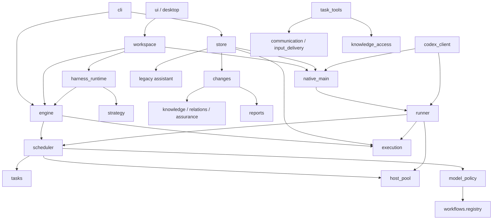

# PMRS-Next 第一阶段架构审计报告

**性质：静态架构审计与设计建议；不是新版本实现、运行验收或科研结论。**  
**日期：2026-10-11**  
**仓库：** `ZhiyaoXiongMath/Pure-Math-Research-Studio`  
**分支：** `4.2.2-preview`  
**固定提交：** `e4de0210f9985224e030ac4cfd2f7e2904005b37`  
**固定树：** `c17a592ff0a4906afa7a6423535f41c67c926128`  
**需求基线：** `PMRS-Next-Development-Guide.zh-CN.md`，SHA-256：`1d9ac66c7d8758e0eb269370ca84e1f780ee37bd85144b2e43957abdc57394bb`。

配套文档：[实施计划与接口设计](02-Implementation-Plan.zh-CN.md) · [源码清单与审阅覆盖](03-Source-Inventory.zh-CN.md)。

---

## 0. 决策摘要

**建议重构，但不建议把“采用一个成熟框架”当成这次重构的主要目标。**

4.2.2 已经具有不可丢失的科研语义和恢复约束：每实例独立 MAIN、动态职责选择、原始输出先保存后接纳、范围化数学资格、用户授权、UNKNOWN 保留、原目标与 D0 边界。真正需要改变的是这些职责目前混杂在 Store、执行器、工作区、Codex 原生适配器及展示服务之间的依赖关系。[R-architecture] [R-execution] [R-scheduler]

本报告建议的架构为：

```text
Codex / CLI / 受限 MCP 客户端
                 │
         查询与显式命令接口
                 │
     应用层：授权、事务、唯一 MAIN、执行准入
         ┌───────┴────────┐
         │                │
   独立数学领域内核    可替换编排引擎
         │                │
   权威证据/知识状态    统一 Agent Runner
                          │
              托管 Agent 后端 或 模型/API Provider
```

优先级不是“先换框架、再修行为”，而是：

**纯查询和诊断 → 契约与依赖边界 → 内核/存储/执行解耦 → 无界面后台服务 → 快慢数学闭环 → 删除 Web UI → 基于证据决定框架与后端采用。**

### 0.1 本次最重要的五项发现

| 发现 | 已核对的事实 | 对重构的影响 |
|---|---|---|
| 助手入口并非现成可用 | `assistant.py` 尚在，但 Store、执行准入、模型策略均拒绝新 `PROJECT_ASSISTANT` 工作 | 新观察/讨论会话必须建立新入口；只能有选择地复用历史数据和辅助函数 |
| 查询并非全部无副作用 | `host_pool.status()` 使用可写 ledger，执行 `_clean()`，可能写回全局资源池 | 必须拆分 `read_status` 与 `reconcile_pool`；不能直接把现有状态函数宣称为严格只读 |
| 存储与原生运行时耦合 | `store.py` 导入 `native_main` 的集合定义，并直接提供原生事件提交入口 | 需要依赖反转；不应让数学内核或纯查询依赖 Codex 原生运行时 |
| MAIN 不是普通 API 调用 | 原生 MAIN 依赖带根轮次准入补丁的 app-server 及匹配 sidecar | 不能用 stock Codex、LangGraph 重试或另一个模型 SDK 无验证替换 |
| “快数学”闭环仍缺接口 | 已有战略路线/检查点，但知识入口仍以记录前缀导航为主；缺少完整模块—连接—落实—回写契约 | 必须升级领域模型及实际任务输入/输出，不能仅添加 overview.md |

上述事实分别见 [R-store]、[R-execution]、[R-policy]、[R-pool]、[R-native]、[R-access]。它们是静态代码事实；尚不意味着每个风险都已在实际运行中复现。

### 0.2 本阶段明确没有做的事情

没有提交仓库代码、创建实际 PR、运行 PMRS、导入正式科研项目、改变 MAIN/Goal、恢复 HSC 项目、构建原生二进制或调用研究模型。没有运行仓库测试；没有把历史测试报告当成本阶段验收结果。文中的 PR 编号全部是规划编号。

本次使用已连接 GitHub 读取固定版本代码与目录，并读取用户提供的指南。通用框架部分依据当日获取的官方文档。未获得完整本地 checkout，因此**没有生成全仓 AST 调用图、完整传递依赖锁文件或可执行环境 SBOM**。附录对每个模块标明审阅深度；“目录盘点完整”不等于“每行实现都已经审查”。

---

## 1. 审计证据和覆盖边界

### 1.1 四种结论标签

| 标签 | 含义 | 允许的措辞 |
|---|---|---|
| **V：源码已核对** | 固定提交的源码、配置或目录直接支持 | “该函数调用……”“该分支拒绝……” |
| **D：文档陈述已核对** | 仓库或官方资料这样描述，但未独立运行复现 | “仓库报告曾观察到……”“官方文档描述……” |
| **I：架构推断** | 由已核对依赖/状态路径推导出的风险或收益 | “可能导致……”“因此建议……” |
| **T：待测试** | 需要执行、环境、负载或独立数学检查才能回答 | “尚未验证”“验收需覆盖……” |

设计建议统一标为 **P**。不以源文件存在、测试名称存在或模型输出格式合法替代运行证据。

### 1.2 覆盖范围

完整列出 `research_studio/` 顶层 **69 个 Python 模块**及 `workflows/` **5 个模块**，并分类安装/构建脚本、测试族、原生资源、schema 和 UI 资产。74 个 Python 文件的 Git tree 元数据大小合计为 **1,560,557 字节**；这是源码字节数，不是行数、代码复杂度或测试覆盖率。[R-tree] [R-workflow-tree]

针对状态读写、科研接纳、原生 MAIN、执行恢复、资源池、模型策略、方法注册、知识入口和 UI/工作区启动等关键路径进行了定向源码阅读。其余模块的归属建议通过目录、架构文档及已读调用点交叉定位，内部实现仍需后续逐函数核对。详见配套清单的 E/H/D/T 级别。

### 1.3 对既有指南的一项纠正

原指南提出“复用 assistant 与报告服务”作为早期安全讨论入口的基础。进一步读取发现：

```text
Store.commit_assistant
    拒绝创建/授权/提交新的助手工作
execution 的 RESERVE
    拒绝 PROJECT_ASSISTANT
model_policy.resolve_assistant
    无条件返回 PROJECT_ASSISTANT_REMOVED 错误
```

因此准确表述应改为：**复用可验证的历史记录、报告定位及部分查询辅助逻辑；重新设计并实现观察/讨论角色的准入与权限。**不能把 legacy assistant 直接打开作为新版 observer。[R-store] [R-execution] [R-policy]

---

## 2. 当前系统的职责分布

### 2.1 六个用户关注层面，以及两个需要单列的层面

| 层面 | 当前主要位置 | 审计判断 | 建议归属 |
|---|---|---|---|
| 数学领域逻辑 | `knowledge`, `relations`, `assurance`, `obligations`, `changes`, `workflows/*`, `workflow_instances` | 类型、证据和职责已有实质内容；部分函数同时读取运行和授权状态 | `domain/` 加应用层接纳服务 |
| 通用编排 | `scheduler`, `runner`, `engine`, `autoflow`, `harness_runtime`, `research_plans` | 就绪判断、资源公平、事件唤醒、线程池、执行恢复分散 | `application/` 和 `orchestration/` |
| Codex 专有运行时 | `native_main`, `codex_client`, `runner`, `main_recovery`, `task_tools` | 原生 Goal、RPC、权限参数、根轮次门控和模型能力检测深度耦合 | `adapters/codex/` |
| 模型接口 | `model_policy`, `codex_client`, `runner` | 角色配置与 Codex 命令编码混合；不是通用 Provider 层 | 角色要求 + 明确模型选择 + Provider/Runner 适配 |
| 状态存储 | `store`, `util`, `portability`, `archive`, `host_pool` | 权威 journal/blob；SQLite 是派生投影；全局资源另有文件账本 | 存储端口、单一事务边界、独立全局资源服务 |
| UI | `ui`, `desktop`, `workspace`, `static`, `localization`, 安装器 | 工作区既有界面行为又有后台维护，不能整块删除 | 删除表现层；先提取服务 |
| 科研知识组织与上下文 | `strategy`, `research_audit`, `context`, `input_plans`, `main_*`, `knowledge_access` | 已有路线与战略记忆；尚非完整快数学层 | 第一类快层对象 + 输入规划服务 |
| 报告与可观测性 | `views`, `activity`, `usage_ledger`, `incidents`, `reports`, `report_catalog`, `render` | 报告/日志/数学状态/运行状态有区别，但入口和解析仍混合 | 查询投影、诊断、报告服务、渲染适配器 |

分类为重构归属建议，不表示现有模块能原封不动搬入目标目录。

### 2.2 必须保留的既有强项

**MAIN 的科学决策权已经有实现基础。** `scheduler.validate_consumer_control()` 要求阶段工作来自真实 MAIN 提案，路线被停放、替换或耗尽时阻止未发工作；`workflows.registry` 明确禁止 `automatic_next`。这不是需要从零发明的职责体系。[R-scheduler] [R-registry]

**证据接纳与执行结束已经分开。** 执行层先保存原始 capture，再做接纳；接纳结果还区分 accepted、stale、contract rejection 与 exact duplicate。`changes.live_check()` 对精确输入、有效支持、来源版本、写集合和职责版本进行检查。[R-execution] [R-changes]

**恢复已经具有保守边界。** UNKNOWN 不被当作未发；原始 capture 可重新接纳而不重采样；格式修复不能改科学内容；已暂停实例可接收满足规则的已封存阶段输出，但不能因此应用新的 MAIN 计划。[R-execution] [R-changes]

**用量未知被真实表达。** `usage_ledger` 把计数未知、父子计量关系未知及内部请求数量不可见分别保存；它不把缓存 token、推理 token 再加到总量上，也不无依据合计父子线程。[R-usage]

这些不是“框架重复代码”可以随意删去的部分。框架可以承接执行机制，但必须通过相同契约保留这些语义。

---

## 3. 依赖盘点：零 Python 依赖不等于零运行依赖

### 3.1 声明、实际环境与待核实传递依赖

| 依赖族 | 已核对内容 | 当前作用 | 重构处理 |
|---|---|---|---|
| Python 包元数据 | `requires-python >=3.11`，`dependencies=[]`；构建使用 `setuptools>=68` | 核心应用及打包 | 核心保持轻依赖；框架、后端、报告依赖使用 extras 或独立包 |
| Python 标准库系统能力 | `fcntl`、`subprocess`、`threading`、`socket`、`sqlite3` 等出现在核心执行/存储路径 | 文件锁、线程池、RPC、派生索引 | 将 OS 能力隔离为适配器；不能宣称现版跨平台 |
| 官方 Codex CLI | 代码调用能力目录、调试输入、沙箱、认证及阶段任务执行 | 阶段 Agent 与能力验证 | 保留精确版本/能力证据；查询路径不能自动探测或登录 |
| 修改后的 app-server | 固定上游源码提交及 PMRS root admission patch | 持久 MAIN、原生 Goal 与采样前预算准入 | 独立 adapter 包与能力验收；不能静默 stock fallback |
| `codex-code-mode-host` | 需要独立 hash、匹配 manifest；仓库说明 candidate22 来自官方 0.160.0 分发 | 原生 code-mode 配套 | 与 app-server 分开记录来源；兼容性待实机验证 |
| 原生构建链 | Linux x86_64、C/C++、Rust 工具链、pkg-config、OpenSSL headers、curl/tar/patch、网络和空间 | 构建修改后的原生程序 | 可选发行层；纯读/领域测试不应要求构建它 |
| 报告工具链 | `tectonic`, `pdfinfo`, `pdftotext`, `pdftoppm`, `fc-match`, `bwrap`；代码还使用 `prlimit`、seccomp、字体及 CA 资源 | 安全离线 PDF 渲染与检查 | 与数学研究核心完全可选；Markdown 状态查询不应因其缺失失败 |
| 浏览器/桌面/JS 资产 | HTTP reader、网页资产、桌面启动器；仓库说明保留数学渲染资产及许可 | 原有 UI | 达到 CLI 功能等价后删除；科研正文与报告数据保留 |
| CI / 测试环境 | 手动 `workflow_dispatch`；指定 self-hosted Linux x64、Ubuntu 26.04 标签及 browser evidence 输入 | 当前产品验收与打包流程 | 新增脱离浏览器/原生模型的离线核心 CI；不把旧 gate 原样套到 headless 产品 |

源码依据：[R-pyproject] [R-runner] [R-client] [R-native-doc] [R-render] [R-ci]。

原生文档说明，匹配源码的 sidecar 构建曾遇到 `rusty_v8` 150.4.0 归档 404。**这是仓库报告的构建事实，不是本次独立复现。**本阶段没有验证这些依赖在用户机器上的安装状态、漏洞状态或完整传递版本。[R-native-doc]

### 3.2 不应在本阶段下的结论

不能由 `dependencies=[]` 推出系统维护成本低，也不能由引入 LangGraph 就推出稳定性会提高。前者忽略自建运行时与系统依赖；后者忽略节点重放、副作用、版本升级、双层状态机和权限映射的新增成本。

不能宣称已有完整 SBOM、全部许可证审计或所有依赖不存在漏洞。后续应离线收集源包/锁文件/二进制 manifest，并把运行需要、开发需要、渲染需要和仅 UI 需要分开。

---

## 4. 当前依赖图与关键执行路径

### 4.1 手工核对的依赖子图

以下箭头表示导入或调用，不表示全部运行都发生，也不表示循环导入一定导致启动错误。包含函数内的延迟导入；不是自动生成的全仓 AST 图。



依据：上述对应源文件的 import、`Store.commit*`、`harness_runtime.advance`、`codex_client.derive_task_input_evidence`、`native_main._workspace_permissions` 等函数。[R-store] [R-changes] [R-harness] [R-client] [R-native] [R-tools]

该图揭示的是**职责边界穿透**：存储知道原生后端；模型策略知道命令行；工作区知道后台唤醒；科学接纳又知道报告及实例运行许可。解决办法是拆纯规则与应用事务，而不是仅批量移动文件。

### 4.2 一次研究任务的现有主干

```text
用户明确授权 / 有效 MAIN 决策
    → 职责与依赖就绪判断
    → 冻结任务、材料、模型配置及精确输入
    → PREPARE / 原始调用身份与额度占用
    → 资源池、控制版本和执行准入
    → RESERVE
    → Codex 阶段 CLI 或持久原生 MAIN
    → SENT / UNKNOWN
    → 原始 CAPTURE 与输入窗口封存
    → 科学接纳 / 拒绝 / 精确重复
    → 路线、职责、报告、研究检查点更新
    → 新事件决定是否唤醒同一 MAIN
```

这条链已经有明确的身份和原件约束。新编排引擎应该围绕这些边界工作，不能绕过 PREPARE/准入直接启动模型，也不能把框架节点完成当成科研任务合格。[R-execution] [R-scheduler] [R-harness]

### 4.3 三类“检查点”必须拆清楚

| 对象 | 作用 | 是否数学证据 | 是否可随缓存清理 |
|---|---|---|---|
| Store 回放 checkpoint | 加速从 journal 重建投影 | 否 | 在保留可回放依据后可以 |
| MAIN research checkpoint | 已发布的研究综合、路线与指导记忆 | 不是证明本身，但属于正式研究记录 | 不可以按缓存删除 |
| 框架 execution checkpoint | 恢复执行节点、游标、等待状态 | 否 | 按框架生命周期管理；不能删除仍需恢复的状态 |

已有 Store checkpoint 与 MAIN checkpoint 的区别应保持；未来 LangGraph checkpointer 不能替代任一正式证据记录。[R-store] [R-architecture] [F-persistence]

---

## 5. 发现登记册

优先级表示重构风险排序，不是对用户项目正在发生事故的断言。

### F01 — Store 与 Codex 原生后端没有隔离〔V，高〕

**事实。** `store.py` 顶层导入 `native_main.MAPS`，`commit_native_main()` 直接使用原生 reducer。其他提交入口又直接调用策略、报告、执行和助手模块。[R-store]

**推断。** 替换后端、单独部署读取器、跨平台运行纯领域测试，都会触及本应稳定的存储模块。

**处理。** 先提取纯事件类型与 reducer 注册表，由 composition root 注入；保留当前 journal 的事务与精确身份。禁止 domain 导入 adapters；不同时更换数据库格式。

**待测。** 静态 import-boundary gate；无 Codex、无 PDF、无 UI 环境下导入 domain 和只读查询包；旧 journal 回放一致性。

### F02 — 旧项目助手被显式停用〔V，高〕

**事实。** 新助手工作在 Store、execution、model_policy 三处受阻；保留代码不等于保留有效产品入口。[R-store] [R-execution] [R-policy]

**处理。** 将历史读取隔离为 legacy reader；新建 observer/advisor 协议。禁止靠删除 `PROJECT_ASSISTANT_REMOVED` guard 恢复旧写权限。新角色不能继承 MAIN 身份、resume、budget 或科学接纳能力。

**待测。** 历史助手可读；新 observer 无修改正式项目能力；任何提案不自动成为 human command。

### F03 — 状态查询包含维护副作用〔V，高〕

**事实。** `host_pool.status()` 进入 `ledger('model-pool')` 并调用 `_clean()`。ledger 会创建 runtime 目录/锁并在数据变化时写回；`_clean()` 更新资源池和失活 demand。[R-pool]

**准确影响。** 这里证明的是全局运行账本可能被查询更新，**不是**查询直接修改数学正文。`workspace` 的进展路径调用该服务，因此不能给观察会话简单套上“只读”标签。

**处理。** 把只读 `read_pool_snapshot()` 与显式 `reconcile_pool()` 分开。默认状态读取只报告观测时间、缺失和陈旧，不自动修复。

**待测。** 查询前后对项目和全局 runtime 的文件内容/文件集合做比较；首次查询、陈旧 owner、缺失 ledger、权限只读四类场景均不得创建或写回文件。

### F04 — Web 工作区承担后台维护〔V/I，高〕

**事实。** `workspace.start_maintenance()` 的循环读取项目，调用 `native_main.sync_pending()`、`harness_runtime.maintenance()` 并按就绪信号启动执行；工作区还维护动作回执与线程任务。[R-workspace]

**推断。** 删除工作区或其启动路径而没有移交这些职责，会遗漏同步、事件唤醒或动作恢复。是否具体导致某个实例停滞尚未运行验证。

**处理。** 先提取独立 SupervisorService；Web 与 CLI 都只能是客户端。定时器只观察或产生 due event，不直接决定科研阶段，更不以付费 MAIN 调用充当轮询。

### F05 — Runner 与 Model Provider 的概念尚未分开〔V，高〕

**事实。** `model_policy` 把角色/用途映射到仓库固定模型配置，并定义 `codex_arguments()`；`codex_client` 混合登录、目录探测、沙箱探测和输入测量；`runner` 混合进程、权限、任务冻结物、资源池、捕获与协调。[R-policy] [R-client] [R-runner]

**处理。** 分离 RoleRequirements、AuthorizedModelSelection、AgentRunner、ModelProvider。保留当前配置为显式 legacy policy，不能因新后端不认识 `ultra` 就自行改成 `high`。

**重要边界。** 仓库里的模型名称和 effort 是固定配置事实，**不构成本阶段对公共 API、用户套餐或模型权限的验证**。

### F06 — 原生 MAIN 有需要逐项迁移的专有语义〔V/D，高〕

**事实。** `native_binary()` 检查 app-server、code-mode-host 和 manifest；原生 root turn 绑定当前 reservation、control version 和原始 thread/turn；Goal 身份使用线程、创建时刻及 objective hash，而非一个通用 opaque Goal ID。[R-native]

**文档事实。** app-server 来源与 sidecar 来源不同；源码分支不包含已编译程序。[R-native-doc]

**处理。** 将 logical MAIN/ResearchGoal 与 backend binding 分开。新后端必须声明能否持久恢复、运行中指导、观察取消、门控自主续轮；缺能力时明确阻塞。不能用当前官方 App Server 有 steer/interrupt 接口，推导它已经具备 PMRS 的全部 root-gate 语义。[F-codex]

### F07 — UNKNOWN 处理应保留，而不是交给通用重试覆盖〔V，高〕

**事实。** scheduler 对 UNKNOWN 保留原 reservation；host pool 保留槽位；执行层不把 UNKNOWN 改回 PREPARED 并直接重发。[R-scheduler] [R-pool] [R-execution]

**处理。** 明确区分未发送、可能已发送、已确认开始、已结束但未捕获、已捕获未接纳。只允许凭原始证据消除不确定性。框架 retry、SDK retry、PMRS retry 不能各自对同一外部副作用负责。

**待测。** 外部已接收、客户端未持久化回执时崩溃；恢复不得产生第二次真实调用。没有供应商幂等保证时，不能承诺外部 exactly-once。

### F08 — 预算单位容易在引入 API 后被偷换〔V/I，高〕

**事实。** 当前授权主要以 PMRS top-level request 为单位；内部原生委派不占阶段池，且用量可能只能局部观察。[R-scheduler] [R-usage] [R-policy]

**推断。** 若把“一个 Agent 调用”改成“一个 inference 请求”却沿用原预算数字，资源授权含义会改变。

**处理。** Grant 必须记录 unit、scope、owner、累计使用、未决 reservation 和上层/下层包含关系。不同后端的调用次数不直接比较；没有价格和完整用量就不制造货币成本。现行 8/20 阶段资源政策应迁为配置化兼容 profile，不能顺手改为新的数值。

### F09 — 快数学入口不是已有检索缓存的同义词〔V/I，高〕

**事实。** 知识导航明确以有限前缀/关键词为基础，并公开 `BOUNDED_PREFIX_NAVIGATION_ONLY`；已有战略检查点与路线不等于成熟模块的输入/输出和落实契约。[R-access] [R-architecture]

**补充事实。** `relations.py` 已有 IMPLIES、EQUIVALENT_ON_SCOPE、BOUND_TO_ARGUMENT 等类型及依据绑定；`assurance.py` 明确按精确范围与消费者职责检查，且声明自己不是自然语言真值判定器。因此不应把现有系统说成“没有关系/资格模型”。新版要补的是可调用模块、机制表达、项目适用性和实际派工回写层，而非另造一套不兼容的证据规则。[R-relations] [R-assurance]

**处理。** 新增 KnowledgeModule、Transition、ResearchMap、Frontier/Probe、ReaderProfile、RefinementBinding。检索索引可重建，模块与连接的精确作者版本不可作为缓存随意丢弃。

**待测。** 超出前缀的查询、超过索引上界的引用、项目适用性未检查的成熟定理、条件结论压缩成无条件结论。

### F10 — 路线写入与通用搜索的集合名不一致〔V/I，中高〕

**事实。** 策略/调度读取 `research_routes`；`knowledge_access.search()` 的组织导航集合列举的是 `routes`、`strategy_routes`、`attempt_accounts`、`incidents`。[R-scheduler] [R-access] [R-strategy]

**推断。** 若没有其他同步投影，该通用搜索入口不会直接枚举新路线。这里不宣称 MAIN 通过其他输入一定看不到路线。

**处理与测试。** 为写入真实 research_routes 后的授权查询增加回归；使用单一类型化查询服务，避免再添加一个同名但不同义的路线索引。

### F11 — 状态一致性需要明确多时点来源〔V/I，中高〕

**事实。** 部分读路径显式冻结 snapshot；workspace 的综合进展又调用全局资源、协调器及其他服务。原生视图已经区分 desired 与 observed。[R-ui] [R-workspace] [R-native]

**推断。** 把这些不同时间和来源的数据包装为一个“当前状态”容易误导。并发下出现具体不一致还需要复现。

**处理。** 每个视图提供 `project_commit`、`runtime_observed_at`、`source_cursors`、`coverage`、`stale`。不能为了表现为一个时间点而伪造一致性。全局资源与项目 journal 没有天然的共同原子快照。

### F12 — 只读检查、无推理探测、维修是三种操作〔V，中高〕

**事实。** `codex_client.isolation_probe()` 和 `runner.doctor()` 会启动本地 CLI/沙箱探测；它们被设计为无模型推理，但并非纯文件读取。[R-client] [R-runner]

**处理。** 新 CLI 分为 `doctor --offline`、显式 `doctor --probe-local` 和受授权的 recovery apply。无模型推理不能被写成没有进程/没有本地副作用。观察角色默认只具备第一类权限。

### F13 — 巨型跨职责模块增加改动波及面〔V/I，中〕

**事实。** Git tree 中 `reports.py` 94,644 字节、`survey.py` 74,955、`execution.py` 67,575、`changes.py` 64,560、`strategy.py` 64,011、`workspace.py` 52,139；其中关键模块已读到多类职责。[R-tree]

**推断。** 这些位置很可能是接口抽取的主要收益点，但文件大小本身不是缺陷或性能结论。

**处理。** 按事务、纯校验、传输和投影边界拆，不按“每个文件最多 N 行”机械切分。保留公共 facade，逐批迁移调用者。

### F14 — 现有 CI 不能直接充当新版验收〔V/D，高〕

**事实。** 工作流是手动触发的指定 self-hosted Ubuntu 26.04 产品 gate，要求实际 browser evidence；并非每次 PR 都运行的无模型核心 CI。[R-ci]

**文档事实。** candidate22 的报告明确：仅一个真实 HSC TRH 实验，数学 OPEN、后续暂停；FDH、SURVEY、大量恢复/并发/渲染分支未建立实测验收。[R-validation]

**处理。** 建立离线核心回归、适配器契约、故障注入和产品无界面验收。历史 coverage JSON 与测试源文件保留为待重验输入，不作 PASS。

### F15 — 快层与通用 Agent 记忆具有不同的资格要求〔P，高〕

通用摘要、长期记忆、todo list 或框架 filesystem 可以帮助导航，但不能成为独立数学依据。快层必须保留精确范围、条件、量词、参数依赖和共同见证；一项支持被撤回只使下游支持失效，不自动证明结论为假。

MAIN 可以做短小数学核对，但其主要工作是形成机制/路线/判别性任务。worker 同一次提交同时携带详细数学与 `fast_layer_delta`；缺少快层变化说明应标明交付不完整，而不是丢弃已经保存的数学原件。详见实施计划中的领域契约。

---

## 6. 框架重叠分析与中立选型

### 6.1 先区分层级

官方资料将 LangGraph 定位为低层、持久的有状态编排运行时；Deep Agents 在其上提供 Agent harness 能力。二者不是同一层级的两个完全等价替代品。LangGraph 不要求必须使用 LangChain 的模型抽象。[F-langgraph] [F-deepagents]

**P：PMRS 应允许只采用编排引擎，也允许只在某类 worker 中采用更高层 harness。**不要把领域内核、外层 MAIN、内层 agent loop、模型 SDK 全部绑成一次选择。

### 6.2 重叠能力与不可替代职责

| 当前自建能力 | 成熟框架可提供什么 | 可迁移范围 | 仍必须由 PMRS 保有 |
|---|---|---|---|
| 执行状态、等待、重启 | LangGraph 的持久状态与中断 | 运行图位置、等待句柄、执行检查点 | 当前授权、原始调用身份、UNKNOWN 判定 |
| 动态任务扇出、合流 | 图路由、子图、Agent 子任务 | 已授权工作项的执行机制 | MAIN 的数学决策及科学依赖与完成依赖区别 |
| 工具注册与 Agent loop | Deep Agents/LangChain 的模型和工具编排 | 受约束 worker 的 loop、工具包装 | 工具授权、证据接纳与真实输入送达 |
| 上下文压缩、文件卸载 | Deep Agents 的上下文与 filesystem 能力 | 工作缓存、草稿、导航 | 精确数学输入、完整源文、独立评审隔离 |
| 人工审批与恢复 | 框架 interrupt / resume | 交互机制 | 谁能授权、授权范围、预算、P14/D5 语义 |
| 流式输出与 tracing | 框架事件流；可选观测平台 | 适配器事件和诊断可视化 | 权威本地事件、数学状态与隐私控制 |
| 长期记忆 | 跨线程 memory/store | 非权威检索辅助 | 六类证据、快层作者版本、落实关系、撤销传播 |

前两列的框架能力见 [F-langgraph] [F-deepagents] [F-persistence] [F-subagents]；后两列是本报告的设计边界，不是声称框架原生实现 PMRS 资格规范。

### 6.3 四个候选方案

| 方案 | 预期收益〔I〕 | 迁移成本/风险〔I〕 | 本报告建议〔P〕 |
|---|---|---|---|
| A. 现有机制提取为最小 Legacy Engine | 最小语义变化，保留原生 MAIN 和证据链；形成比较基线 | 自建线程、调度、恢复仍需维护 | 必须有此过渡基线；不把它预先宣布为最终赢家 |
| B. LangGraph Engine + PMRS kernel + Codex Runner | 可复用持久执行/中断/流式机制，领域接口保持独立 | 双重 checkpoint、节点重放、外部 Codex 进程/Goal 的生命周期映射 | 值得优先做离线适配试验；通过硬门槛再决定采用 |
| C. Deep Agents 作为受控 AgentRunner | 减少模型 loop、上下文卸载、部分委派工具维护 | 默认工具/记忆/中间件/子任务权限可能与 PMRS 冲突；引入更多行为约定 | 先评估专向 worker 或 observer；不能直接替换科研主控及资格体系 |
| D. DeepSeek Harness 作为替代运行后端 | 插件式工具、会话与模型适配，已有 headless/SDK 方向 | developer preview；外部 Codex 子执行与可继续本地会话语义不同；跨语言集成成本 | 保留端口；不是本轮前置依赖，也不承诺零成本互换 |

DSH 能力与限制依据官方仓库 README、architecture 和 subagent 文档；这是资料核对，未做兼容性执行。其链接指向查阅时的 master，并未与 PMRS 一样固定到已验证的兼容提交。[F-dsh] [F-dsh-architecture] [F-dsh-subagents]

### 6.4 两个不能被“框架成熟”掩盖的风险

**节点恢复不等于远端调用恰好一次。** LangGraph 文档明确，中断恢复会从节点开头重新执行。因此，调用前的副作用需要幂等设计；框架的持久机制不能自行判断一个未收到回执的 Codex/API 调用是否已经发生。[F-interrupt]

**工具权限不等于完整隔离。** Deep Agents 文档说明，filesystem permissions 只覆盖内建文件工具，不覆盖自定义/MCP 文件工具，也不覆盖能任意执行命令的 sandbox backend；规则是 first-match、未匹配默认允许。其子任务工具、中间件、权限等具有不同继承规则。PMRS 必须建立闭合的权限边界，不可只给 `read_file` 套一层配置。[F-permissions] [F-subagents]

### 6.5 采用决策门

在相同离线任务轨迹上对比 A/B/C，而非让不同框架各跑一个随机数学问题后比较“谁证明得好”。

必须先全部满足：单一 MAIN owner、控制与预算不可绕过、UNKNOWN 不盲重发、原件身份不丢失、暂停/正式 D5/P14 语义一致、独立性不被上下文继承破坏、快慢层资格不提升、只读查询无副作用。

随后比较适配代码复杂度、第三方依赖面、维护边界、恢复可解释性和操作步骤。运行时延迟、吞吐、成本、真实科研质量均属待测指标；本报告不提供虚构分数或性能百分比。

若一个框架只能通过更改数学资格、静默禁用现有原生能力，或加入第二个 MAIN 才运行，应暂不采用。若最小 Legacy Engine 在验收后更简单且足够稳定，也可保留。

---

## 7. 目标架构的不可变约束

### 7.1 科研控制

每个 TRH/FDH 实例一个逻辑 MAIN；任意时刻最多一个有效控制代次。TRH 固定原目标；FDH 固定 D0 范围。阶段是职责，不是硬编码顺序。SURVEY 暂时保留已有产品语义，不因重构擅自并入 MAIN。

P9/P12/D4 的独立性取决于实际输入与暴露，不取决于“另开线程”或使用不同模型。完成一个工具调用、Agent turn 或框架 graph，不代表 Goal 完成。

### 7.2 存储与接口

数学/授权真相留在 PMRS 的版本化领域记录和控制账本。框架内部状态只负责恢复执行，不能成为人类授权或数学结论的来源。

存储适配器可以替换，但初期保留当前 journal/blob 身份与原子提交边界。把全部正文复制到另一个框架 state/store 再让二者互相覆盖，会制造双重真相，应禁止。

### 7.3 稳定性

恢复先判定原始事实，再决定是否有合法下一动作。租约失效不等于原生进程已停止；通信超时不等于调用未发生；取消请求成功送达不等于所有已启动工具都被撤销。

查询与维护分离。只读入口无需实例 ACTIVE、无需模型可用、无需原生 MAIN 可连接，更不能自动恢复项目。

### 7.4 快慢数学

快层不是幻觉许可，也不是只能写已知定理的静态目录。允许探索性节点和箭头，但必须清楚标明未知、条件和判别性检验。checked 必须指定支持依据、适用范围及版本当前性。

应能把每个重要快层主张展开到慢层证据；同时能从每次慢层成果得知路线和下一步选择发生了什么变化。默认读者基础为数学本科通用基础及相关方向博士低年级基础，具体 ReaderProfile 应列出专项入口和项目特有定义。

---

## 8. 风险、未决事项与进入下一阶段的条件

| 未决事项 | 当前证据 | 关闭条件 |
|---|---|---|
| 全仓函数级依赖和实际不可达 legacy 范围 | 模块清单及关键路径 | 在隔离源码 checkout 上做不导入产品的 AST 扫描和人工核对 |
| Store、资源池及进程锁的完整崩溃边界 | 已读锁/提交/UNKNOWN 实现 | 故障注入、文件损坏、并发与重复回执测试 |
| 指定 native pair 与用户环境兼容性 | manifest 检查实现和仓库报告 | 明确授权后的隔离环境准入；不能把当前报告当实测 |
| LangGraph/Deep Agents 是否减少维护成本 | 官方能力、接口差异 | 固定依赖版本的离线适配试验及对比 ADR |
| Observer 的真正隔离性 | 新设计；旧助手停用事实 | OS/工具/MCP/子任务/网络各路径拒绝测试 |
| 快层语义是否忠实 | 指南与拟议数据契约 | 类型化负例 + 必要的数学语义审核；不是 schema-only 判定 |
| 新无界面程序能否长期稳定推进 | 设计和已有有限实验报告 | 后续明确授权的新测试实例运行；本阶段不启动 |
| 数据迁移与活动 native Goal 的处理 | 保留原件/暂停原则 | 只在副本测试；跨后端 rebind 有明确人工授权及 fencing |

**建议下一阶段先授权 PR-01–03：源码级依赖补全与安全测试入口、统一契约、纯查询拆分。**最小内核抽取列为其后的 PR-04。框架正式采用、数据库格式迁移、真实项目迁移和付费科研评估分别设授权门，不捆绑成“一次升级全部允许”。

---

## 9. 来源索引

代码链接全部固定到本次提交。函数定位是审阅入口，不声称已经完成该文件每一行的检查。外部框架链接为 2026-10-11 获取的官方文档；上线实现前仍需固定实际使用的包版本与 hash。

| 来源 ID | 来源及核对用途 |
|---|---|
| F-codex | [OpenAI Codex App Server 官方接口；文档可能重定向至 learn.chatgpt.com](https://developers.openai.com/codex/app-server/) |
| F-deepagents | [Deep Agents 官方 harness 定位](https://docs.langchain.com/oss/python/deepagents/overview) |
| F-dsh | [DeepSeek Harness 开发预览声明](https://github.com/deepseek-ai/deepseek-harness/blob/master/README.md) |
| F-dsh-architecture | [DeepSeek Harness 插件、headless/SDK 结构](https://github.com/deepseek-ai/deepseek-harness/blob/master/docs/architecture.md) |
| F-dsh-subagents | [DeepSeek Harness 本地可续会话与外部执行区别](https://github.com/deepseek-ai/deepseek-harness/blob/master/docs/subsystems/subagent.md) |
| F-interrupt | [LangGraph interrupt/resume 重放与副作用](https://docs.langchain.com/oss/python/langgraph/interrupts) |
| F-langgraph | [LangGraph 官方架构定位](https://docs.langchain.com/oss/python/langgraph/overview) |
| F-permissions | [Deep Agents 文件权限适用边界](https://docs.langchain.com/oss/python/deepagents/permissions) |
| F-persistence | [LangGraph 持久状态与检查点](https://docs.langchain.com/oss/python/langgraph/persistence) |
| F-subagents | [Deep Agents 子任务与继承规则](https://docs.langchain.com/oss/python/deepagents/subagents) |
| R-access | [授权知识读取、前缀导航、路线查询集合](https://github.com/ZhiyaoXiongMath/Pure-Math-Research-Studio/blob/e4de0210f9985224e030ac4cfd2f7e2904005b37/research_studio/knowledge_access.py) |
| R-architecture | [总体架构与证据边界](https://github.com/ZhiyaoXiongMath/Pure-Math-Research-Studio/blob/e4de0210f9985224e030ac4cfd2f7e2904005b37/ARCHITECTURE-4.2.2.md) |
| R-assurance | [范围化检查、条件角色与资格](https://github.com/ZhiyaoXiongMath/Pure-Math-Research-Studio/blob/e4de0210f9985224e030ac4cfd2f7e2904005b37/research_studio/assurance.py) |
| R-changes | [科学接纳、live_check、暂停 capture 的窄例外](https://github.com/ZhiyaoXiongMath/Pure-Math-Research-Studio/blob/e4de0210f9985224e030ac4cfd2f7e2904005b37/research_studio/changes.py) |
| R-ci | [指定 self-hosted 验收入口](https://github.com/ZhiyaoXiongMath/Pure-Math-Research-Studio/blob/e4de0210f9985224e030ac4cfd2f7e2904005b37/.github/workflows/final-candidate.yml) |
| R-client | [本地能力探测与实际输入测量](https://github.com/ZhiyaoXiongMath/Pure-Math-Research-Studio/blob/e4de0210f9985224e030ac4cfd2f7e2904005b37/research_studio/codex_client.py) |
| R-execution | [原始调用、UNKNOWN、capture 与接纳生命周期](https://github.com/ZhiyaoXiongMath/Pure-Math-Research-Studio/blob/e4de0210f9985224e030ac4cfd2f7e2904005b37/research_studio/execution.py) |
| R-harness | [MAIN 事件准入及真正输入 criterion](https://github.com/ZhiyaoXiongMath/Pure-Math-Research-Studio/blob/e4de0210f9985224e030ac4cfd2f7e2904005b37/research_studio/harness_runtime.py) |
| R-native | [原生 MAIN、Goal 与门控](https://github.com/ZhiyaoXiongMath/Pure-Math-Research-Studio/blob/e4de0210f9985224e030ac4cfd2f7e2904005b37/research_studio/native_main.py) |
| R-native-doc | [原生 pair 来源、构建与已报告限制](https://github.com/ZhiyaoXiongMath/Pure-Math-Research-Studio/blob/e4de0210f9985224e030ac4cfd2f7e2904005b37/docs/NATIVE-RUNTIME.md) |
| R-policy | [模型策略与 Codex 参数](https://github.com/ZhiyaoXiongMath/Pure-Math-Research-Studio/blob/e4de0210f9985224e030ac4cfd2f7e2904005b37/research_studio/model_policy.py) |
| R-pool | [全局资源池、status/ledger/_clean](https://github.com/ZhiyaoXiongMath/Pure-Math-Research-Studio/blob/e4de0210f9985224e030ac4cfd2f7e2904005b37/research_studio/host_pool.py) |
| R-pyproject | [Python 包、入口与依赖声明](https://github.com/ZhiyaoXiongMath/Pure-Math-Research-Studio/blob/e4de0210f9985224e030ac4cfd2f7e2904005b37/pyproject.toml) |
| R-registry | [科研职责注册与禁止自动阶段转移](https://github.com/ZhiyaoXiongMath/Pure-Math-Research-Studio/blob/e4de0210f9985224e030ac4cfd2f7e2904005b37/research_studio/workflows/registry.py) |
| R-relations | [关系类型、依据绑定、循环检查与撤销传播](https://github.com/ZhiyaoXiongMath/Pure-Math-Research-Studio/blob/e4de0210f9985224e030ac4cfd2f7e2904005b37/research_studio/relations.py) |
| R-render | [离线报告编译工具与隔离](https://github.com/ZhiyaoXiongMath/Pure-Math-Research-Studio/blob/e4de0210f9985224e030ac4cfd2f7e2904005b37/research_studio/render.py) |
| R-runner | [CodexExecutor、沙箱、协调器与 doctor](https://github.com/ZhiyaoXiongMath/Pure-Math-Research-Studio/blob/e4de0210f9985224e030ac4cfd2f7e2904005b37/research_studio/runner.py) |
| R-scheduler | [资源与预算、MAIN 决策准入](https://github.com/ZhiyaoXiongMath/Pure-Math-Research-Studio/blob/e4de0210f9985224e030ac4cfd2f7e2904005b37/research_studio/scheduler.py) |
| R-store | [权威存储、原子提交、回放与旧助手拒绝](https://github.com/ZhiyaoXiongMath/Pure-Math-Research-Studio/blob/e4de0210f9985224e030ac4cfd2f7e2904005b37/research_studio/store.py) |
| R-strategy | [research_routes、MAIN 决策与增量](https://github.com/ZhiyaoXiongMath/Pure-Math-Research-Studio/blob/e4de0210f9985224e030ac4cfd2f7e2904005b37/research_studio/strategy.py) |
| R-tools | [请求级 MCP、绑定身份与权限](https://github.com/ZhiyaoXiongMath/Pure-Math-Research-Studio/blob/e4de0210f9985224e030ac4cfd2f7e2904005b37/research_studio/task_tools.py) |
| R-tree | [74 模块目录盘点的主目录](https://github.com/ZhiyaoXiongMath/Pure-Math-Research-Studio/tree/e4de0210f9985224e030ac4cfd2f7e2904005b37/research_studio) |
| R-ui | [HTTP、快照读取和网页入口](https://github.com/ZhiyaoXiongMath/Pure-Math-Research-Studio/blob/e4de0210f9985224e030ac4cfd2f7e2904005b37/research_studio/ui.py) |
| R-usage | [原始用量与委派事件解释](https://github.com/ZhiyaoXiongMath/Pure-Math-Research-Studio/blob/e4de0210f9985224e030ac4cfd2f7e2904005b37/research_studio/usage_ledger.py) |
| R-validation | [candidate22 已陈述实验与未验证范围](https://github.com/ZhiyaoXiongMath/Pure-Math-Research-Studio/blob/e4de0210f9985224e030ac4cfd2f7e2904005b37/TEST-REPORT-4.2.2.md) |
| R-workflow-tree | [5 个科研协议模块](https://github.com/ZhiyaoXiongMath/Pure-Math-Research-Studio/tree/e4de0210f9985224e030ac4cfd2f7e2904005b37/research_studio/workflows) |
| R-workspace | [工作区、后台维护、动作与状态聚合](https://github.com/ZhiyaoXiongMath/Pure-Math-Research-Studio/blob/e4de0210f9985224e030ac4cfd2f7e2904005b37/research_studio/workspace.py) |

外部文档仅支持对应框架能力描述，不支持本报告提出的 PMRS 实现已经存在或经过运行验证。

[F-codex]: https://developers.openai.com/codex/app-server/ "OpenAI Codex App Server 官方接口；文档可能重定向至 learn.chatgpt.com"
[F-deepagents]: https://docs.langchain.com/oss/python/deepagents/overview "Deep Agents 官方 harness 定位"
[F-dsh]: https://github.com/deepseek-ai/deepseek-harness/blob/master/README.md "DeepSeek Harness 开发预览声明"
[F-dsh-architecture]: https://github.com/deepseek-ai/deepseek-harness/blob/master/docs/architecture.md "DeepSeek Harness 插件、headless/SDK 结构"
[F-dsh-subagents]: https://github.com/deepseek-ai/deepseek-harness/blob/master/docs/subsystems/subagent.md "DeepSeek Harness 本地可续会话与外部执行区别"
[F-interrupt]: https://docs.langchain.com/oss/python/langgraph/interrupts "LangGraph interrupt/resume 重放与副作用"
[F-langgraph]: https://docs.langchain.com/oss/python/langgraph/overview "LangGraph 官方架构定位"
[F-permissions]: https://docs.langchain.com/oss/python/deepagents/permissions "Deep Agents 文件权限适用边界"
[F-persistence]: https://docs.langchain.com/oss/python/langgraph/persistence "LangGraph 持久状态与检查点"
[F-subagents]: https://docs.langchain.com/oss/python/deepagents/subagents "Deep Agents 子任务与继承规则"
[R-access]: https://github.com/ZhiyaoXiongMath/Pure-Math-Research-Studio/blob/e4de0210f9985224e030ac4cfd2f7e2904005b37/research_studio/knowledge_access.py "授权知识读取、前缀导航、路线查询集合"
[R-architecture]: https://github.com/ZhiyaoXiongMath/Pure-Math-Research-Studio/blob/e4de0210f9985224e030ac4cfd2f7e2904005b37/ARCHITECTURE-4.2.2.md "总体架构与证据边界"
[R-assurance]: https://github.com/ZhiyaoXiongMath/Pure-Math-Research-Studio/blob/e4de0210f9985224e030ac4cfd2f7e2904005b37/research_studio/assurance.py "范围化检查、条件角色与资格"
[R-changes]: https://github.com/ZhiyaoXiongMath/Pure-Math-Research-Studio/blob/e4de0210f9985224e030ac4cfd2f7e2904005b37/research_studio/changes.py "科学接纳、live_check、暂停 capture 的窄例外"
[R-ci]: https://github.com/ZhiyaoXiongMath/Pure-Math-Research-Studio/blob/e4de0210f9985224e030ac4cfd2f7e2904005b37/.github/workflows/final-candidate.yml "指定 self-hosted 验收入口"
[R-client]: https://github.com/ZhiyaoXiongMath/Pure-Math-Research-Studio/blob/e4de0210f9985224e030ac4cfd2f7e2904005b37/research_studio/codex_client.py "本地能力探测与实际输入测量"
[R-execution]: https://github.com/ZhiyaoXiongMath/Pure-Math-Research-Studio/blob/e4de0210f9985224e030ac4cfd2f7e2904005b37/research_studio/execution.py "原始调用、UNKNOWN、capture 与接纳生命周期"
[R-harness]: https://github.com/ZhiyaoXiongMath/Pure-Math-Research-Studio/blob/e4de0210f9985224e030ac4cfd2f7e2904005b37/research_studio/harness_runtime.py "MAIN 事件准入及真正输入 criterion"
[R-native]: https://github.com/ZhiyaoXiongMath/Pure-Math-Research-Studio/blob/e4de0210f9985224e030ac4cfd2f7e2904005b37/research_studio/native_main.py "原生 MAIN、Goal 与门控"
[R-native-doc]: https://github.com/ZhiyaoXiongMath/Pure-Math-Research-Studio/blob/e4de0210f9985224e030ac4cfd2f7e2904005b37/docs/NATIVE-RUNTIME.md "原生 pair 来源、构建与已报告限制"
[R-policy]: https://github.com/ZhiyaoXiongMath/Pure-Math-Research-Studio/blob/e4de0210f9985224e030ac4cfd2f7e2904005b37/research_studio/model_policy.py "模型策略与 Codex 参数"
[R-pool]: https://github.com/ZhiyaoXiongMath/Pure-Math-Research-Studio/blob/e4de0210f9985224e030ac4cfd2f7e2904005b37/research_studio/host_pool.py "全局资源池、status/ledger/_clean"
[R-pyproject]: https://github.com/ZhiyaoXiongMath/Pure-Math-Research-Studio/blob/e4de0210f9985224e030ac4cfd2f7e2904005b37/pyproject.toml "Python 包、入口与依赖声明"
[R-registry]: https://github.com/ZhiyaoXiongMath/Pure-Math-Research-Studio/blob/e4de0210f9985224e030ac4cfd2f7e2904005b37/research_studio/workflows/registry.py "科研职责注册与禁止自动阶段转移"
[R-relations]: https://github.com/ZhiyaoXiongMath/Pure-Math-Research-Studio/blob/e4de0210f9985224e030ac4cfd2f7e2904005b37/research_studio/relations.py "关系类型、依据绑定、循环检查与撤销传播"
[R-render]: https://github.com/ZhiyaoXiongMath/Pure-Math-Research-Studio/blob/e4de0210f9985224e030ac4cfd2f7e2904005b37/research_studio/render.py "离线报告编译工具与隔离"
[R-runner]: https://github.com/ZhiyaoXiongMath/Pure-Math-Research-Studio/blob/e4de0210f9985224e030ac4cfd2f7e2904005b37/research_studio/runner.py "CodexExecutor、沙箱、协调器与 doctor"
[R-scheduler]: https://github.com/ZhiyaoXiongMath/Pure-Math-Research-Studio/blob/e4de0210f9985224e030ac4cfd2f7e2904005b37/research_studio/scheduler.py "资源与预算、MAIN 决策准入"
[R-store]: https://github.com/ZhiyaoXiongMath/Pure-Math-Research-Studio/blob/e4de0210f9985224e030ac4cfd2f7e2904005b37/research_studio/store.py "权威存储、原子提交、回放与旧助手拒绝"
[R-strategy]: https://github.com/ZhiyaoXiongMath/Pure-Math-Research-Studio/blob/e4de0210f9985224e030ac4cfd2f7e2904005b37/research_studio/strategy.py "research_routes、MAIN 决策与增量"
[R-tools]: https://github.com/ZhiyaoXiongMath/Pure-Math-Research-Studio/blob/e4de0210f9985224e030ac4cfd2f7e2904005b37/research_studio/task_tools.py "请求级 MCP、绑定身份与权限"
[R-tree]: https://github.com/ZhiyaoXiongMath/Pure-Math-Research-Studio/tree/e4de0210f9985224e030ac4cfd2f7e2904005b37/research_studio "74 模块目录盘点的主目录"
[R-ui]: https://github.com/ZhiyaoXiongMath/Pure-Math-Research-Studio/blob/e4de0210f9985224e030ac4cfd2f7e2904005b37/research_studio/ui.py "HTTP、快照读取和网页入口"
[R-usage]: https://github.com/ZhiyaoXiongMath/Pure-Math-Research-Studio/blob/e4de0210f9985224e030ac4cfd2f7e2904005b37/research_studio/usage_ledger.py "原始用量与委派事件解释"
[R-validation]: https://github.com/ZhiyaoXiongMath/Pure-Math-Research-Studio/blob/e4de0210f9985224e030ac4cfd2f7e2904005b37/TEST-REPORT-4.2.2.md "candidate22 已陈述实验与未验证范围"
[R-workflow-tree]: https://github.com/ZhiyaoXiongMath/Pure-Math-Research-Studio/tree/e4de0210f9985224e030ac4cfd2f7e2904005b37/research_studio/workflows "5 个科研协议模块"
[R-workspace]: https://github.com/ZhiyaoXiongMath/Pure-Math-Research-Studio/blob/e4de0210f9985224e030ac4cfd2f7e2904005b37/research_studio/workspace.py "工作区、后台维护、动作与状态聚合"

