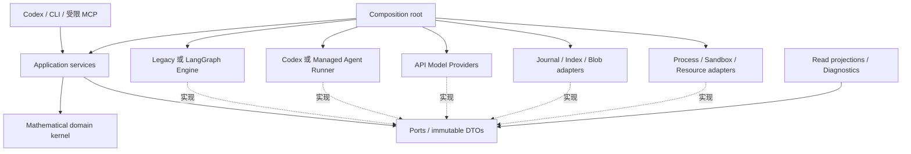
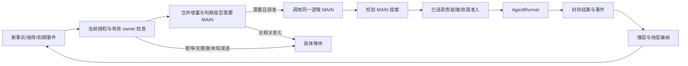
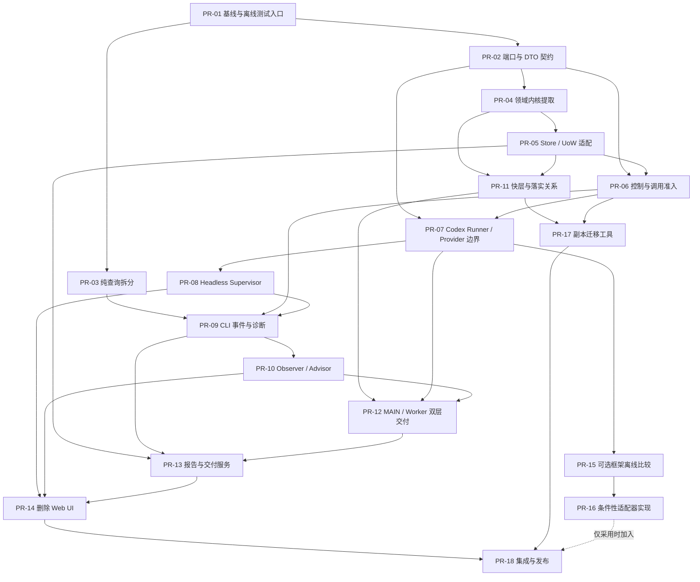

# PMRS-Next 第一阶段实施计划与接口设计

**状态：待授权的设计；所有新命令、目录、接口、PR 与测试均未实现或执行。**  
**日期：2026-10-11**  
**源码基线：** `e4de0210f9985224e030ac4cfd2f7e2904005b37`（`4.2.2-preview`）。  
**需求：** 既有 `PMRS-Next-Development-Guide.zh-CN.md` 与本次“独立内核＋可替换编排＋可替换模型/API Runner＋Codex/CLI”要求。

配套：[架构审计报告](01-Architecture-Audit.zh-CN.md) · [源码清单](03-Source-Inventory.zh-CN.md)。本计划不授权后续执行、不增加预算、不恢复任何实例。

---

## 1. 建议确定的架构决策

| ADR | 决策 | 理由及边界 |
|---|---|---|
| ADR-01 | 采用端口/适配器分层，领域内核不依赖具体框架 | TRH/FDH、证据与快慢数学不应随执行引擎变化 |
| ADR-02 | 保留 PMRS 为科研和授权的权威来源 | 框架 checkpoint 不能授权、授予数学支持或改写原目标 |
| ADR-03 | AgentRunner 与 ModelProvider 分开 | 一个托管 Agent turn 可包含多次推理、工具和委派，不等于一次 API 调用 |
| ADR-04 | 每实例唯一逻辑 MAIN；backend binding 单独版本化 | 保留研究身份，允许后端替换，但不允许两个有效控制者 |
| ADR-05 | 查询与维护严格分开 | 修正状态读取可能写回全局资源池的问题 |
| ADR-06 | 先保留 journal/blob，再抽换持久化适配器 | 不将 UI、框架和存储格式三类风险一次引入 |
| ADR-07 | 采用 intent/outbox/inbox、幂等接纳与保守 UNKNOWN | 不承诺远端无条件 exactly-once；禁止盲重发 |
| ADR-08 | 快数学为第一类、版本化领域对象 | 不是任意摘要缓存；资格来自精确慢层证据及范围化检查 |
| ADR-09 | 默认本地可观测，外部 tracing opt-in | 不强制引入新 UI、付费平台或向外上传研究内容 |
| ADR-10 | 框架采用独立比较和验收，不预先选定 | LangGraph、Deep Agents、DSH 分层评估；Legacy Engine 也是有效候选 |
| ADR-11 | 删除表现层，不删除报告、证据和后台职责 | 先达到 headless 功能等价，再拆除 web/desktop 入口 |
| ADR-12 | 不原地迁移正式科研项目 | 后续显式授权后只写新目录，保留原件并默认暂停 |

这些是建议决策，不冒充已经在 GitHub 合并的 ADR。

---

## 2. 目标模块与依赖方向

### 2.1 建议目录

```text
pmrs/
  domain/
    evidence/             # 六类记录、精确来源、前提、论证与检查范围
    qualification/        # 支持资格、独立性、撤销影响
    protocols/            # TRH/FDH/SURVEY 职责与交付规则
    lifecycle/            # 科研目标、候选选择、P14/D5 领域规则
    fastmath/             # 模块、连接、骨架、前沿、ReaderProfile、落实关系
    strategy/             # 路线机制、判别性任务、失败分类
    reporting/            # 报告范围、快照和数学主张约束
  ports/
    dto/                  # 不含框架类、SDK 对象或进程句柄的版本化 DTO
    agent_runner.py
    model_provider.py
    orchestration_engine.py
    evidence_repository.py
    event_repository.py
    unit_of_work.py
    policy_gateway.py
    clock.py
  application/
    control/              # 人类授权、有效指导、控制版本、MAIN owner
    tasks/                # 任务冻结、实际输入送达与结果封存
    admission/            # 模型/资源/科学接纳的应用协调
    execution/            # reservation、outbox、inbox、UNKNOWN 与恢复计划
    context/              # 快层入口、精确材料与按需展开
    supervisor/           # 无 UI 事件服务、唤醒和后台生命周期
    queries/              # 只读快照、运行/数学分轴查询
    reports/              # P13/正式报告生命周期
    migration/            # 明确授权的新目录转换
  orchestration/
    legacy/               # 从现有机制提取的兼容实现
    langgraph/            # 可选、通过验收后启用
  adapters/
    storage/journal/      # 初期保留 4.2.2 物理证据与回放语义
    storage/index/        # 可重建、只读消费的检索索引
    codex/                # 阶段 CLI、原生 MAIN、RPC、能力、用量解析
    managed_agent/        # PMRS 可控 loop；可选 Deep Agents 实现
    providers/            # 直接 API 模型适配；不用于冒充托管 Codex 内部控制
    dsh/                  # 可选 DSH bridge
    local_runtime/        # 进程、OS 锁、沙箱、全局资源池
    sources/              # 来源获取；网络能力按授权隔离
    reporting/            # TeX/PDF/页面检查等可选工具
  observability/
    projections/
    diagnostics/
    exporters/            # 默认关闭外发；本地 JSON/JSONL 优先
  interfaces/
    cli/
    mcp/                  # query、proposal、operator 接口分开
    codex_skill/          # 使用说明与入口，不掌握授权真相
  legacy/
    assistant_reader/     # 停用助手历史读取；无新执行入口
  bootstrap/              # 唯一 composition root / 配置装配
```

目录是职责边界，不要求一次迁完。旧 `research_studio` facade 可暂留，并逐个转发到新服务。不要为了符合目录图先移动全部文件再修 import。

### 2.2 依赖约束



硬规则：`domain` 不导入 `langgraph`、`deepagents`、Codex、HTTP UI、`subprocess`、持久化实现或凭据服务。Ports 不暴露 SDK response、LangGraph StateGraph、native process、mutable Store。Adapters 依赖端口，不反过来被领域模块导入。

初期某些迁移 facade 仍有旧依赖，必须登记例外及移除 PR；不能把永久跨层调用藏在 `utils` 或 `common` 中。用于验证这些规则的扫描只解析源码 AST，不通过 import 执行产品。

### 2.3 配置不是任意笛卡尔积

建议支持两个明确执行模式：

| 模式 | 谁拥有单个 Agent 的推理/tool loop | ModelProvider 的位置 | 典型组合 |
|---|---|---|---|
| `MANAGED_AGENT` | 外部 Codex/DSH 等托管后端 | 由该后端管理；PMRS 只冻结可支持的模型选择并观察 | Legacy/LangGraph 外层编排 + CodexAgentRunner |
| `PMRS_MANAGED_LOOP` | PMRS 控制的 AgentRunner 或受约束 Deep Agents runner | PMRS 直接在每次 inference 准入后调用 | Legacy/LangGraph 编排 + ManagedLoopRunner + API Provider |

**不能在 Codex 外层加一个 Provider 选项，就声称已经接管 Codex 内部的每次 API、重试和 token 计量。**也不能因 Deep Agents 自身使用 LangGraph，就再让两个独立的外层 MAIN 同时派工。[F-langgraph] [F-deepagents] [F-codex]

每个组合都有 capability matrix；不支持的组合在启动前拒绝，不能静默换模型、关闭必需通信或取消安全约束。

---

## 3. 领域内核与应用事务

### 3.1 领域内核边界

领域内核接收不可变输入并返回可检查的决定或拟议变更；它不启动模型、不读任意路径、不发网络、不创建线程，也不通过工具字符串授予权限。

| 接口〔拟议〕 | 输入 | 输出 | 禁止事项 |
|---|---|---|---|
| `validate_evidence` | 六类记录、原文 bytes、精确前提/来源视图 | 结构/身份/依赖检查结果 | 不因格式正确宣布数学正确 |
| `evaluate_qualification` | 精确支持、审核范围、消费者职责、暴露记录 | 范围化资格/开放条件/失效原因 | 不继承其他范围的 verdict |
| `validate_fast_delta` | 当前快层版本、变更、RefinementBinding、慢层支持 | 可接纳变更或缺口 | 不把条件性连接升级为无条件结论 |
| `validate_research_decision` | TRH 原目标或 FDH D0、MAIN 提案、职责规则 | 有效科研选择/明确拒绝 | 不由宿主凭阶段编号生成新研究 |
| `evaluate_delivery` | 目标/候选、资格、报告、未完成职责、当前控制 | OPEN/合格交付/待用户选择的领域结果 | 不由 turn.completed 推导成功 |

科学内容中的任意自然语言蕴含关系不能靠 JSON Schema 完全判定。内核可以确定性检查身份、版本、类型化条件与已声明依赖；压缩忠实性和具体数学有效性仍需范围明确的数学审查。缺少该证据时保持未检查，不假装 schema validator 证明了定理。

### 3.2 接纳事务

```text
1. 接收原始输出；先保存原件身份，不做科学升级
2. 绑定原任务、execution、实际输入窗口和 backend capture
3. 纯规则验证慢层记录、支持、前提与范围
4. 验证 fast_layer_delta 和上下层落实关系
5. 在单一 UnitOfWork 下重新检查相关版本、权限及控制边界
6. 原子提交慢层、快层、依赖、接纳回执与必要事件
7. 异步更新可重建索引；索引陈旧必须公开
8. 新知识事件交给 MAIN 唤醒机制；不直接启动后续科研
```

对已暂停实例：保留现有“合法已封存阶段 capture 可接纳”的窄例外，原目标/mission/输入/未被 fence 等条件仍须满足；暂停 MAIN 的策略不得借接纳顺便生效。接纳已发生结果和授权新调用是两个独立决定。[R-changes]

存储层初期保留 `records`、`blobs`、journal、HEAD 及回放语义。不要未经兼容设计重算全部 KR 身份、重写原始证据或把 SQLite 投影提升为新的权威数据库。[R-store]

---

## 4. 统一 AgentRunner 与 ModelProvider

### 4.1 冻结请求 DTO

`AgentInvocationSpec` 至少包含：

```text
schema_version
project_id / instance_id / research_goal_id
logical_agent_id / role / stage_responsibility / purpose
invocation_id / request_id / execution_id / attempt_id
owner_epoch / expected_control_version
original_scope_ref / method_version / guidance_version
input_manifest_ref / read_set_digest / visibility_policy_ref
output_contract_ref / communication_contract_ref
runner_binding_ref / authorized_model_selection_ref
budget_grant_ref / budget_unit / reservation_ref
sandbox_policy_ref / tool_capability_ref
idempotency_key / parent_invocation_ref / correlation_id
```

所有身份由可信应用层绑定。模型只能提交科学任务提案，不能填写任意 principal、control version 或 grant 来扩大权限。`idempotency_key` 重用仅允许同一 payload；同 key 不同内容必须冲突。

### 4.2 AgentRunner 接口

| 方法〔拟议〕 | 职责 | 返回边界 |
|---|---|---|
| `describe_capabilities()` | 报告固定实现版本、能力和证据来源 | 区分静态声明、离线探测、真实运行观察；无隐式推理 |
| `prepare(spec)` | 检查配置、材料及隔离，不启动推理 | PreparedInvocation / 不支持原因 |
| `start(prepared, permit)` | 在有效准入下启动一个绑定执行 | Handle 或明确的 NOT_SENT / UNKNOWN |
| `events(handle, cursor)` | 读取标准化事件，保留原始事件引用 | 可重连游标、覆盖范围和 gap |
| `inspect(handle)` | 查询该执行的已观察事实 | 不启动新 turn；能力不可用返回 UNOBSERVED |
| `steer(handle, message, permit)` | 发送已授权的有界指导 | SAVED/DELIVERED 等回执，不能伪造 READ/ADOPTED |
| `cancel(handle, permit)` | 请求取消指定执行 | 请求回执与实际结束观察分开 |
| `recover(handle, evidence)` | 重新附着/读原结果/判断恢复能力 | 不默认重发；无法确认则 UNKNOWN |
| `seal_capture(handle)` | 输出最终原件及实际输入窗口身份 | CaptureReceipt，不是科学资格 |

`prepare` 可以有**声明为本地准备的**临时文件写入，但不属于只读 query 接口；observer 无此能力。`recover` 的实现不允许隐藏模型重采样。

### 4.3 能力声明必须足够具体

| 能力字段 | 可选值举例 | 意义 |
|---|---|---|
| continuation | none / same-session / durable-after-restart | 新对话、同线程续接、冷恢复不是一回事 |
| steering | unsupported / next-turn / live-turn | 不可把延后留言冒充运行中指导 |
| cancellation | request-only / observed-terminal / descendant-aware | 取消指令不等于进程树已停止 |
| dispatch_idempotency | none / provider-supported / receipt-query-only | 决定未知发送后的合法动作 |
| root_turn_gate | unavailable / caller-controlled / native-gated | 托管后端自主续轮能否每次验证授权 |
| tool_isolation | documented-only / enforced / tested-on-platform | prompt-only 不是沙箱 |
| raw_input_capture | partial / exact-frozen-and-dynamic | 是否能支持精确输入与独立资格 |
| usage_coverage | none / turn-aggregate / inference-level | 与预算单位共同决定可执行的硬限制 |
| internal_delegation | opaque / observable / controlled | 不把未知内部请求数计为零 |
| structured_output | unsupported / schema-subset / validated-capture | 格式能力不等于科学正确 |

能力 manifest 记录 `adapter_version`、backend build/hash、platform、observation timestamp、test receipt refs。仅官方文档声明的能力不能标成已在用户环境验收。

### 4.4 ModelProvider 接口

ModelProvider 仅在 PMRS 管理 loop 的模式下直接生效：

```text
describe_model(model_selection) → supported parameters + evidence scope
validate_request(inference_spec) → accepted / unsupported / requires authorization
stream(inference_spec, inference_permit) → normalized provider events
inspect(provider_request_id) → observed state, where supported
cancel(provider_request_id) → cancellation observation, where supported
normalize_usage(raw_evidence) → counts + units + inclusion relationships + unknowns
```

不得在 `stream()` 内自行无限重试。SDK 内置重试应禁用，或通过适配器明确纳入 PMRS 的有限尝试和未知发送策略。模型名称、effort、service tier、工具/schema、endpoint、认证引用属于冻结选择；实际响应暴露的模型身份另记，不能只回显请求值当作实际值。

`credential_ref` 由后端凭据服务解析。凭据、token、环境变量值不进入知识库、MAIN 提示词、一般诊断或观察会话。

### 4.5 当前 Codex 的映射

| 现有实现 | 提取后的角色 |
|---|---|
| `runner.CodexExecutor` 的 CLI/进程/权限部分 | `CodexStageRunner` |
| `native_main.Service`、RPC、原生事件与 root gate | `CodexNativeMainRunner` |
| `codex_client` 的目录、探测、登录 | Codex capability/auth adapter；登录不属于 query |
| `model_policy.codex_arguments` | Codex 参数 encoder |
| `usage_ledger` 中 Codex discriminator/原始日志解析 | Codex usage/event normalizer |
| `task_tools` 中 stdio/MCP transport | MCP adapter；授权和工具处理留应用服务 |
| `main_recovery` 中 launcher/manifest 专有判断 | Codex-specific recovery evidence adapter |

OpenAI 官方 App Server 描述了 `turn/start`、`turn/steer`、`turn/interrupt`，但这不证明 stock 版本满足当前自定义根轮次门控和配套 binary 契约。迁移这些能力必须单列验收，不静默回退。[F-codex] [R-native-doc]

---

## 5. 编排引擎接口：管运行，不替 MAIN 做数学

`OrchestrationEngine` 可以负责持久等待、触发合并、任务排队、合法工作项的扇出、执行进度和恢复位置。它不能自行选择 P8 而没有 MAIN 决策，也不能从一个 worker 的“建议下一步”直接派生科研调用。

| 方法〔拟议〕 | 输入 | 输出 |
|---|---|---|
| `accept_event` | 经应用层验证的领域/控制/执行事件 | 去重后的执行触发 |
| `next_actions` | 有效 MAIN 决策、当前控制、就绪职责、资源观察 | 有界运行命令；不是新数学路线 |
| `checkpoint` | 执行位置、等待条件、领域 commit 引用 | 可恢复运行状态 |
| `resume_execution` | 有效控制代次和合法恢复依据 | 恢复等待/已授权执行；不重置预算 |
| `quiesce` | pause/end/换后端控制 | 禁止新派工；在途事实仍保留 |

建议的图是技术执行循环，而不是 `P1 → P2 → … → P14`：



LangGraph 适配时，graph state 最好保存 `instance_id`、领域 commit、有效 owner、待处理 event IDs、invocation handles 和等待条件；不要保存一个可被 Agent 任意编辑的完整数学真相副本。

一条运行链只能有一个权威“是否再次产生外部调用”的决策层。Framework retry、Runner retry、Provider SDK retry 的责任必须明确，不能叠加自动循环。[F-interrupt]

---

## 6. 安全控制与唯一 MAIN

### 6.1 角色权限

| 角色 | 可读 | 可提交 | 不能做 |
|---|---|---|---|
| Observer | 用户许可实例的一致快照、报告、适用证据 | 自己隔离会话中的解释/草案 | 改正式 KB、创建研究任务、应用指导、恢复 MAIN、增加预算 |
| Advisor | 同 Observer | 明确标为模型提案的 GuidanceProposal | 冒充 HUMAN、直接修改有效控制 |
| MAIN | 本实例获准的快层、证据、指导与任务结果 | 研究决策、受约束派工、骨架草案、审计 | 改原目标/D0、追加预算、授予自己独立审查资格 |
| Worker | 冻结材料及合同允许的动态输入 | 详细数学、fast delta、消息/缺口 | 自行开启未授权后续阶段、写权威存储 |
| Independent reviewer | 专门冻结并过滤的输入 | 范围明确的 Assessment | 读取禁用的已有判词、盲审伙伴输出或污染摘要 |
| Operator | 授权范围内的控制视图 | 明确的启动/暂停/恢复/额度/采用候选决定 | 通过普通模型输出冒充这一身份 |
| Commit service | 当前相关状态及原件 | 验证后的原子提交 | 自己规划新的数学研究 |

Observer 可以写自己的沙箱笔记和由外部客户端管理的会话日志；“只读”针对正式项目、控制面与共享运行账本。其内部日志不能悄悄成为 MAIN 的指导或数学依据。

### 6.2 三类不同消息

`DISCUSSION`：假设性交流、问题、草稿。默认不送到 MAIN 控制入口。

`GUIDANCE_PROPOSAL`：模型提出的可供考虑的想法；可以在明确提交意图后入箱，但没有操作授权。

`HUMAN_GUIDANCE / CONTROL_COMMAND`：由可信交互通道绑定实际操作主体、原文、适用范围及当前控制版本。建议、优先级和启动/暂停/追加预算还要分类型，不使用一个万能 `execute_instruction(text)`。

指导状态应分别记录：`SAVED → DELIVERED → READ → CONSIDERED → ADOPTED / REJECTED / DEFERRED`。有后端送达回执只说明 DELIVERED；MAIN 的实际确认或后续决策才可能支持更高状态。撤回和 supersedes 保留原文与历史，不删除旧暴露。

### 6.3 唯一 MAIN 与代次

`logical_main_id` 保持研究身份；`owner_epoch` 是控制代次；`backend_binding_ref` 保存实际 runner/session/thread/goal 的适配器身份。

取得新 owner 必须在同一控制事务中提升 epoch。所有派工和计划提交检查 epoch 与 `control_version`。旧进程醒来，即使持有过期 session 或租约，也不能再创建有效工作。

**租约到期只意味着失去控制权，不意味着远端执行已停止。**必须继续保存旧执行的未知/在途证据、预算风险和原始 capture；它不能因 owner 更换消失。

### 6.4 隔离不是一句提示词

默认 observer 不拿可写项目目录，不拿 operator 工具、通用 shell 或未经约束的 MCP 服务器。需要计算草稿时使用独立 scratch 与明确工具白名单。工具参数不能传任意宿主路径、SQL、替代身份或自由命令。

Deep Agents 的内建路径权限不覆盖所有自定义/MCP/execute 通道；子任务也有不同的继承规则。因此每种实际执行世界都要测试，不能只测试一个 `write_file` 被拒绝就宣布隔离完毕。[F-permissions] [F-subagents]

威胁模型是约束 Agent 和工具进程，不是抵御已经拥有宿主 root 或同用户任意文件控制权的恶意管理员。文档必须说明这一边界，不能许诺本机所有权模型之外的安全性。

---

## 7. 状态事件与持久化

### 7.1 事件信封

```text
schema_version
id / event_type / event_domain
project_id / instance_id / aggregate_id / aggregate_sequence
journal_sequence / committed_at
occurred_at / observed_at / clock_source
actor_principal_ref / actor_kind
correlation_id / causation_id / operation_id / idempotency_key
request_id / execution_id / attempt_id / activation_id
logical_main_id / owner_epoch / control_version
provider_request_id / backend_binding_ref
payload_ref / raw_evidence_ref / payload_sha256
classification / trust_origin / visibility_policy_ref
```

没有真实值的字段保留 null/unknown；不用自造 provider request ID 补空。跨进程时间只作为观测，不代替序列和因果关系。普通日志行与权威已提交事件分开；文件系统存在未引用 blob 不代表已被接纳。

### 7.2 事件类别及授权源

| 域 | 事件举例〔拟议〕 | 权威生产者 |
|---|---|---|
| 控制 | `AuthorizationGranted`, `PauseRequested`, `ResumeAuthorized`, `GuidanceAccepted`, `MainOwnerChanged` | 经认证的人类控制入口/控制服务 |
| 运行 | `InvocationPrepared`, `DispatchIntentCommitted`, `SendOutcomeUnknown`, `BackendStarted`, `CaptureSealed`, `InvocationTerminated` | 可信执行适配器与准入服务 |
| 接纳 | `CaptureAdmitted`, `CaptureRejected`, `AdmissionRechecked` | 原件绑定的接纳服务 |
| 科研 | `EvidenceRevisionAdded`, `SupportQualified`, `SupportInvalidated`, `FastLayerRevisionAdmitted`, `ResearchCheckpointPublished` | 领域校验后提交服务 |
| 计量 | `BudgetReserved`, `BudgetDispositionRecorded`, `UsageObserved`, `UsageConflictDetected` | 预算及用量观察服务 |
| 诊断 | `IncidentOpened`, `RecoveryPlanProposed`, `RecoveryActionAuthorized`, `ProjectionLagObserved` | 诊断/受控恢复服务 |

模型输出中出现 `SupportQualified` 字符串不构成事件。Runner 的 `completed` 也不能通过事件映射直接变成 `GoalSatisfied`。

### 7.3 事件消费

事件流按项目 journal 或明确 aggregate 序列消费，允许至少一次投递。消费者必须用 event ID 去重并持久化游标。跨项目不宣称一个自然的全局全序。

断线后从已确认 cursor 恢复；若事件保留窗口不足，返回明确 GAP 并要求读取一致快照。不得把遗漏区间补成“无变化”。关键控制和科学原件不能仅存在临时 stream buffer。

索引/诊断等派生投影可以滞后，但应公开源 commit 与落后范围。框架自身的 checkpoint schema/version 单独登记，不直接混入数学 schema。

### 7.4 Outbox / Inbox 与全局资源

领域控制与本实例预算 reservation 应与 dispatch intent 在同一 UnitOfWork 原子提交。真正外部调用在锁外执行；不能在 Store writer lock 内等待网络或长时间运行模型。

全局资源池与项目 journal 不在同一个物理事务里。用稳定 operation ID、可重试的资源令牌获取/确认和明确未决状态协调，不能假设两个文件写入天然原子。

```text
intent + budget reservation 已提交
    → 按同一 operation_id 获取/核验全局 slot token
    → 记录资源确认与当前 control/epoch
    → 最后发送边界再次验证 permit
    → 外部启动
    → 原始回执或 UNKNOWN
```

资源池故障优先保守保留 reservation，不靠丢失 slot “恢复容量”。回收规则必须有未发或已结束证据；不得只看一个过期 PID 就释放可能仍有外部计算的 UNKNOWN。

---

## 8. 运行状态、数学状态与错误诊断

### 8.1 至少四个独立状态轴

| 状态轴 | 示例 | 不能推出什么 |
|---|---|---|
| 实例控制 | ACTIVE / PAUSED / WAITING_HUMAN_AT_P14 / WAITING_HUMAN_AT_D5 / ENDED | PAUSED 不说明所有外部进程已结束 |
| 任务执行 | PREPARED / RESERVED / SENT / UNKNOWN / CAPTURED / TERMINATED | TERMINATED 不说明结果已接纳或定理已证 |
| 结果接纳 | PENDING / ACCEPTED / REJECTED_CONTRACT / REJECTED_STALE / EXACT_DUPLICATE | ACCEPTED 不自动等于达到原目标科学资格 |
| 数学研究 | OPEN、范围化支持、条件性结果、反驳证据、候选关系、待解决接口 | OPEN 不说明程序异常；运行繁忙不说明数学有进展 |

本表是新视图的概念模型，不要求原格式立即重命名所有枚举。适配层应准确保留旧值并建立明确映射，特别区分旧 `SETTLED` 与框架 turn completed。

### 8.2 runtime 视图

每个实例至少给出：逻辑 MAIN、owner epoch、当前 backend binding、desired control、实际 observed native/runner 状态、最后真实事件、观测覆盖、在途与 UNKNOWN、等待原因、资源占用、授权余额、错误链和合法下一操作。

`heartbeat` 应说明是谁的心跳：PMRS supervisor、OS 子进程、RPC 通道还是后端推理。一个本地线程仍活着不能证明模型仍在推进；日志暂时无更新也不能自动判定死锁。

### 8.3 science 视图

默认顺序是：**原目标/D0 → 关键知识模块 → 研究骨架 → 已核实与开放连接 → 新增数学成果/失败机制 → 当前判别性任务 → 未完成范围。**

每项变化有精确证据引用和生效版本。不用文件数、调用数、阶段百分比或路线改名代表数学进展。FDH 展示候选历史、已知强弱关系和关系未知，而不是 TRH 式证明完成百分比。

### 8.4 CLI 设计〔全部为拟议命令〕

```sh
# 以下路径与编号都是占位符，不是本阶段执行命令。
pmrs status /path/to/project --instance INSTANCE --runtime --science --json
pmrs tasks list /path/to/project --instance INSTANCE --state UNKNOWN --json
pmrs task inspect /path/to/project --request REQUEST --json
pmrs events /path/to/project --instance INSTANCE --after CURSOR --follow --jsonl
pmrs knowledge map /path/to/project --instance INSTANCE --as-of COMMIT
pmrs knowledge explain /path/to/project --ref TRANSITION --as-of COMMIT
pmrs reports list /path/to/project --instance INSTANCE --json
pmrs budget inspect /path/to/project --instance INSTANCE --json
pmrs diagnose /path/to/project --instance INSTANCE --read-only --json
pmrs recovery plan /path/to/project --request REQUEST --read-only --json
pmrs doctor --offline --json
```

纯查询不得：写项目/全局 runtime、追加研究事件、做 native sync、启动 CLI/模型、刷新认证、调用收费 API、应用待处理提案或自动重建 SQLite。索引缺失应返回降级的只读查询或明确缺失，不自动执行修复。

另设需要操作者权限的命令族：`guidance submit`、`pause`、`resume`、`budget grant`、`recovery apply`、`runtime reconcile`、`index rebuild`、`doctor --probe-local`。使用实际授权绑定及明确实例，不能让 `--yes` 成为绕过原权限的一般开关。

### 8.5 示例状态〔纯教学数据〕

```json
{
  "schema": "pmrs.status/next-draft",
  "instance_id": "example:trh",
  "snapshot": {
    "project_commit": "example:commit",
    "runtime_observed_at": "2026-10-11T00:00:00Z",
    "global_pool_as_of": "example:pool-cursor",
    "consistent_project_view": true,
    "cross_store_atomicity": false
  },
  "control": {"desired": "PAUSED", "version": 8},
  "runtime": {
    "main_owner_epoch": 3,
    "backend_observed": "ACTIVE",
    "sync_state": "PAUSE_PENDING",
    "unknown_requests": ["example:request"],
    "new_dispatch_allowed": false
  },
  "science": {
    "target_state": "OPEN",
    "checked_transition_refs": ["example:transition-1"],
    "open_transition_refs": ["example:transition-2"],
    "qualification_basis": "SCOPED_EVIDENCE_NOT_FORMAL_VERIFICATION"
  },
  "budget": {
    "unit": "TOP_LEVEL_AGENT_INVOCATION",
    "reserved_unknown": 1,
    "remaining_authorized": 0,
    "internal_inference_count": null,
    "monetary_cost": null
  }
}
```

该例说明：控制已禁止派工，但后端尚未确认暂停；原目标仍开放；未知调用继续占额度。任何一个状态都不能覆盖其他轴。

### 8.6 错误分类与可操作诊断

| 类别 | 示例 | 默认可建议的下一步 | 禁止误判 |
|---|---|---|---|
| AUTHORIZATION | 暂停、目标范围不符、过期 epoch | 查看原指导与控制版本 | 不自动恢复/增加预算 |
| CAPABILITY | 必需 effort/steer/root gate 不支持 | 显示请求与能力差异 | 不静默降级 |
| RESOURCE | slot、磁盘、文件描述符、内存限制 | 读取占用与等待依据 | 不把受限任务标成数学失败 |
| TRANSPORT | 断连、超时、未知发送 | 查原回执，保留 UNKNOWN | 不盲目重新采样 |
| CAPTURE/CONTRACT | 封窗错误、坏格式、缺失字段 | 保留原件，提出合法维修计划 | 不用格式修复补造数学 |
| SCIENTIFIC_SEMANTICS | 范围/前提/见证/审核资格不符 | 显示具体未满足接口 | 不将工程拒收写成原命题为假 |
| SOURCE | 原文不可访问、版本冲突 | 展示已读/未读范围 | 不把检索失败当作不存在文献 |
| PROJECTION | 索引落后、游标缺口 | 返回权威快照/明确重建建议 | 不隐藏缺失或自动改状态 |

诊断对象包含 root cause、affected refs、原始错误证据、最近有效边界、可用恢复选项及其授权要求。模型可以帮助解释，但默认 `diagnose` 只做确定性查询；故障分析付费调用是独立授权活动。

### 8.7 日志、指标与隐私

默认提供本地 JSONL 标准事件及原始 capture 的受控引用；可选导出 OpenTelemetry 等通用格式，但不强制接入 LangSmith 或任何收费平台。外发默认关闭，必须明确允许目标、数据字段和保留策略。

通常指标记录等待类型、资源占用、失败类别、UNKNOWN 年龄、capture/admission 延迟及 query freshness，不记录完整数学正文、工具参数中的秘密或未公开研究目标。普通 trace 不承载不可替代证据；审计原件另行授权读取。

---

## 9. 崩溃恢复与 UNKNOWN 决策表

| 崩溃/故障位置 | 应保留的事实 | 允许恢复 | 不允许 |
|---|---|---|---|
| intent 尚未提交 | 没有有效调用授权记录 | 重新构建待提交提案 | 推断已经调用 |
| intent/reservation 已提交，尚未触及发送边界 | 原请求、额度、资源状态 | 在有效控制下继续同一准备请求 | 增加一次无理由新请求 |
| 发送边界已越过但无回执 | 可能已发生付费/工具副作用 | 标 UNKNOWN；查询后端原身份或收集原日志 | 自动回到 PREPARED 并再次发送 |
| 后端已确认运行，本地协调器消失 | 原 backend handle 与未决使用 | 能力允许时重新附着；否则继续 UNKNOWN | 仅凭新 owner 抹掉旧执行 |
| 原始 capture 已写，接纳未完成 | 原 bytes、hash、输入封窗 | 重放接纳，无模型重采样 | 改写 capture 或重新请求“相同回答” |
| 接纳已提交、投影未刷新 | 已提交 journal 与回执 | 重建/续消费投影 | 重复授予支持、重复应用派工 |
| pause 与发送并发 | 当前控制版本和发送观察 | 发送前 gate 阻止新 work；已发 work 保留 | 把 pause 回执当成所有请求从未发送 |
| 恢复旧框架 checkpoint | 旧执行位置与当前 PMRS 控制版本 | 先核对当前权限，再恢复合法操作 | 从历史 checkpoint 恢复旧授权/额度 |
| 原项目副本恢复 | 原件和历史在途身份 | 保持 PAUSED；原 RESERVED/SENT 按证据处理 UNKNOWN | 假设备份恢复了远端进程 |

`ABANDON_UNKNOWN` 是行政上放弃继续追踪的决定，不是“确认没有消费”，也不是“确认已取消”。默认保留预算/风险及兼容的槽位策略；任何释放资源策略必须有独立依据和显式规则，不能借放弃选项重置余额。[R-scheduler] [R-pool]

恢复计划应列出 `read-only steps`、`local-write steps`、`remote-control steps`、`potential-inference steps`。最后一类绝不能隐含在前三类中。

---

## 10. 预算、重试与资源边界

### 10.1 预算单位

最少区分 `TOP_LEVEL_AGENT_INVOCATION`、`MODEL_INFERENCE`、`TOKEN`、`MONEY`、`LOCAL_RESOURCE`。当前仓库主要规则迁为第一类兼容策略，不借引入 API 重定义已授权额度。[R-scheduler] [R-usage]

同一个 grant 需要 `limit`、`spent_or_settled`、`reserved`、`unknown_reserved`、`released_with_evidence`、`remaining`。所有数字有单位。原生内部委派用量与父级重叠不明时，分别显示，不强行求和。

跨供应商成本必须同时具备实际用量、币种、价格版本和计费维度；否则给 unknown 或已知部分。硬货币上限要求可验证的请求级上界/准入能力；不具备时不能承诺硬限制已经执行。

### 10.2 重试所有权

一个外部副作用仅有一个重试决策者。Framework 和 SDK 只能提出/报告失败，应用执行服务决定是否有新的合法 attempt。明确未发的可重试错误可使用有限退避；已发不明的统一进入 UNKNOWN，不因错误名含 timeout 就重试。

格式修复、源码修复后的原 capture 重验、模型重新采样是三种不同动作。第一种消耗新模型调用时须有额度；第二种原则上无重新推理；第三种必须是新的有据可查 attempt。

### 10.3 并发政策

保留现版兼容政策：每实例阶段最多 8、共享阶段池 20、SURVEY 串行、MAIN 及原生内部委派不占这些阶段槽。[R-pool]

这是当前基线，不是新的全局不可配置常数，也不是本阶段对用户后续偏好的新设定。迁移为版本化 ResourcePolicy；新限额或对内部委派增加约束，需要明确授权和能力支持。

---

## 11. 快慢数学知识库升级

### 11.1 第一类对象

| 对象 | 必需内容 | 与慢层关系 |
|---|---|---|
| KnowledgeModule | 输入假设、输出、核心机制、适用边界、reader prerequisites | 精确 Statement/Context/SourceEvidence 与支持 |
| Transition | 起点/终点、方向、必要/充分/等价/条件/启发类型、关键想法、未决接口 | Argument、兼容性论证和开放条件 |
| ResearchMap | 原目标、AND/OR 结构、共同背景、路线分支和见证约束 | 节点与连接的精确版本闭包 |
| Frontier/Probe | 当前阻碍、可执行检验、可能结果及决策影响 | 绑定任务职责、输入与回写 |
| ReaderProfile | 本科通用基础、专项入口、项目特有对象、解释粒度 | 改解释入口，不改数学资格 |
| RefinementBinding | 快层精确主张、慢层精确依据、范围、审核、版本及开放条件 | 上下层不放大主张的可追溯绑定 |

不要把这些全部塞进自由文本 `strategy.summary`；也不要把六类慢层记录直接替换成通用向量 memory。

### 11.2 快层资格

内部至少区分：`support_basis`、`project_applicability`、`freshness`。前台可以显示“已核对/待探索/支持失效”，但不能抹去条件。

\[
\operatorname{checked}(A\Rightarrow G)\not\Rightarrow\operatorname{checked}(A),
\qquad
\operatorname{checked}(A\Rightarrow G)\not\Rightarrow\operatorname{checked}(G).
\]

逐参数对象 `∀t∃x_t` 不能压缩成共同对象 `∃x∀t`。多个局部模块合格不自动证明它们可拼接。ReaderProfile 的变化不得改变支持资格。来源新版出现不自动推翻旧结论；支持被撤回不自动把结论判成假。

### 11.3 MAIN 实际输入

默认输入：原目标/D0、有效指导、版本化完整方法入口、当前精简骨架、最新实质变化、支持失效、活动任务和剩余授权。详细证明和原文通过受控接口按需展开。

这不是禁止 MAIN 阅读慢数学。MAIN 在关键条件、适用性、见证或争议处必须下钻；已经合格的成熟接口不必每轮重读全部证明。每项派工要解释它针对哪个精确未知连接，以及不同结果如何改变路线。

当前 MAIN 方法和 runtime criterion 允许 MAIN 直接做实质数学；新分工必须修改真实输入与接纳契约，而非只更新 README。[R-harness] [R-method]

### 11.4 Worker 双重交付

```text
slow_layer_result:
    精确命题、证明/构造/计算、失败、条件与来源
fast_layer_delta:
    哪个模块/连接变化、精确新范围、被否定的机制、未决接口
attempt_account:
    已做/未做、失败类型、后续判别性建议
```

三部分来自同一次任务交付，不默认追加写作模型链。缺 fast delta 时保留原始数学结果并标交付未完整；补充不能伪装原任务已经读过后来材料。

### 11.5 独立性与共享缓存

独立评审输入必须冻结：目标精确正文、允许来源、原始论证范围、必要背景与规定检查任务。过滤 MAIN 偏好、旧 verdict、相互盲审结果，以及由它们生成的快层摘要。

缓存 key 至少含身份/允许 refs/范围/相关版本，不能只按 query 文本缓存后跨角色复用。读者水平配置也不能成为泄露旧结论的旁路。

### 11.6 检索与视图

先做结构化模块/连接索引和足够完整的文本检索，再决定是否加 embeddings。检索结果必须说明覆盖范围、索引 commit、权限及截断；导航片段不是原文阅读凭证。正文或路线超出当前索引范围时应能准确定位/扩展，而非仅翻页一个固定前缀集合。[R-access]

---

## 12. TRH/FDH、报告及删除 UI 的功能等价表

| 既有职责/操作 | 新入口/服务 | 删除 UI 前的必要验收 |
|---|---|---|
| 创建 TRH/FDH/SURVEY | 显式 CLI / Application command | 新实例默认 PAUSED；没有模型调用 |
| TRH 动态研究 | 同一 MAIN + OrchestrationEngine | 不硬编码全部阶段依次执行 |
| 每次 P14 前 P13 | DeliveryPolicy + report service | 原目标、证据、缺口、报告身份齐全 |
| 手动 P14 / stop-next | ControlService | 改模式、查看、取消标志不自动恢复 |
| FDH 普通 D5 综合 | 研究检查点 | 不触发正式人工选择暂停 |
| FDH 正式 D5 交付 | 独立 control 状态 | 暂停，保存候选、关系未知与未完成工作 |
| 采用候选交接 TRH | 精确 human adoption command | 建立独立 MAIN/Goal 的暂停实例，不自动启动 |
| 看研究进展/原件 | QueryService + observer | 一致快照、精确引用、无写入和调用 |
| 指导研究 | proposal 与 human guidance 分离 | 明确送达/采用状态；暂停时入箱不恢复 |
| 报告修改/正式稿件 | 独立 report authorization | 不以写报告为名改数学、不强制调用 PDF 链 |
| 原始输入/输出/usage | task inspect + 原件导出 | 不丢已拒收输出、格式维修和未知用量 |
| 后台维护 | 无 UI SupervisorService | 无浏览器亦能观察事件和合法唤醒 |
| 登录/能力检查 | 后端明确的 operator 命令 | 与纯 query 分离；不写认证进科研项目 |

删除对象：web HTTP 展示路由、静态前端、浏览器启动、桌面专用入口、只服务 UI 的安装资源。保留对象：报告、来源、原件 allowlist 的安全思路、查询投影、操作幂等、后台服务及所有科研资格规则。MathJax 等只服务旧 UI 的资产可删除；TeX/PDF 报告能力单独可选，不能随 UI 一起误删。

---

## 13. 独立 PR 划分、顺序与回滚

**以下 PR-01–PR-18 是规划编号，不是已经创建的 GitHub Pull Request。** 每个 PR 应能独立评审、在其声明的离线环境中验收，并有明确回滚方式。不能把“下一阶段允许开始”解释为这 18 项全部获准执行。

### 13.1 依赖图



PR-03 可以先通过薄适配器接现有 Store，不等候整个内核提取。PR-15 不应阻塞纯查询、知识库和取消 UI；没有采用新框架时，PR-16 可以正式记为“不采用”，而不是为了走完清单强行开发。

### 13.2 PR 工作包

| PR | 独立修改范围与现有源码入口 | 前置条件 | 必须取得的验收证据 | 回滚边界 |
|---|---|---|---|---|
| **01 基线与安全测试入口** | 保存本报告/ADR 草案；建立源码 AST 依赖清单、静态禁止依赖规则、测试沙箱入口；核对 `tests/`、`scripts/test-runner.py`、CI | 单独开发授权、隔离源码目录 | 不导入产品的扫描；测试运行器默认拒绝网络/模型/真实 HOME/真实项目；记录 baseline hash | 只撤销开发辅助文件，不涉及科研状态 |
| **02 端口、DTO、错误契约** | 新增 `ports/` 与版本化 DTO/schema；定义 AgentRunner、ModelProvider、Engine、Repository、PolicyGateway | PR-01 | fake 实现可构造；不暴露 Store/SDK/原生进程对象；能力不支持时显式失败 | 保留旧服务默认路径；撤销未使用端口无数据影响 |
| **03 纯查询拆分** | 从 `host_pool.status()` 分出 `read_status` / `reconcile_pool`；整理 `views.py`、`workspace._progress`、`main_session` 的只读路径；最小 CLI | PR-01；接口命名与 PR-02 对齐 | 项目、共享池、配置不存在时查询不创建文件；快照/全局观测时点明确；查询不启动子进程/模型 | 回滚 CLI 路由；不能将“旧查询可能写入”隐藏成同样的安全保证 |
| **04 数学领域内核提取** | `contracts.py`、`knowledge.py`、`relations.py`、`assurance.py`、`workflows/*`；拆 `changes.py` 中纯科学规则与应用控制 | PR-02 | 既有数据身份与负例行为等价；领域不得依赖 Codex、Store 实现、HTTP、进程或框架 | 保留旧 facade；仅新测试实例启用新实现，不重写旧 KR |
| **05 存储端口与事务** | `store.py` 拆 journal/blob、UoW、reducer registry、查询投影；消除 Store 对 `native_main` 等具体运行实现的依赖 | PR-04 | 同输入产生兼容的证据身份；重复提交幂等；HEAD 前后故障恢复；索引丢失不丢权威事实 | 格式兼容期间可切回旧 facade；若格式变化，必须新目录并保留旧格式只读 |
| **06 控制与调用准入** | `workflow_instances.py`、`execution.py`、`scheduler.py`、`host_pool.py`、`strategy.py` 控制部分；epoch、reservation、outbox/inbox | PR-02/05 | 单有效 MAIN；pause/send 竞态受 fence；UNKNOWN 不重发/不清零；跨账本崩溃可对账 | 新派工关闭后回退；保留全部已发调用身份；不能靠删除事件回滚 |
| **07 Codex Runner 与 Provider 边界** | `runner.py`、`native_main.py`、`codex_client.py`、`model_policy.py`、`usage_ledger.py`、`task_tools.py` 传输部分；先实现兼容 Codex adapter 与 fake provider | PR-02/06 | 离线 transcript 契约、模型请求与实际观察分离、raw capture 不丢；不支持能力 fail closed | 保留原生后端及其旧绑定；不在活动实例中自动换 runner |
| **08 无 UI Supervisor** | 提取 `workspace` 的启动/维护相关入口、`runner` 协调器、`harness_runtime` 事件协调；增加无 HTTP 的服务入口 | PR-07 | 无浏览器时等待/唤醒/暂停/退出可用；重启不产生第二 MAIN；查询不要求 supervisor 存活 | 保留兼容启动器但只能一个 coordinator；不能同时开旧、新后台 |
| **09 CLI、事件与诊断** | `cli.py`、`activity.py`、`views.py`、`research_audit.py`、`incidents.py`、`main_session.py` 中查询/投影部分 | PR-03/06/08 | 游标续读不漏已提交事件；显式 gap；四轴状态；error 与 recovery plan 可追溯且无凭据 | CLI/schema 版本化；旧查询可保留兼容别名，不复用会写的“只读”路径 |
| **10 观察/讨论与受控指导** | 新 observer/advisor 入口、只读 MCP/query gateway、proposal inbox、operator guidance；仅复用 `assistant.py` 已核对的历史读取 | PR-09 | 阅读暂停实例不恢复；讨论不变成授权；越权 shell/MCP/子任务均拒绝；旧助手仍不能派发 | 撤销新角色能力即可停用；草案保留独立区，不篡改 MAIN 指导历史 |
| **11 快数学领域对象** | 新 `domain/fastmath`、RefinementBinding、ReaderProfile；改 `knowledge_access.py` 与真实 `research_routes` 查询 | PR-04/05 | 模块接口完整、条件/量词保真；checked 有具体范围化依据；撤销≠反命题；索引不只限前缀 | 新 schema 在测试/新项目启用；原六类记录和 slow bodies 不改写 |
| **12 MAIN/Worker 闭环** | `harness_methods.py`、真实方法文档、`research_prompts.py`、`tasks.py`、`input_plans.py`、`strategy.py`、`research_audit.py`；双层输出接纳 | PR-07/10/11 | 捕获真实待发 packet，证明方法/骨架已送达；worker slow+fast delta；独立审查不读污染摘要 | 新方法版本与旧任务分开；已冻结任务不能换 prompt 冒充原输入 |
| **13 报告及 TRH/FDH 交付** | 拆 `reports.py`、`report_catalog.py`、`report_revisions.py`、`rounds.py`、`handoff.py` 的领域/应用/渲染职责 | PR-05/09/12 | P13 在 P14 前；普通 D5 与正式 D5 分离；采用候选只建暂停 TRH；无强制 PDF 链 | 保留原报告快照与修订历史；仅回退展示/调度代码，不能覆盖已出版正文 |
| **14 移除自建 Web UI** | `ui.py`、`desktop.py`、`static/*`、仅 UI 的 locales/安装器/入口、`pyproject.toml` package-data 与 CI；`workspace` 保留已提取领域无关服务 | PR-08/10/13 全部等价门通过 | 不启动 HTTP/浏览器；干净 headless 包完整操作；报告/原件/用户选择功能未丢 | 保留发布前源码归档；回滚代码不同时激活两个后台；不重新依赖浏览器作为恢复手段 |
| **15 可选框架离线比较** | `adapters/orchestration/langgraph` 最小试验、受约束 Deep Agents runner 试验；固定版本/依赖清单；不替换默认后端 | PR-07，且具独立试验授权 | 同一预录轨迹/故障模型的行为对比；维护面、权限、重放、计量结果；形成采用/不采用 ADR | 删除试验适配器不改变数据；Legacy Engine 始终是比较基线 |
| **16 条件性后端适配** | 只实现通过 PR-15 决策门的引擎/runner/provider；DSH 可另作同等门槛适配，不打包为必选依赖 | 正式采用决策与单独开发授权 | 同一契约测试集；unsupported steering/取消/推理门控明确；凭据与隐私隔离；不承诺 stock-native 等价 | 按新实例选择后端；旧实例不自动 rebind；活动任务用原适配器收尾 |
| **17 副本迁移工具** | 旧 journal/read-only loader、新目录迁移、身份映射/验证报告；依赖 `portability.py` 与 `version.py` 的精确格式核对 | PR-05/06/11；单独迁移工具授权 | 原目录哈希不变；新目录 PAUSED；UNKNOWN 历史保留；不自动执行 LLM/授予 checked | 删除未采用的目标副本即可；原目录不可被工具覆盖或原地升级 |
| **18 集成与可重现发布** | 新 CI 分层、离线契约全矩阵、headless 安装包/升级说明/操作手册；保留真实运行未验证清单 | PR-14；PR-17 有明确处置；PR-16 仅采用时要求 | 所有宣称支持的平台/组合有匹配证据；默认不含密钥/模型日志/私人科研；版本与回滚边界清楚 | 发布回撤不回撤科研事实；不支持旧二进制读取新 schema 时必须阻止误用 |

### 13.3 控制 PR 的规模

每个 PR 应只改变一个主要职责边界。出现大规模机械移动时，先独立提交不改行为的 facade/转发，随后提取规则，最后清理旧路径；不能把复杂行为变化埋在整仓 rename 中。

PR-04、05、06、07 各自可能需要细分为若干子 PR，例如 `06a budget types`、`06b ownership fence`、`06c outbox`。细分后保留同一验收门和依赖，不把某个半成品接入真实实例。不得用“PR 数量越多”代替边界清晰。

### 13.4 每个 PR 的固定交付模板

```text
Base SHA / changed paths / exact scope
Behavior unchanged / intentionally changed
Interface and schema versions
Offline tests executed + raw receipts
NOT_EXECUTED tests and why
External calls / subprocess / writes actually observed
Authorization and project-safety impact
Data compatibility and rollback boundary
Follow-up duties; no implicit authority for them
```

出现兼容性失败时，不能通过放宽证据校验、去掉 UNKNOWN、静默降级模型、取消隔离或跳过 P13/D5/P14 来让测试变绿。

---

## 14. 框架比较试验的设计

### 14.1 对照组和输入

对照组 A 是从现有代码提取的 Legacy Engine，B 是 LangGraph Engine，C 是 Deep Agents 用作受约束 runner。C 若只替换 worker，就只比较 worker 职责，不把它与整个外层编排的能力混为一谈。

使用相同的 `ReplayAgentRunner`、`FakeModelProvider`、虚拟时钟和固定文件语料，所有输入输出标 `SYNTHETIC_TEST_ONLY`。这些测试判断软件行为，不判断哪个模型数学能力更强。不得复用未授权的私人真实会话或向第三方 tracing 上传材料。

覆盖轨迹：单 MAIN 派两个独立任务；一个结果到达、另一个仍运行；暂停时到达迟到 capture；指导入箱；正式 D5 等待；重复事件；发送后回执前崩溃；checkpoint 恢复；权限撤销；预算耗尽。

### 14.2 框架特有反例

| 反例 | 要防止的错误 | 合格表现 |
|---|---|---|
| interrupt 前执行一次外部调用，resume 重进节点 | 重复花费和第二份科学采样 | 以持久 operation identity 找到原执行；无法确认则 UNKNOWN |
| 框架 checkpoint 早于用户暂停 | 恢复旧 ACTIVE 状态并派工 | 读取当前权威控制版本，旧 epoch 无效 |
| 同一 tool call 被框架和 SDK 各重试 | 重试次数相乘，超出授权 | 一个明确的 retry owner；每次外部尝试留证据 |
| Deep Agents 子任务继承额外工具 | 绕过 observer/盲审权限 | 有效工具集经过再验证，未授权工具不可见且不可执行 |
| 自定义 MCP 读取/写入正式项目 | 内建文件权限挡不住旁路 | 工具服务独立实施路径、身份与操作权限 |
| 总结 middleware 改写关键前提 | 快层丢条件却仍被当作完整材料 | 原件不变；摘要单独身份；精确依赖使用原件/合格接口 |
| 将框架 memory 中的 verdict 注入新 reviewer | 名义独立、实际污染 | 冻结无污染视图；记录任何后续科学暴露 |
| SDK stream 中断但服务器仍运行 | 把断线当作未发送 | 保留远端身份/UNKNOWN，不默认再生成 |

前两个反例针对官方文档描述的重放语义，后续行为仍需实际适配测试。[F-interrupt] [F-permissions] [F-subagents]

### 14.3 选择标准

**硬门槛先于便利性。** 任一安全、授权、证据、恢复或科研协议硬门失败即不能成为默认后端。通过后再记录以下实测或审阅指标，不预先打主观百分比分数：

| 指标 | 获取方式 | 本阶段状态 |
|---|---|---|
| 非领域适配代码及维护点 | 具体源码差异、依赖图、必须维护的补丁列表 | 待试验 |
| 外部依赖面 | 固定版本的直接/传递依赖、许可、构建与升级要求 | 待生成实际锁文件 |
| 恢复正确性 | 各 fault boundary 的执行/捕获/接纳计数 | 未运行 |
| 诊断可解释性 | 操作者能否区分工作中、等待、UNKNOWN、拒收、数学 OPEN | 未做用户验收 |
| 查询与恢复开销 | 冷启动、长日志回放、并发查询、峰值内存 | 无本阶段实测 |
| 安装复杂度 | 干净机器/容器的精确步骤和必要二进制 | 未验证 |
| 真实研究质量与成本 | 后续独立授权的可比科研实验 | 明确不在本阶段 |

框架可随版本改变行为，应锁定实际包、模型适配库和底层 SDK。仅查了官网不足以指定精确版本兼容矩阵；本计划没有编造一份已经验证的 lockfile。[F-langgraph] [F-deepagents]

---

## 15. 测试方案与验收条件

**本节所有测试均为 `NOT_EXECUTED`。** 本阶段仅设计它们；本次对 Markdown 文件完整性和引用的检查不构成任何 PMRS 测试通过。

### 15.1 分层测试环境

| 测试层 | 输入/依赖 | 允许行为 | 不能据此宣称 |
|---|---|---|---|
| S0 静态边界 | AST、配置、接口/schema | 不 import 产品、不创建运行实例 | 运行安全性已证明 |
| S1 纯领域单元 | 固定合成记录与原文 | 纯函数校验、快慢层负例 | 新数学结论成立 |
| S2 事务与恢复 | 临时目录、虚拟时钟、fake transport | 测试目录写入、模拟 crash、进程间锁测试 | 真实 Codex/API 兼容 |
| S3 适配器离线契约 | 合成/获准的去敏 transcript、fake provider | 解析事件、模拟流/取消/重连 | 真实服务端发送恰好一次 |
| S4 本地平台隔离 | 明确授权的实验环境、无凭据或专用测试凭据策略 | 本地沙箱/进程检查，禁止推理网络 | 真实模型质量或账单语义 |
| S5 原生/模型端到端 | 后续独立授权、独立新实例、明确有限额度 | 授权范围内的真实调用 | 全部平台、长时稳定性和全部科研分支自动通过 |

S4/S5 不随源码开发默认开启。对文件读取、sandbox doctor 和模型调用要分别计数；“无付费模型调用”并不意味着“没有启动子进程”。

### 15.2 最低软件验收矩阵

| 新测试 ID | 场景与明确断言 | 所属 PR / 层 |
|---|---|---|
| A01 | domain/ports AST 无禁止依赖；扫描不 import 产品 | 01/02/04 · S0 |
| A02 | 缺少 Codex、native pair、HTTP 资产仍可导入纯领域包及离线查询入口 | 04/07 · S1/S2 |
| A03 | 全部 Runner 返回统一身份/事件 envelope；SDK 对象不泄漏端口 | 02/07 · S3 |
| A04 | MANAGED_AGENT 与 PMRS_MANAGED_LOOP 的计量/能力不被混同 | 02/07 · S1/S3 |
| Q01 | 项目和共享池目录均不存在时 query 不创建目录、锁、索引或登录状态 | 03 · S2 |
| Q02 | query 前后项目、配置、共享资源池内容/目录结构完全不变 | 03/09 · S2 |
| Q03 | query 禁止模型、网络、进程启动，能返回既有证据与不可用原因 | 03/09 · S2 |
| Q04 | 并发写入期间正文分页固定同一 commit；运行事实注明独立观测时点 | 03/09 · S2 |
| Q05 | supervisor/native backend 停止时仍能只读诊断，状态为失联/未观察而非自动 FAILED | 08/09 · S2/S3 |
| E01 | HEAD 发布前崩溃不把未发布 journal 当作已提交事实 | 05 · S2 |
| E02 | HEAD 发布后应答前崩溃，同 command 重试不重复接纳 | 05/06 · S2 |
| E03 | Store replay checkpoint 或 SQLite 索引丢失后可从原始 journal 重建 | 05 · S2 |
| E04 | blob/hash/原始 capture 损坏时拒绝或隔离，不能从摘要补造原文 | 05/07 · S2/S3 |
| E05 | 跨全局池/项目账本每个操作边界崩溃后，对账保留未知调用风险 | 06 · S2 |
| E06 | 相同幂等 key+相同内容为同操作；不同内容明确冲突 | 06 · S1/S2 |
| E07 | outbox 重放且后端无幂等/查询能力时，不把 UNKNOWN 当作可以重发 | 06/07/15 · S3 |
| E08 | 远端执行已完成、接纳失败后恢复，只重验原 capture，不生成新响应 | 05/07 · S2/S3 |
| C01 | 同实例两个 coordinator/MAIN 竞争只有一个有效 epoch | 06/08 · S2 |
| C02 | owner lease 到期但旧远端仍运行，预算/执行证据继续保留 | 06/07 · S3 |
| C03 | pause 与 prepare/send 并发，门控按最新控制版本阻止未发调用 | 06/07 · S2/S3 |
| C04 | 暂停后合法已封存 worker capture 可接纳，但不得应用 MAIN 策略或新派工 | 04/06 · S1/S2 |
| C05 | 正式 D5 后 timer、迟到消息、框架 checkpoint 恢复均不能恢复 Goal | 06/08/13/15 · S2/S3 |
| C06 | 普通 D5 综合不触发人工选择；精确采用候选只创建独立暂停 TRH | 04/13 · S1/S2 |
| C07 | 自动/人工 P14 与 stop-next 组合；P13 缺失不得进入下一轮决策 | 04/13 · S1/S2 |
| C08 | 查看、修改模式、取消 stop 标志、上传材料不自动继续已暂停实例 | 06/09/10 · S2 |
| B01 | PREPARED/RESERVED/SENT/UNKNOWN 保留当前政策所需额度；未发送取消才按规则释放 | 06 · S1/S2 |
| B02 | unknown usage 为 null；父子 token 包含关系不明时不相加 | 07/09 · S3 |
| B03 | SDK/Runner/Engine 三层不叠加隐藏重试；每一新外部尝试有准入 | 06/07/15 · S3 |
| B04 | 不支持逐 inference 上限的托管后端，不能宣称能执行该硬预算 | 02/07 · S1/S3 |
| B05 | 兼容 profile 保留每实例 8、全局 20、MAIN 排除；排队不等于在途 | 06/08 · S2 |
| B06 | 源码配置或能力变化不静默替换已冻结任务的模型、模式、tier 和 runner | 07 · S3 |
| O01 | 事件重复/乱序/断线续读后游标稳定；丢失区间显式 gap | 09 · S2/S3 |
| O02 | 所有错误有分类、原件关联、可行动恢复选项；数学失败不写为 transport error | 09 · S1/S3 |
| O03 | 诊断包默认不含凭据、私人正文、原始认证流；外部 tracing 默认关闭 | 09/18 · S2/S3 |
| O04 | desired PAUSED 但 observed ACTIVE 时同时显示，不伪造已停状态 | 07/09 · S3 |
| O05 | turn 正常结束、输出接纳、数学 qualified、目标交付为四种不同事实 | 04/09/13 · S1/S3 |
| O06 | 活动请求数不冒充活跃进程数；内部请求覆盖未知时不造计数 | 07/09 · S3 |
| S01 | observer 通过文件、shell、MCP、子任务均不能写正式 KB 或控制面 | 10 · S2/S4 |
| S02 | 模型伪造 HUMAN/epoch/grant/capability 字段不能越权 | 06/10 · S1/S2 |
| S03 | 相同查询在不同 reviewer/observer 权限下不会命中污染缓存 | 10/11 · S2 |
| S04 | 源文中的命令、旧 verdict、相互盲审摘要不能被当成授权或独立输入 | 10/12 · S1/S2 |
| S05 | 指导 saved/delivered/read/adopted 各有证据；重复指导不重复应用 | 06/10 · S2/S3 |
| S06 | 指导撤回不删除已发生科学暴露，迟到内容不追认已读 | 10/12 · S1/S2 |
| K01 | 条件性连接、量词次序、共同见证、参数依赖在快层保持可见 | 11 · S1 |
| K02 | 一条支持被撤回使对应快层待复核；不能直接判结论为假 | 11 · S1/S2 |
| K03 | 无依赖闭合的循环支持无法得到 checked | 04/11 · S1 |
| K04 | 成熟模块已核对但项目适用性未知，路线保持相关开放义务 | 11/12 · S1 |
| K05 | worker 同次交付 slow result+fast delta；缺一部分保留原件并记录未完成 | 11/12 · S1/S3 |
| K06 | 原文前缀外、索引上限外及真实 research_routes 的知识能被授权定位 | 11 · S2 |
| K07 | MAIN 实际输入包含当前原目标/指导/骨架/增量；“文件存在”不算送达 | 12 · S3 |
| K08 | ReaderProfile 不给数学资格；陌生读者的模块/连接理解需另行人工检验 | 11/12 · S1，理解性另验 |
| R01 | P13、observer 问答、正式稿件身份不同；旧快照报告展示未覆盖增量 | 13 · S1/S2 |
| R02 | 没有 UI/TeX 依赖也能完成 Markdown 查询和进展报告；PDF 仅按请求 | 13/14 · S2 |
| R03 | 包内没有被移除的浏览器入口/静态 UI 依赖；CLI 操作等价表全部覆盖 | 14/18 · S2 |
| M01 | 副本迁移前后原项目内容哈希不变，新实例保持暂停，不创建原生 Goal | 17 · S2 |
| M02 | 原任务身份/UNKNOWN/旧 raw capture 保留，迁移不自动授予快层 checked | 17 · S1/S2 |
| M03 | 旧版本遇不支持的新 schema 明确拒绝，不原地“修复”或再发请求 | 17/18 · S2 |
| M04 | 新后端绑定必须经授权且保留历史，不出现旧/新 MAIN 同时有效 | 06/16/17 · S2/S3 |

自然语言数学压缩和证明正确性不能只依靠 K01–K08 的合成类型化测试完成验收。测试中的显式条件和量词反例是必要防线，仍需对真实模块/连接进行范围化数学审查；后者不得被声称已在本阶段完成。

### 15.3 既有指南 46 项验收的继承映射

使用 `GUIDE:Kxx/Cxx/Pxx` 前缀，避免与上表的新测试 ID 和 TRH 的 P 阶段混淆。全部继承，未被本计划删减；下面是测试职责映射，不是执行回执。

| 指南 ID | 原始风险/要求摘要 | 新计划归属 |
|---|---|---|
| GUIDE:K01 | 模块只有定理名，没有可调用接口 | PR-11；K04/K08 |
| GUIDE:K02 | 文献定理成熟不等于当前项目适用 | PR-11/12；K04 |
| GUIDE:K03 | 快层遗漏附加条件 | PR-11；K01 |
| GUIDE:K04 | `∀t∃x_t` 被压成 `∃x∀t` | PR-11；K01 |
| GUIDE:K05 | 节点 checked 但连接没有证明 | PR-11；K03/K04 |
| GUIDE:K06 | AND 分解遗漏必须职责 | PR-04/11；K01 |
| GUIDE:K07 | OR 分支被误当全部必做 | PR-04/11/12；K01/K04 |
| GUIDE:K08 | 必要条件误作充分条件 | PR-11；K01 |
| GUIDE:K09 | 支持撤回误作结论为假 | PR-11；K02 |
| GUIDE:K10 | 新来源版本覆盖旧有效依据 | PR-05/11；K02/M02 |
| GUIDE:K11 | 循环支持得到 checked | PR-04/11；K03 |
| GUIDE:K12 | 只交慢层，没有骨架变化 | PR-12；K05 |
| GUIDE:K13 | 方法失败误判原命题为假 | PR-04/11；O02/K01 |
| GUIDE:K14 | 读者基础配置变成证明资格 | PR-11；K08 |
| GUIDE:K15 | 正文前缀之外无法查询 | PR-11；K06 |
| GUIDE:K16 | 新研究路线集合不被搜索 | PR-11；K06 |
| GUIDE:C01 | 观察者修改权威知识库 | PR-10；S01 |
| GUIDE:C02 | 隐蔽写接口/自由 shell 绕过限制 | PR-10；S01 |
| GUIDE:C03 | 读取暂停实例触发恢复或模型 | PR-03/10；Q03/C08 |
| GUIDE:C04 | 讨论被当作指导 | PR-10；S05 |
| GUIDE:C05 | 模型冒充人类授权 | PR-06/10；S02 |
| GUIDE:C06 | 暂停时指导入箱不能恢复 | PR-06/10；C08/S05 |
| GUIDE:C07 | 重复指导要幂等 | PR-06/10；E06/S05 |
| GUIDE:C08 | 旧 MAIN 代次仍能派工 | PR-06；C01/C02 |
| GUIDE:C09 | 暂停与发送的竞态 | PR-06/07；C03 |
| GUIDE:C10 | 迟到输出被追认为此前已读 | PR-07/12；S06 |
| GUIDE:C11 | UNKNOWN 盲目重发 | PR-06/07；E07 |
| GUIDE:C12 | 崩溃恢复身份、目标与额度 | PR-06/08；C01/B01/M04 |
| GUIDE:C13 | 无关变更使全部工作失效 | PR-04/05；增补相关 read-set/CAS 回归 |
| GUIDE:C14 | 同一连接修订冲突 | PR-05/11；增补 FastDelta CAS 回归 |
| GUIDE:C15 | 盲审被快层 verdict 污染 | PR-10/12；S03/S04 |
| GUIDE:C16 | 来源中的指令越权 | PR-10/12；S02/S04 |
| GUIDE:P01 | TRH 非机械顺序执行 | PR-04/12；动态 MAIN 固定轨迹回归 |
| GUIDE:P02 | P14 前必须有 P13 | PR-13；C07 |
| GUIDE:P03 | 普通 D5 综合不暂停 | PR-13；C06 |
| GUIDE:P04 | 正式 D5 交付暂停 | PR-13；C05/C06 |
| GUIDE:P05 | 采用候选创建独立暂停 TRH | PR-13；C06/M04 |
| GUIDE:P06 | 未知关系不写成互不蕴含 | PR-04/11；候选关系类型负例 |
| GUIDE:P07 | observer 不改正式检查点 | PR-10/13；R01/S01 |
| GUIDE:P08 | 陈旧快照报告披露增量 | PR-09/13；Q04/R01 |
| GUIDE:P09 | 删除 Web UI 不丢功能 | PR-14；R03 |
| GUIDE:P10 | 后端不支持实时通信时明确限制 | PR-07/16；A03/A04 |
| GUIDE:P11 | 结构化完成不等于数学支持 | PR-04/09；O05 |
| GUIDE:P12 | 未知内部用量不计零、不双算 | PR-07/09；B02/O06 |
| GUIDE:P13 | 旧格式不隐式迁移/启动 | PR-17；M01/M03 |
| GUIDE:P14 | 离线迁移不自动调模型 | PR-17；M01/M02 |

GUIDE:C13/C14、P01/P06 是独立验收职责，不因为映射到同一模块而省略。具体测试实现应逐项保留它们的输入、预期和回执。

### 15.4 现有测试资源的使用

仓库保留的测试文件可以作为行为重建输入，但尚未在本阶段运行，其名称不证明内部断言已覆盖新需求。[R-tests] [R-validation]

| 资源族 | 已确认存在的文件举例 | 下一阶段做法 |
|---|---|---|
| 核心/格式/原生边界 | `test_final_kernel.py`、`test_contract421.py`、`test_final_native_boundaries.py` | 阅读实际断言后选择复用，补领域隔离与快层负例 |
| 存储/恢复 | `test_final_storage.py`、`test_resource_storage.py`、`test_final_operation_recovery.py` | 分离原件恢复、投影重建、未知发送；检查全局路径影响 |
| 资源/并发 | `test_model_pool.py`、`test_scheduler_aging.py`、`test_resource_admission.py` | 所有 HOME/全局池使用测试命名空间；补严格 query-no-write |
| 控制/通信 | `test_runner_pause.py`、`test_communication_runtime.py`、`test_round_intervention.py`、`test_intervention_inputs.py` | 补 epoch、迟到消息、子任务权限与暂停快层接纳 |
| MAIN/助手历史 | `test_main421.py`、`test_assistant_retirement421.py` | 保留旧助手拒绝派发，不把新 observer 当旧助手复活 |
| 协议/报告 | `test_final_workflows.py`、`test_direct_report421.py`、`test_final_reports.py`、`test_survey_reports.py` | 去除对 UI 载体的依赖，保留数学语义与报告身份 |
| UI/安装/本地工具 | `test_final_surface.py`、`test_final_packaging.py`、`test_final_render_dependencies.py`、各 workbench JS 测试 | 明确哪些删除，哪些改为 CLI 等价；不能简单删除失败测试 |

测试进程须使用临时 HOME/XDG 目录、独立运行池、只读源码和可写测试输出，阻止访问真实工作区。不要直接执行未知测试脚本再依赖“应该是 fake”来保证无模型调用；先静态检查执行入口与外部动作。

### 15.5 完成标准

Phase 1 的完成标准是：固定基线、可追溯发现、目标接口、PR 依赖、待测矩阵与未决事项完整可读。**它不包含产品运行通过。**

新版本进入 release 候选前，必须逐项满足：领域依赖隔离、只读入口无副作用、单 MAIN fence、预算/UNKNOWN/重放一致、TRH/FDH 人工边界、快慢数学资格、observer 隔离、无 UI 功能等价、迁移和回滚边界。任何一个以“已知风险”替代必须门槛的发布，都要明确缩小对外支持范围，不能仍宣称完整满足总目标。

---

## 16. 数据迁移、兼容与回滚

### 16.1 本阶段不迁移

不访问正式研究目录、不扫描用户私有项目、不启动旧程序，也不改变任何 native binding。指南与源码审计不足以证明用户现存项目可安全迁移；必须在下一阶段具备工具和另行授权后判断。[R-validation] [R-native-doc]

### 16.2 拟议迁移流程

```text
用户选择源项目 + 明确授权
    ↓
只读源目录/一致性快照 + 内容清单与 hash
    ↓
新目录导入原件及明确的版本映射
    ↓
保留旧历史、旧 qualifier 与检查范围，记录其来源
    ↓
新快层仅建结构入口或 draft，不自动把历史摘要变成 checked
    ↓
验证原件身份、引用完整性、预算/UNKNOWN 历史
    ↓
输出迁移报告；新实例 PAUSED，无原生 Goal 启动
    ↓
另一个明确的启动/后端绑定授权
```

源目录活动状态无法得到一致快照时，应拒绝迁移，不能自行暂停它来“帮助用户完成”。历史使用量未知时保留未知；不能用新任务 ID 抹去历史支出。迁移新格式不要求旧版本能够读取它，必须用 schema gate 阻止错误写入。

跨后端时，逻辑研究 Goal 可以继承已授权的范围与证据，但原生线程是旧后端的执行事实，不能伪造为新后端的同一 thread。用明确的 binding revision、旧执行处置、epoch 和人工授权表示交接；无法排除旧远端工作时先保持阻塞/UNKNOWN。

### 16.3 三种回滚不能混同

**代码回滚：** 停止新派工、保留当前执行与身份，再切回兼容版本。已经发生的模型请求和接纳事件不会被“git revert”撤销。

**投影回滚：** 删除/重建有明确身份的可再生索引或框架执行缓存；科研检查点、原始输出和权威事件不是缓存。

**数据格式回退：** 仅在提供经验证的转换器时才支持。默认不把新格式原地降级；保留可读归档/原副本，并阻止旧程序继续写新格式。

每个启用新适配器的实例固定版本/配置指纹；版本升级导致 tool schema、输入配置或模型能力改变时，既有冻结任务不允许悄悄重新生成。必须保留旧原件与明确的新请求依据。

---

## 17. 授权门与下一步范围

| 门 | 可进入的工作 | 不随之授权 |
|---|---|---|
| G0 本阶段静态审计 | 本报告、实施计划、清单和引用核对 | 修改产品代码、运行研究、调用模型、改变项目/Goal |
| G1 基础开发 | 明确选择的 PR-01/02/03；源码及合成离线测试 | 其余 PR、真实环境探测、项目迁移、付费调用 |
| G2 内核/执行重构 | 明确选择 PR-04–13；离线功能回归 | 自动更换用户运行后端或恢复旧实例 |
| G3 框架采用 | PR-15 比较结果及明确 ADR 后，选择 PR-16 | 无条件接受框架默认权限、SDK 重试或外部 tracing |
| G4 迁移/发布 | 副本迁移、headless 包、规定平台验收 | 对旧正式项目原地改写或自动启动 |
| G5 真实端到端 | 指定新实例、目标、后端、模型、有限授权与停止条件 | 全部未选项目、追加预算和永久自动运行 |

**建议下一次授权从 PR-01–03 开始。** 最先交付一个在后端不可用、项目暂停或资源池不存在时仍能安全查询的 CLI，以及后续重构共同遵守的端口契约。随后再决定第一批内核抽取，不把全量重构和框架选型一次放开。

本报告所列来源、代码状态和计划截止于固定提交。以后分支有新提交，必须先输出相对于本基线的差异审计，不能继续引用本报告把新代码标成已验证。

---

## 18. 来源索引

仓库链接固定到审计提交；框架文档为查阅时的官方说明。拟议接口、命令和目录不是这些来源已经实现的 API。

| 来源 ID | 来源及核对用途 |
|---|---|
| F-codex | [OpenAI Codex App Server 官方接口；文档可能重定向至 learn.chatgpt.com](https://developers.openai.com/codex/app-server/) |
| F-deepagents | [Deep Agents 官方 harness 定位](https://docs.langchain.com/oss/python/deepagents/overview) |
| F-interrupt | [LangGraph interrupt/resume 重放与副作用](https://docs.langchain.com/oss/python/langgraph/interrupts) |
| F-langgraph | [LangGraph 官方架构定位](https://docs.langchain.com/oss/python/langgraph/overview) |
| F-permissions | [Deep Agents 文件权限适用边界](https://docs.langchain.com/oss/python/deepagents/permissions) |
| F-subagents | [Deep Agents 子任务与继承规则](https://docs.langchain.com/oss/python/deepagents/subagents) |
| R-access | [授权知识读取、前缀导航、路线查询集合](https://github.com/ZhiyaoXiongMath/Pure-Math-Research-Studio/blob/e4de0210f9985224e030ac4cfd2f7e2904005b37/research_studio/knowledge_access.py) |
| R-changes | [科学接纳、live_check、暂停 capture 的窄例外](https://github.com/ZhiyaoXiongMath/Pure-Math-Research-Studio/blob/e4de0210f9985224e030ac4cfd2f7e2904005b37/research_studio/changes.py) |
| R-harness | [MAIN 事件准入及真正输入 criterion](https://github.com/ZhiyaoXiongMath/Pure-Math-Research-Studio/blob/e4de0210f9985224e030ac4cfd2f7e2904005b37/research_studio/harness_runtime.py) |
| R-method | [MAIN 实际科研方法要求](https://github.com/ZhiyaoXiongMath/Pure-Math-Research-Studio/blob/e4de0210f9985224e030ac4cfd2f7e2904005b37/docs/TRH-MAIN-METHOD-4.2.2.md) |
| R-native-doc | [原生 pair 来源、构建与已报告限制](https://github.com/ZhiyaoXiongMath/Pure-Math-Research-Studio/blob/e4de0210f9985224e030ac4cfd2f7e2904005b37/docs/NATIVE-RUNTIME.md) |
| R-pool | [全局资源池、status/ledger/_clean](https://github.com/ZhiyaoXiongMath/Pure-Math-Research-Studio/blob/e4de0210f9985224e030ac4cfd2f7e2904005b37/research_studio/host_pool.py) |
| R-scheduler | [资源与预算、MAIN 决策准入](https://github.com/ZhiyaoXiongMath/Pure-Math-Research-Studio/blob/e4de0210f9985224e030ac4cfd2f7e2904005b37/research_studio/scheduler.py) |
| R-store | [权威存储、原子提交、回放与旧助手拒绝](https://github.com/ZhiyaoXiongMath/Pure-Math-Research-Studio/blob/e4de0210f9985224e030ac4cfd2f7e2904005b37/research_studio/store.py) |
| R-tests | [测试源文件清单；不表示执行通过](https://github.com/ZhiyaoXiongMath/Pure-Math-Research-Studio/tree/e4de0210f9985224e030ac4cfd2f7e2904005b37/tests) |
| R-usage | [原始用量与委派事件解释](https://github.com/ZhiyaoXiongMath/Pure-Math-Research-Studio/blob/e4de0210f9985224e030ac4cfd2f7e2904005b37/research_studio/usage_ledger.py) |
| R-validation | [candidate22 已陈述实验与未验证范围](https://github.com/ZhiyaoXiongMath/Pure-Math-Research-Studio/blob/e4de0210f9985224e030ac4cfd2f7e2904005b37/TEST-REPORT-4.2.2.md) |

外部文档仅支持对应框架能力描述，不支持本报告提出的 PMRS 实现已经存在或经过运行验证。

[F-codex]: https://developers.openai.com/codex/app-server/ "OpenAI Codex App Server 官方接口；文档可能重定向至 learn.chatgpt.com"
[F-deepagents]: https://docs.langchain.com/oss/python/deepagents/overview "Deep Agents 官方 harness 定位"
[F-interrupt]: https://docs.langchain.com/oss/python/langgraph/interrupts "LangGraph interrupt/resume 重放与副作用"
[F-langgraph]: https://docs.langchain.com/oss/python/langgraph/overview "LangGraph 官方架构定位"
[F-permissions]: https://docs.langchain.com/oss/python/deepagents/permissions "Deep Agents 文件权限适用边界"
[F-subagents]: https://docs.langchain.com/oss/python/deepagents/subagents "Deep Agents 子任务与继承规则"
[R-access]: https://github.com/ZhiyaoXiongMath/Pure-Math-Research-Studio/blob/e4de0210f9985224e030ac4cfd2f7e2904005b37/research_studio/knowledge_access.py "授权知识读取、前缀导航、路线查询集合"
[R-changes]: https://github.com/ZhiyaoXiongMath/Pure-Math-Research-Studio/blob/e4de0210f9985224e030ac4cfd2f7e2904005b37/research_studio/changes.py "科学接纳、live_check、暂停 capture 的窄例外"
[R-harness]: https://github.com/ZhiyaoXiongMath/Pure-Math-Research-Studio/blob/e4de0210f9985224e030ac4cfd2f7e2904005b37/research_studio/harness_runtime.py "MAIN 事件准入及真正输入 criterion"
[R-method]: https://github.com/ZhiyaoXiongMath/Pure-Math-Research-Studio/blob/e4de0210f9985224e030ac4cfd2f7e2904005b37/docs/TRH-MAIN-METHOD-4.2.2.md "MAIN 实际科研方法要求"
[R-native-doc]: https://github.com/ZhiyaoXiongMath/Pure-Math-Research-Studio/blob/e4de0210f9985224e030ac4cfd2f7e2904005b37/docs/NATIVE-RUNTIME.md "原生 pair 来源、构建与已报告限制"
[R-pool]: https://github.com/ZhiyaoXiongMath/Pure-Math-Research-Studio/blob/e4de0210f9985224e030ac4cfd2f7e2904005b37/research_studio/host_pool.py "全局资源池、status/ledger/_clean"
[R-scheduler]: https://github.com/ZhiyaoXiongMath/Pure-Math-Research-Studio/blob/e4de0210f9985224e030ac4cfd2f7e2904005b37/research_studio/scheduler.py "资源与预算、MAIN 决策准入"
[R-store]: https://github.com/ZhiyaoXiongMath/Pure-Math-Research-Studio/blob/e4de0210f9985224e030ac4cfd2f7e2904005b37/research_studio/store.py "权威存储、原子提交、回放与旧助手拒绝"
[R-tests]: https://github.com/ZhiyaoXiongMath/Pure-Math-Research-Studio/tree/e4de0210f9985224e030ac4cfd2f7e2904005b37/tests "测试源文件清单；不表示执行通过"
[R-usage]: https://github.com/ZhiyaoXiongMath/Pure-Math-Research-Studio/blob/e4de0210f9985224e030ac4cfd2f7e2904005b37/research_studio/usage_ledger.py "原始用量与委派事件解释"
[R-validation]: https://github.com/ZhiyaoXiongMath/Pure-Math-Research-Studio/blob/e4de0210f9985224e030ac4cfd2f7e2904005b37/TEST-REPORT-4.2.2.md "candidate22 已陈述实验与未验证范围"

